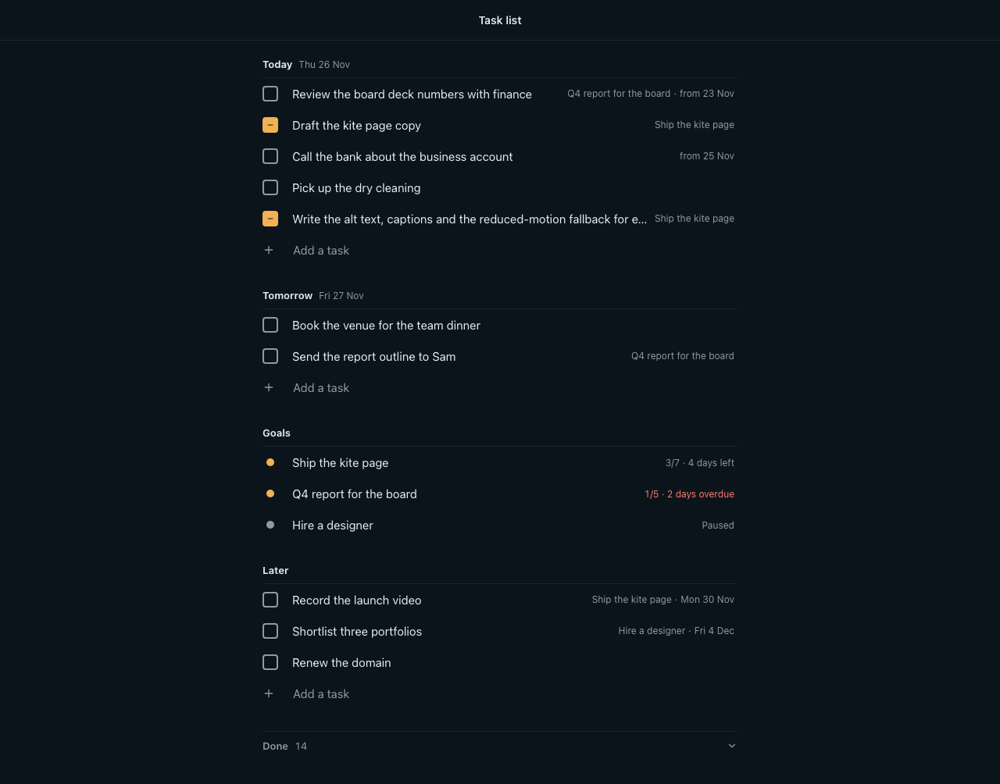
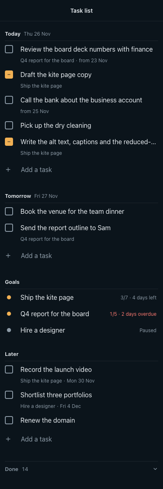

# Task list: wireframes and design note

Wireframes for a much better task list view in Jet. There are three options, and option A is chosen. Option A was revised once after the critique; §10 lists each change. Options B and C stay as they were, as the record of what was considered. The mockups will be made from the approved wireframes, and the page will be built from the mockups.

**Task line (T1).** The person opens the task list to see what is overdue, what is due today, what is in progress, what is done, and how far each goal has got. Then they add a task, move a task or change its status, each in one or two actions.

Files, all in `docs/design/task-list/wireframes/`. Each HTML file opens from disk with no server. The images are full-page renders at 400 px and 1280 px.

| Option | Wireframe | 1280 px | 400 px |
| --- | --- | --- | --- |
| Current page | (the real `ui/task-list/view.js` with sample tasks) | `current-page-1280.png` | `current-page-400.png` |
| **A. Agenda (chosen)** | `option-a-agenda.html` | `option-a-1280.png` | `option-a-400.png` |
| B. By goal | `option-b-goals.html` | `option-b-1280.png` | `option-b-400.png` |
| C. Status board | `option-c-board.html` | `option-c-1280.png` | `option-c-400.png` |

`wireframe.css` holds the shared low-fidelity look. `sample.js` holds the shared sample list for Thu 26 Nov 2026: 2 overdue tasks, 3 due today, 3 in progress, 2 done today and 12 done earlier, 3 goals (one overdue, one paused), tasks with no goal, and one title of 130 characters.

The wireframes use grey and black only. Status is carried by shape: an empty box means not started, a half-filled box means in progress, and a full box with a tick means done. A black chip with "!" means overdue. The mockups map these shapes to Jet's existing tokens and keep each shape as well, so colour never carries meaning alone (C6): `--muted` for not started, `--warning` for in progress, `--ok` for done and `--danger` for overdue.

---

## 1. The current page and what the request asks it to fix

These images are the real page. The harness loads `ui/task-list/view.js` with a stand-in store and the same sample list as the wireframes, and draws it with the page's own CSS (`chat.css`, `library.css` and `task-list.css`).

| # | Problem | Where it shows |
| --- | --- | --- |
| P1 | **Nothing is overdue at a glance.** A late task sits in Today among the others. Its only sign is "from 23 Nov" in 12 px `--muted`, at the end of the row, and on a phone that text drops to a second line. The old plan muted it on purpose ("not a wall of red", design §1.5). The request now asks for the opposite. | Today: "Review the board deck…" and "Call the bank…" |
| P2 | **No counts.** The page never says how many tasks are overdue, due today, in progress or done today. The drawer shows one number, today's open tasks, and that number mixes late tasks with due ones. | Whole page |
| P3 | **In progress is a 20 px amber box and nothing else.** Started tasks are spread across three days, and nothing collects them. | The two amber boxes in Today |
| P4 | **Done is out of sight.** A finished task leaves for a folded pile at the very end after 4 s. The pile shows a total, "Done 14", but nothing says what was done today. | The "Done 14" fold |
| P5 | **Goal progress is the text "3/7".** Goals sit in their own section, apart from their tasks. A goal's tasks are found only by reading the small goal name on each row. A goal's due date is shown only when the goal is open. | Goals section |
| P6 | **Adding is slow and partial.** There are three add lines, one at the end of each day, so the person scrolls to reach the right one. A new task cannot be given a goal while it is added, although the server's `POST /tasks` already takes `goalId`. It must be opened and changed afterwards. | Each "Add a task" line |
| P7 | **Moving is hidden.** A drag has no visible handle. Without a drag, the row must be opened and then "Move to" chosen. The row never shows when a task is due, except in Later and for late tasks. | Rows |
| P8 | **Setting a status directly takes three actions.** A tap on the box only steps forward. Going back from in progress, or from not started straight to done, needs the row opened first. | Box and open row |

---

## 2. The options

All three options show the same facts and keep the same box. They differ in what the page is ordered by: **time** (A), **goal** (B) or **status** (C).

### Option A: Agenda (chosen)

The list stays a list of days, in the charter's order. Five parts are added:

- a **summary toolbar** of four counts (Overdue, Due today, In progress, Done today), which filter the list when tapped;
- one **add bar** that sets the title, the day and the goal together;
- **goals with progress bars** near the top: a rail of cards on the right on a desktop, and a band of one-line meters under the add bar on a phone. A tap on a goal shows only its tasks;
- an **Overdue** section at the top, capped at three rows, with "Move all to Today";
- a **meta line** on each row that says "In progress since Tue" in words, and a **chip** that moves the task.

Done-today tasks stay under Today.

- For: it answers "what do I do today" first. It answers all four tracking questions in the first screen at both widths. Moving takes two taps and adding takes one line. It keeps the server's one order for each day, the existing drag and the open row, so it adds the least new code.
- Against: a goal's tasks are spread across the days until the person taps the goal. The page has more chrome than it has now.
- New server facts: **none** (§6).
- The wireframe of A adds three overdue tasks with no goal to the shared sample, so the Overdue limit shows. B and C use the shared sample as it is.

### Option B: By goal

Each goal is a block with its bar, its counts and its due line. Its tasks are grouped Overdue, Today, Tomorrow and Later. Tasks with no goal come last. One line of counts sits at the top. Each block has its own add line with the goal already set. A drag between blocks changes a task's goal.

- For: it is the strongest view of goal progress. Adding to a goal is direct.
- Against: today's work is spread across every goal, so "what do I do today" needs a full scan. That breaks the charter's order: today, then tomorrow, then the goals. A reorder inside a goal must work out `after` across tasks of other goals that are hidden from that block. "No goal" tasks come last, even when they are due today. The tally line counts but cannot filter.
- New server facts: none. The page would need a new placing rule for `after`.

### Option C: Status board

There are three columns: To do, In progress and Done today. To do is grouped Overdue, Today, Tomorrow and Later. A band of goal meters sits above the board. A drag across columns changes a task's status. A phone shows one column at a time, under tabs.

- For: in progress and done are the shape of the page. A status changes by a drag on a desktop.
- Against: one day's work is split across three columns. A drag means status across the columns and day inside To do, so one gesture has two meanings. On a phone the tabs hide two thirds of the list, and a drag cannot cross tabs. It adds the most new layout and drag code. Cards cost about twice the height of rows, so fewer tasks fit on a screen.
- New server facts: none.

---

## 3. The choice: option A, and why

| Question from the request | A | B | C |
| --- | --- | --- | --- |
| Overdue plain at a glance | Own section first, plus a count | Per goal, plus the tally | Group at the top of To do, plus the tab count |
| Due today plain | Today section, plus a count | Spread across the goals | Spread across two columns |
| In progress plain | Count and filter, plus the half box | Tally, plus the box | Own column |
| Done plain | Done today under Today, plus a count | Folded in each goal | Own column |
| Goal progress | Bar, counts and due line; tap to filter | Strongest | Bar band |
| Fast add | One bar: title, day and goal | One line per goal | One field, day only |
| Fast move | Chip: 2 taps. Open row: 2 taps. Drag | Chip, or a drag between goals | Chip, or a drag between columns |
| Fast status | Box (1 tap); `1`/`2`/`3` keys; open row (2 taps) | Box | Drag, or box |
| Works at 400 px | One column, nothing hidden | Long scroll | Tabs hide 2 of 3 columns |
| New code | Least: the sections, drag and open row stay | New grouping and placing | New layout and drag meanings |

The repo's priorities are "correctness of what Jet says, **visibility**, **simplicity** (the least new code), cost of idle wake-ups" (`crates/jet/src/lib.rs:3`).

- **Visibility decided first.** After revision 1, A shows all four tracking answers and every goal's progress in the first screen at both widths, without hiding a column. At 400 px the goal band starts about 220 px below the top of the app (frame A1). Before the revision this held only at 1280 px: on a phone the goals came after Tomorrow, about 1,135 px down (critique F2).
- **Simplicity decided between A and B.** B is better for goals but worse for today. A adds a goal filter that gives most of B's view in one tap, and it needs no new placing rule.
- **Taken from B:** the goal progress bar, the per-goal counts and each goal's next task. **Taken from C:** done-today shown where the person looks, the compact goal meters for a phone, and in progress shown in words on the row.

---

## 4. Option A in full

The frames A1 to A7 in `option-a-agenda.html` show each part. The rules below are what the engineer builds. They are the rules after revision 1 (§10).

### 4.1 Layout

| Main column width | Layout |
| --- | --- |
| 920 px or wider (1280 window with drawer: 1020 px) | A tasks column of at most 640 px and a goals rail of 280 px, with 32 px between them, centred. The rail is `position: sticky` under the head band, with `max-height` set to the window's height less the head band, and `overflow-y: auto`. When it is taller than the window, as with many goals or an open "⋯", it scrolls on its own. |
| 480 to 919 px | One column. The goals show as a **band of meters** under the add bar. |
| under 480 px (400 phone) | The same, plus: the summary stays one row of four, with tighter padding. The add bar takes one line at rest, and its Day and Goal line appears once the field has the focus or text. A Later chip shows only "in 4 days" where the wide chip shows "Mon 30 Nov · in 4 days". |

The breakpoints are container queries on the page column, so they still hold when the drawer folds to its rail.

The goals block is one element, and the page moves it with `insertBefore` when the width crosses 920 px, so the Tab order follows what is seen:

- **Wide:** the block goes after the Done fold, in the rail.
- **Narrow:** the block goes after the add bar, as the band. The rail's cards and the band's meters are two looks of the same goal items.

Order in the column:

1. The head band "Task list" (as now), the alert and the refresh notice.
2. The **summary toolbar**, then the **add bar**.
3. [The **Goals** band, when narrow.]
4. The filter line, only while a filter is on.
5. **Overdue**, only when it has tasks.
6. **Today**, with its **Done today** group.
7. **Tomorrow**, then **Later**, then the **Done** fold.

On a wide screen the **Goals** rail sits on the right.

**First screen at 400 × 750 with the sample of frame A1:**

| Part | Where it sits, measured from the top of the app |
| --- | --- |
| Summary | 77 to 132 px |
| Add bar | 155 to 203 px |
| Goal band (3 goals) | 220 to 385 px |
| Overdue (3 of 5 rows and "Show 2 more") | 420 to 650 px |
| Today heading | about 700 px |

The overdue tasks are themselves today's work, and Overdue never shows more than three rows, so Today's heading stays near the first screen however many tasks are carried.

### 4.2 Summary toolbar

- It is `role="toolbar"` with `aria-label="Show only"`. It holds four toggle buttons (`aria-pressed`) and is one Tab stop with a roving `tabindex`; ← / → move inside it.
- The buttons are **Overdue**, **Due today**, **In progress** and **Done today**. Each shows its count above its word. Overdue is marked by "!" and a bold word while its count is above 0. In the mockup it also takes the `--danger` token, and it has no special border.
- **Every filter control has one "on" look, filled.** A pressed summary button and a pressed goal both use it. A heavy border means nothing.
- The counts are worked out on the page from the read (§6). They change the moment a change is drawn.
- A tap shows only those tasks, and the sections with none are left out. One filter is on at a time, a goal filter included. A second tap, the filter line's "Show all", or Esc while the focus is in the toolbar clears it. The filter is the page's own state and is never sent.
- While a filter is on, a filter line (`role="status"`) says what shows, for example "Showing 3 in progress. Show all". A filter that matches nothing says "No tasks in progress. Show all".
- The toolbar is hidden while the list has no task at all (A4).

### 4.3 Add bar

- It holds the field "Add a task (N)", the Day select (Today, Tomorrow, Later), the Goal select ("No goal", then the open goals by due date) and the **Add** button. Enter or Add sends `POST /api/task-list/tasks {title, day, goalId}`.
- Under 480 px the Day and Goal line is shown only while the field has the focus or holds text, so the bar takes one line at rest. The line appears because the person acted, not because data arrived.
- After an add, the field is empty and keeps the focus. Day and Goal keep their values, so several tasks can be added in a row. A goal filter sets Goal to that goal, and "Show all" puts it back to "No goal".
- The new task goes last in its day, as now. The page announces "Added Order the kite fabric to Tomorrow, under Ship the kite page."
- **An add that the current filter would hide clears the filter.** Examples: a not-started task added while "In progress" is on, or a task given another goal while a goal filter is on. The page also announces "Showing all tasks", so the new row is always in sight.
- If the add fails, the title, day and goal stay. The error sits under the bar ("The task could not be added. … Press Add to try again."), tied to the field by `aria-describedby`.
- The three per-day add lines of the current page are removed. One bar replaces them.

### 4.4 Rows

A row has three columns: the box (a 44 × 44 target), the main part (the title and a meta line under it) and the chip. A done row shows its time in place of the chip.

**The title** takes up to two lines, then an ellipsis. The whole title is in `title` and in the open row's field (E6).

**The meta line** is 13 px and joins its parts with " · ":

- For a task in progress, the words **"In progress since …"** in `--warning` at weight 600, worked out from `startedAt`. They are never cut; they wrap, and the goal's name after them is cut first:

  | When it was started | Words |
  | --- | --- |
  | today | "since 09:30" |
  | yesterday | "since yesterday" |
  | within the last 6 days | "since Tue" |
  | longer ago | "since 16 Nov · 10 days" |

  The amber of the mockup never carries the state alone (C6).
- The goal's name, in `--muted`.
- A row with neither has no meta line.

**The chip** is a `button` with `aria-haspopup="menu"`. It carries a fact only where its section heading does not:

| Section | Chip | Look |
| --- | --- | --- |
| Overdue | "! 3 days late" | strong (`--danger` in the mockup) |
| Today, Tomorrow | "Move" | quiet, dashed border |
| Later, within 6 days | "Mon 30 Nov · in 4 days" (under 480 px: "in 4 days") | quiet |
| Later, further off | "Fri 4 Dec" | quiet |
| Later, no date | "No date" | quiet |

- The chip's name always gives the date in full, for example "Due today, Thu 26 Nov. Move" or "Was due Mon 23 Nov. Move".
- A tap opens the **move menu** under the chip. The menu is a popover with no backdrop and is not a dialog. It holds Today, Tomorrow and Later as `menuitemradio`, with the current day ticked.
- For a late task nothing is ticked, and the menu's foot says "Was due Wed 25 Nov".
- A choice sends `PATCH {day}`, closes the menu and puts the focus back on the chip. Moving a late task to Today gives it today's date, by the server's existing rule, so it leaves Overdue.

**The box** steps the status forward on each tap: not started, in progress, done. A done task lingers in place for 4 s after the last tap and then moves to Done today. This is all as now (D5 and §3.4 of `docs/task-list-design.md`).

**The open row** (a tap on the title) holds the title field and four labelled lines:

1. **Status**: a segmented control (Not started, In progress, Done) that sets any status in one tap.
2. **Day**: a segmented control (Today, Tomorrow, Later) that moves the task in one tap. It replaces "Move to".
3. **Goal**: the native select.
4. **Up, Down, Open chat**, then **Delete**, which takes two taps.

The rest is as now: one open row at a time, Esc restores the title, and a done row offers Delete only. For a late task, the open row differs (A2):

- Day has nothing pressed, and under it says "Was due Mon 23 Nov. Today gives it today's date."
- Up and Down are `aria-disabled`, with the reason under them: "An overdue task keeps its place. Use Day or its chip to move it."

**One-place moves** are Alt+↑ / Alt+↓ and the open row's Up and Down. This rule is fixed after the critique (F1).

- The server re-dates a task on any move that names a day or an `after`. A late task moved within Today gets today's date (`moved_date` in `objectives/task_list.rs`, and `docs/task-list-design.md` §4.5).
- So:
  - A **late task** cannot be moved one place. Alt+arrows on it announce "Move it with its chip." The person gives it a new date only by choosing one: the chip, the Day control, "Move all to Today", or a drag into a day.
  - In **Today**, a one-place move counts over the rows that are shown, which are the tasks that are not late, and steps past the late tasks. `keyboardMove` takes the late tasks out of the Today group before it picks the place, and the `after` it sends is always a task the person can see. Alt+↓ at the bottom of Today moves the task to the top of Tomorrow (as now). Alt+↑ at the top of Today does nothing.
  - Two `model.js` tests prove this:
    1. `keyboardMove` returns null for a late task, so its date is kept.
    2. A one-place move in Today never names a late task as `after`, and never lands next to an unseen row.

**Drag** works as now (§3.5 of the old design), with these changes:

- Overdue is never a drop target. A drag that starts in Overdue can only drop into a day, which is an explicit move that re-dates the task.
- An empty day's "Nothing due tomorrow." line takes a drop. It replaces the add line as the end-of-day target.
- Dragging and one-place moves are off while a filter is on, because hidden tasks sit between the shown ones. Alt+arrows then say "Show all to reorder." The chip, the Day control and the box still work.

### 4.5 Sections

**Overdue** shows the open tasks with `late: true`, in the user's order.

- Its heading carries "!" and a 2 px rule. On the right are the count, "5 open", and the text button **"Move all to Today"**.
- **It shows at most 3 rows**, then "Show 2 more overdue", a button with `aria-expanded="false"` that opens the rest in place. Open, it reads "Show fewer overdue" with `aria-expanded="true"`.
- **"Show more" stays open** through every redraw: a change, a read, a filter put on or cleared. It closes only when Overdue has 3 tasks or fewer (so "Move all" closes it), or when the person leaves the page (`hide()`).
- **Every section heading counts what it shows.** With no filter it reads "3 open", all of that section's open tasks. Under a filter it reads "2 shown", the tasks that match.
- "Move all to Today" takes two taps, as Delete does. The first tap arms it as "Move 5 to Today?", and a second tap within 4 s confirms. It then sends one `PATCH {day:'today'}` for each late task, in order, with no `after`.
- The server gives each task today's date and keeps its place in the one order, because the day does not change. So the tasks land in Today in the order they had.
- Jet is told one line for each task, as for any page change (D8).
- If some writes fail, the list is read again, and the alert says "Some tasks could not be moved. … Try again."
- The section is left out when it would be empty.

**Today · Thu 26 Nov · 3 open** shows the tasks with `day: 'today'` and no `late` flag.

- After them comes **Done today · 2**: the done tasks whose `doneAt` falls on today in the user's zone.
- They are newest first, struck through, each with its time.
- When there are more than 5, the newest 5 show, then "Show 3 more".

**Tomorrow · Fri 27 Nov** and **Later** work as now, each with its "n open" count.

**Done 14** is the fold, as now. Opened, it lists the done tasks from before today, grouped by day, with "Show older" and the line that says how long done tasks are kept (90 days).

### 4.6 Goals

There are two looks of one goal item.

**Card, in the rail at 920 px and wider:**

- The title, which is a toggle button with `aria-pressed`, and a "⋯" button.
- A **bar** with `role="img"` and a name such as "3 of 7 done, 2 in progress". Its parts are done (solid), in progress (hatched in the wireframe, `--warning` in the mockup) and the rest (empty).
- The **counts line**: "3 of 7 done · 2 in progress · 1 late". "Late" is strong, and shows only when above 0.
- The **due line**: "Due Mon 30 Nov · 4 days left". For an overdue goal it reads "! Due Tue 24 Nov · 2 days overdue", in the strong look. For a paused goal it reads "Paused · due Fri 18 Dec".
- **"Next:"** the goal's first open task in agenda order (Overdue, then Today, Tomorrow and Later, each in the user's order), with its chip words. For example: "Next: Review the board deck numbers with finance · ! 3 days late". The words take at most two lines.

**Meter, in the band under 920 px:**

- One line holds the title button, which is cut with an ellipsis and carries `aria-pressed`, the facts "3/7 · 4 days left" (or "1/5 · ! 2 days overdue", or "0/2 · Paused"), and "⋯".
- A 6 px bar sits under it.
- The band shows at most 3 goals, then "Show n more goals" with `aria-expanded`.

**Both looks:**

- A tap on the title is a toggle. It filters the list to that goal's tasks (A3) and sets the add bar's Goal.
- The pressed goal is **filled**, the same "on" look as a pressed summary button.
- "⋯" (`aria-expanded`, `aria-controls`) opens the goal's **details** in place (screen 12). Only one row or goal is open at a time, as now.
  - **In the rail card** the details sit under "Next", after a hairline. The card grows, and the rail, which scrolls on its own, scrolls the card into view (`scrollIntoView({ block: 'nearest' })`).
  - **In the band** the details sit under the meter's bar, as a `--surface` panel the band's width. The bar stays above them, and the meters below move down.
  - **Parts, in order:** the deliverable (13 px `--muted`, cut at three lines, whole in `title`); the title field (`input`, 1 to 200 characters, Enter saves, Esc restores and closes); then Open chat and, at the end, Mark done.
  - **Mark done** takes two taps. The first arms it for 4 s as "Done? Its 4 open tasks leave the list." ("Done?" when none is open), in `--danger` on `--danger-soft`. The second closes the goal.
  - **Focus.** A keyboard or a fine pointer puts the focus in the title field, with the caret at the end; a coarse pointer leaves it on "⋯", so the phone's keyboard stays down. Tab order inside: field, Open chat, Mark done. Esc, a click outside, or "⋯" again closes the details and puts the focus back on "⋯". After Mark done, the focus goes to the next goal's title, or to the add field when no goal is left.
  - "⋯" shows `--surface-2` while open.
- Goals are ordered by due date, as now.
- With no goals, the band is hidden and the rail says "Jet makes a goal when you agree one in a chat."

### 4.7 The drawer's count

The drawer row keeps one place for the count, which now shows its two parts apart:

- With overdue tasks it reads "**! 5** · 3", named "Task list, 5 overdue, 3 due today".
- With none it reads "3", named "Task list, 3 due today".
- At 0 and 0 it is hidden, as now.

The view's `onCount` listener gets `{ overdue, dueToday }` in place of one number. This is a page-side change to `chat/drawer`, with no server fact.

---

## 5. States (E1)

| State | What shows | Frame |
| --- | --- | --- |
| Full | Every section, the summary toolbar, the goals (rail or band) | A1 |
| Many overdue | The first 3 rows, then "Show n more overdue" and "Move all to Today" | A1 |
| 1,000 tasks | `.tasklist` is the scroller (as now), and the page never scrolls. The rail scrolls on its own. The summary and add bar scroll away, and **N** brings the focus back to the add field. Each list stays one Tab stop. | (as A1) |
| Long title | Two lines, then an ellipsis. Whole in `title` and in the open field | A1, row "Write the alt text…" |
| In progress | "In progress since …" in words on the meta line | A1 |
| Working: add, move menu, lingering done, an open overdue row, "Move all" armed | | A2 |
| Goal filter on | Filter line, the goal filled, sections with no match say so, moves off | A3 |
| Status filter on | The same, for example "Showing 5 overdue. Show all" | (as A3) |
| Add that the filter would hide | The filter clears, and "Showing all tasks" is announced | (note in A2) |
| Filter with no match | "No tasks in progress. Show all" | (note in A4) |
| Empty list | Add bar focused (title focused on a phone), "Nothing on your list yet.", Jet's example sentence, the goals invitation. No summary and no band | A4 |
| Empty day | "Nothing due today." under the heading. It is a drop target | (note in A4) |
| No overdue | The Overdue section is left out, and the summary shows "0 Overdue" without "!" | |
| Empty pile | The fold says "Done" with no count. Opened, it says "Tasks you finish land here." (as now) | |
| Loading | Four summary skeletons; the add bar disabled with the placeholder "Loading the list…"; two goal skeletons; one section whose **heading is a bar with no text**, so nothing shifts whether Overdue or Today lands first; four skeleton rows; `aria-busy` | A5 |
| First read failed | One block: "The task list could not be loaded." and "Try again" | A6 |
| Refresh failed | The last list stays, with the quiet line "could not be refreshed. Try again" | A7 |
| A change failed | The list is read again, and the alert at the top names the change and the cause until a later change works (as now) | A7 |
| "Move all" failed in part | Read again; the alert says "Some tasks could not be moved. … Try again." | (note in A7) |
| An add failed | Text, day and goal kept, with the error under the bar | A7 |
| Disabled | Up and Down on an overdue row, with their reason (A2). Up at the top of Today: "Already at the top of Today" (as now). Moves while filtered: "Show all to reorder" | A2, A3 |
| Success | Box filled, row lingers 4 s, then goes under Done today; counts change at once; announced | A2 |
| Offline | As now: "Jet could not be reached." in the alert | |

---

## 6. Facts the page needs

**From the server: no new fact.** `GET /api/task-list` already sends everything option A shows:

- For each task: `title`, `goalId`, `goalTitle`, `date`, `day`, `late`, `state`, `startedAt` and `doneAt`.
- For each goal: `title`, `deliverable`, `chatId`, `due`, `daysLeft`, `status`, `state`, `tasks` and `done`.
- For the list: `today`, `tomorrow`, `timeZone`, `doneCount` and `done` (the newest 100).

`POST /api/task-list/tasks` already takes `goalId`. "Move all to Today" is one existing `PATCH {day}` for each task.

**Worked out on the page** (pure functions in `model.js`, each one testable):

| Fact | Rule |
| --- | --- |
| Overdue count, Overdue section | open tasks with `late` |
| Due today | open tasks with `day === 'today'` and not `late` |
| In progress | open tasks with `state === 'in_progress'` |
| Done today | `done` tasks with `isoDay(doneAt, timeZone) === today` |
| Days late | whole days from `date` to `today`, both `YYYY-MM-DD` |
| Days until (Later chip) | whole days from `today` to `date`, shown when 1 to 6 |
| "In progress since …" | `startedAt` against now, in `timeZone`, by the table in §4.4 |
| A goal's in-progress count and late count | the open tasks with that `goalId` |
| A goal's next task | the first open task with that `goalId` in agenda order |
| A goal's bar | `done / tasks`, then `inProgress / tasks` |
| One-place move | `keyboardMove` over the shown rows: none for a late task; in Today the late tasks are left out of the group |

**Changes to the page alone:**

- `store.add(title, day, goalId)` sends `goalId`. Today it sends only `title` and `day`.
- The view holds the filter state.
- The per-day add lines go.
- The goals section becomes the goal block: rail cards when wide, the band of meters when narrow.
- The move menu is added, and "Move all to Today" with it.
- The open row's "Move to" becomes the Day control.
- `onCount` passes two numbers to the drawer.

**A fact that no option needs now, named for later:** an exact date (`date: 'YYYY-MM-DD'`) on `POST /tasks` and `PATCH /tasks/{id}`. It would let the move menu offer "Pick a date…". Today only Jet sets an exact date, and Later keeps a date the task already has. It is left out on purpose, for simplicity.

---

## 7. Keyboard and touch

### Keyboard

| Key | Where | Does |
| --- | --- | --- |
| Tab / Shift+Tab | page | Moves in this order: summary toolbar (one stop), add field, Day, Goal, Add, [goal band, one stop, when narrow], then each list as one stop with a roving `tabindex` (Overdue, Today, Done today, Tomorrow, Later), the Done fold, the pile, then [goal rail, one stop, when wide] |
| ← / → | summary toolbar | Moves between the four counts (`role="toolbar"`, roving `tabindex`) |
| Enter / Space | a count | Turns its filter on or off. The page announces "Showing 5 overdue tasks." or "Showing all tasks." |
| Esc | summary toolbar, or filter line | Clears the filter |
| N | anywhere in the list, outside a field | Puts the focus in the add field. Listed in `aria-keyshortcuts`. Active only while the focus is in the list (WCAG 2.1.4) |
| Enter | add field | Adds the task. The focus stays in the field |
| ↑ / ↓, Home / End | a row | Moves to the same control in the row above or below, or to the first or last row, within the list (as now) |
| ← / → | a row | Moves between the box, the title and the chip |
| Space | box | Steps the status forward (as now) |
| 1 / 2 / 3 | a row | Sets Not started, In progress or Done directly. The page announces "Draft the kite page copy is done." |
| Enter / Space / ↓ | chip | Opens the move menu, with the focus on the current day, or on Today for a late task |
| ↑ / ↓, Enter, Esc, Tab | move menu | Chooses a day, or closes the menu. Esc puts the focus back on the chip; Tab closes the menu and moves on |
| Enter | title | Opens the row (as now) |
| Alt+↑ / Alt+↓ | a row | Moves the task one place over the shown rows (§4.4). On a late task it announces "Move it with its chip." While a filter is on it announces "Show all to reorder." |
| Delete / Backspace | a row | Opens the row with Delete armed (as now) |
| ↑ / ↓ | goal rail or band | Moves between goals. Enter or Space turns the goal filter on or off, and → moves to "⋯" |

After a move from the menu, the focus stays on the moved row's chip, in its new section. After "Move all to Today", the focus goes to the first moved row's chip in Today. After done or delete, the focus follows the current rules (§3.2 of the old design).

### Touch

- **Targets.** Every target is at least 44 × 44 with `pointer: coarse`. The box target grows into the gutter, as now. The chip is 28 px to see and 44 px to hit, and so are a meter's title and "⋯". Menu items, segmented buttons and summary buttons are 44 px or taller.
- **Opening a row.** A tap on the title opens the row without focusing its field, so the keyboard stays down (as now).
- **Drag.** Touch, hold for 350 ms, then drag, as now. The chip is the drag-free way to move.
- **No swipe gestures.** A swipe cannot be seen, it would clash with the page's vertical scroll and the drawer, and the chip and box already make a move or a status change take one or two taps.
- **On a phone** the page keeps the focus on the title on load, so the keyboard does not cover the list (as now).

---

## 8. Assumptions (decided from the design document and the code)

1. **"Due"** means a task's date under the server's day rule. A task in Later with no date is not due.
2. **"Overdue"** is the server's `late` flag: an open task whose date has passed. The server keeps such a task in Today. The page shows it in its own section. This reverses the old plan's choice to mute carried-over tasks, because the request asks for overdue to be plain. The emphasis is limited to one section of at most three rows, one count and one chip, never a red row, and "Move all to Today" clears the section in two taps.
3. **"Done"** at a glance means done today. The 90-day history stays in the fold.
4. **Goals** are still made only by Jet in a chat. There is no "Add a goal" (as now).
5. The person's own goals only. Shared goals stay in the plan pane (as now).
6. Status keys `1` / `2` / `3` and `N` are new. They are active only while a row or the list has the focus, so they never fire while the person types in the chat.

## 9. Rubric checks done on the wireframes

- **T1** task line written. **T3** one primary action per view: Add in the add bar. In the empty state Add is the only action.
- **E1** every state in §5 is listed, and the ones with their own frame are drawn.
- **K6** every option renders at 400 px with no horizontal page scroll.
- **G list**, option A: 0 hits.
  - The summary counts are not a G4 "big-number hero". They are 1.125rem filter controls over the person's own data.
  - The move menu is a popover, not a modal (G12).
- **Exceptions recorded:** none.

Still to check at the mockup stage: contrast in Jet's dark theme (A1, C7), focus rings (K2), reduced motion (A7), and both themes, if the mockups add a light one.

---

## 10. Revision 1 (wireframes)

The reviewer critiqued the set at f787862, with the verdict FIX: 1 BLOCK, 2 MAJOR, 8 MINOR, and five ideas to make A a clear step up. I checked each finding against the files and the server code. All eleven are applied to option A. B and C are unchanged.

### BLOCK and MAJOR

| ID | Finding | Change |
| --- | --- | --- |
| F1 (BLOCK) | A one-place move on an overdue row, or a move in Today next to one, re-dates the task to today and loses "3 days late"; some moves write and change nothing in view. | **Applied.** I confirmed it in the server: any move that names a day or an `after` runs `moved_date`, which gives a task moved within Today today's date (`objectives/task_list.rs`, `change_task`). New rule, §4.4 "One-place moves": a late task cannot be moved one place. Alt+arrows announce "Move it with its chip.", and the open row's Up and Down are disabled with their reason (frame A2). In Today, `keyboardMove` counts over the shown rows and never names a late task as `after`. Only a choice the person makes re-dates a late task: the chip, Day, "Move all to Today", or a drag into a day. Two `model.js` tests are named. |
| F2 (MAJOR) | At 400 px the goals sat after Tomorrow, about 1,135 px down, so the claim "every goal's progress in the first screen at both widths" was false. | **Applied.** Under 920 px the goals are a band of one-line meters (title, "3/7 · 4 days left", a thin bar, "⋯") under the add bar, at most 3, then "Show n more". The goal block moves there with `insertBefore`. At 400 px the band now sits about 220 to 385 px down. The claim in §3 is corrected and states the revision. |
| F3 (MAJOR) | Overdue had no limit and sat above Today, so carried tasks would push Today off the first screen. | **Applied.** Overdue shows at most 3 rows, then "Show n more overdue" (`aria-expanded`). Its heading gains "Move all to Today", which takes two taps ("Move 5 to Today?") and sends one `PATCH {day:'today'}` for each task, with no `after`, so the order is kept. The sample in A has 5 overdue tasks to show the limit. |

### MINOR findings applied

- **F4:** one "on" look, filled, for both pressed summary buttons and pressed goals. Overdue keeps "!" and bold words, and loses its heavy border.
- **F5:** the summary is `role="toolbar"`, one Tab stop with a roving `tabindex`.
- **F6:** an add that the current filter would hide clears the filter and announces "Showing all tasks" (§4.3).
- **F7:** the loading skeleton's first heading is a bar with no text, so nothing shifts when Overdue lands above Today.
- **F8:** the rail has a `max-height` of the window less the head band, and `overflow-y: auto`.
- **F9:** the chip in Today and Tomorrow is a quiet dashed "Move". Dated words stay in Overdue and Later.
- **F10:** the drawer count shows its two parts, "! 5 · 3", named "Task list, 5 overdue, 3 due today" (§4.7).
- **F11:** each started task says "In progress since Tue" on its meta line, worked out from `startedAt` (§4.4).

### Step-up ideas taken

All five are taken, because the user asked for a dramatic improvement and none needs a server fact.

1. Goals on a phone's first screen (F2).
2. In progress in words, with how long (F11). A task started 10 days ago reads "since 16 Nov · 10 days".
3. A limit on Overdue and a way to clear it (F3).
4. Relative due words in Later: "Mon 30 Nov · in 4 days" within six days, and "in 4 days" under 480 px.
5. The next task on each goal card: "Next: Review the board deck numbers with finance · ! 3 days late".

### Two more changes of my own, found while revising

- Under 480 px the add bar is one line at rest, and its Day and Goal line appears once the field has the focus or text. Without this, the goal band would push Overdue down by another 50 px.
- The summary stays one row of four at 400 px, in place of the 2 × 2 grid. This takes back 64 px.

---

## 11. Mockups

The high-fidelity mockups of option A as revised (f302db5) are in `docs/design/task-list/mockups/`. Each screen is one HTML file that opens from disk with no server. `mock.js` draws each screen from a state given as data, with the same sample list as the wireframe.

### 11.1 Files

| File | What it is | Port it? |
| --- | --- | --- |
| `tokens.css` | Jet's colour tokens (dark values as in `chat.css`, plus proposed light values for the same names), four new colour tokens, and the task list's spacing, type and motion scale on `.tasklist` | Yes: see the build list (§11.9) |
| `task-list.css` | Every rule of the page, written in the `tl-` class names of `ui/task-list/task-list.css`. It reads tokens only. | Yes: it replaces the page's stylesheet |
| `mock.js` | The sample data and one `render(root, state)` that writes the markup the build should produce | As a guide to the markup of `view.js` and `rows.js` |
| `frame.css` | The mock-only parts: Jet's drawer, the caption over each screen, and the drawn focus ring | No |

**Screens.** Each screen has four images, named `<screen>-<1280|400>-<light|dark>.png`.

| Screen | State | Shows |
| --- | --- | --- |
| `01-full.html` | Full | 5 overdue (3 shown, "Show 2 more overdue"), Today with Done today, Tomorrow, Later, the Done fold, the goal rail (1280) or band (400), the drawer count "! 5 · 3" |
| `02-add-and-move.html` | Add bar in use, move menu, a task just done | Title typed with Day = Tomorrow and Goal = Ship the kite page; the menu open on a Today row with the keyboard on "Today"; a lingering done row "Done 10:02" |
| `03-overdue-late-row.html` | Overdue over its limit, Move all armed, an open late row | "Move 5 to Today?" armed; the late row open with no day pressed, the date note, Up and Down disabled with the reason |
| `04-status-filter.html` | Status filter on | "In progress" pressed, the filter line, only the rows that match |
| `05-goal-filter.html` | Goal filter on | "Ship the kite page" pressed in the rail and the band, the add bar's Goal following it |
| `06-empty.html` | Empty | Add bar focused, the sentence, Jet's example, the goals invitation |
| `07-loading.html` | Loading | Skeletons in the final shape, the add bar disabled with "Loading the list…", a first heading with no text |
| `08-error-first-load.html` | First read failed | One block with "Try again" |
| `09-error-change.html` | A change, a refresh and an add failed | The alert, the quiet line, and the add bar keeping its text with the error under it |
| `10-long-title.html` | Long title and an open row | A 200-character title cut at two lines when closed and shown whole in the open row's growing field; an 80-character word that wraps; the goal card's "Next" cut at two lines |
| `11-focus-rings.html` | Focus rings | The ring on seven controls at once, for one image: a count, the add field, a box, the pressed Status segment of an open row (ring in `--on-fill`), a chip, a goal and "Move all" |
| `12-goal-details.html` | Goal details | "⋯" opened on Q4 report for the board: in the rail card at 1280 px, under the meter's bar at 400 px, with Mark done armed and the keyboard on it |

**Reduced motion** is described in words in the caption of screen 02 and in §11.6. The images are taken with `prefers-reduced-motion: reduce`, and every frame is a still, so they look the same either way.

### 11.2 Theme: an assumption

Jet ships **dark only**. `index.html` and `signin/index.html` say `<meta name="color-scheme" content="dark">`, and `chat.css` defines one set of colours.

The mockups draw both themes:

- **Dark** uses Jet's own values, unchanged.
- **Light** proposes a value for each name the page reads. They all come from one cool grey family (hue about 205°, C4), and each pair is checked below.

**The build ships dark only.** It adds the dark values of the four new tokens to `chat.css`, and it does not add a light block. Because `task-list.css` reads tokens only, the page will follow Jet's theme unchanged on the day Jet gets a light one.

This is a recorded exception to G14, "dark as default for look". Dark is Jet's existing brand and the theme of every other page, so a light task list alone would break the app's fit.

### 11.3 What changed from the wireframe, and why

1. **Colour joins each shape. It never replaces one (C6).**
   - Not started is a `--muted` border, in progress a `--warning` fill with a dash, and done an `--ok` fill with a tick. These are the current page's box colours.
   - Overdue is `--danger`, and every danger mark also carries the alert icon and words.
2. **The "on" look is Jet's one accent.** A pressed count, a pressed goal, a pressed segment and the Add button are all `--fill` with `--on-fill` (C3). The wireframe drew them black.
3. **The late chip** is `--danger-soft` behind `--danger` text, with a `--danger` border and the alert icon in place of the "!" character. The Overdue heading has the same icon and a 2 px `--danger` rule.
4. **The "In progress since …" words** are `--warning` at weight 600. They read as the box's colour in words.
5. **The goal card's "Next"** is now two lines: "Next · 3 days late", then the task's title, cut at two lines. A long title can no longer push the card down (screen 10).
6. **The open row's title** is a `<textarea rows="1">` with `field-sizing: content`, so the whole title shows while it is edited (E6). Enter still saves and is never a newline, and the 300-character limit stays. The current page uses an `<input>`, which hides the end of a long title.
7. **The two filled parts of a goal's bar** have a 2 px gap between them. `--ok` and `--warning` have nearly the same lightness (1.06:1 in dark), so the gap and the counts line carry the split, not the hue.
8. **The add bar** starts with Jet's `plus` icon. Add is the one filled button of the page, its primary action (T3).
9. **Section headings** are 15 px at weight 600, where they were 13 px, so the page has three type sizes (§11.5).
10. **The drawer count** shows the alert icon before the overdue number, then "· 3": "(!) 5 · 3".

### 11.4 Tokens

**Existing Jet tokens used:** `--ground`, `--surface`, `--surface-2`, `--line`, `--edge`, `--fg`, `--muted`, `--fill`, `--fill-hover`, `--on-fill`, `--link-jet`, `--danger`, `--warning`, `--ok`, `--focus`, `--font`, `--r-s`, `--r-m`, `--gutter`, `--text-size` and `--drawer-w`.

**New colour tokens.** Each has two values, and its contrast is checked in §11.4.1.

| Token | Dark (ships) | Light (proposed) | Used for |
| --- | --- | --- | --- |
| `--hover` | `rgba(255,255,255,.04)` | `rgba(11,20,27,.04)` | Row and button hover. It replaces the page's literal hover colour. |
| `--danger-soft` | `rgba(255,123,114,.16)` | `rgba(194,47,41,.08)` | The late chip, the alert, armed "Move all" and Delete. It replaces the literal `.12` and `.18` versions. |
| `--track` | `rgba(255,255,255,.14)` | `rgba(11,20,27,.12)` | The empty part of a goal's bar |
| `--shadow` | `0 8px 24px rgba(0,0,0,.5)` | `0 8px 24px rgba(11,20,27,.16)` | The move menu and the drag ghost |
| `--r-pill` | `999px` | (same) | Chips and bars |

**Proposed light values for Jet's existing names:**

| Token | Light value |
| --- | --- |
| `--ground` | `#f6f8fa` |
| `--surface` | `#ffffff` |
| `--surface-2` | `#e9eef2` |
| `--line` | `rgba(11,20,27,.10)` |
| `--edge` | `rgba(11,20,27,.46)` |
| `--fg` | `#0f1a22` |
| `--muted` | `#56636e` |
| `--fill` (and `--accent`) | `#1f6feb` |
| `--fill-hover` | `#1a5fcc` |
| `--on-fill` | `#ffffff` |
| `--link-jet` | `#0b5cc5` |
| `--danger` | `#c22f29` |
| `--warning` | `#9a5a00` |
| `--ok` | `#147a52` |
| `--focus` | `#0b5cc5` |

**The task list's scale**, set on `.tasklist`:

| Group | Tokens |
| --- | --- |
| Spacing | `--tl-space-1` to `--tl-space-7`: 4, 8, 12, 16, 24, 32 and 48 px |
| Type sizes | `--tl-text-xs` .8125rem (13 px), `--tl-text-md` `var(--text-size)`, `--tl-text-lg` 1.125rem |
| Line height | `--tl-leading` 1.4, `--tl-leading-head` 1.25 |
| Weights | 400, 600, 700 |
| Sizes | `--tl-row` 44px, `--tl-mark` 36px, `--tl-column` 640px, `--tl-rail` 280px |
| Motion | `--tl-dur-fast` 120ms, `--tl-dur-base` 150ms, `--tl-ease` `cubic-bezier(.23,1,.32,1)` |

#### 11.4.1 Contrast of each pair

These ratios are WCAG contrast ratios. An alpha colour is blended over the ground it sits on. The script that worked them out is in my scratch folder; the values here are its output.

**Text** (needs 4.5:1):

| Pair | Where | Dark | Light |
| --- | --- | --- | --- |
| `--fg` on `--ground` | Titles, headings | 15.76 | 16.56 |
| `--fg` on `--surface` | Counts, cards, open row, menu | 14.79 | 17.63 |
| `--fg` on `--surface-2` | Selects, a menu item under hover | 13.55 | 15.09 |
| `--muted` on `--ground` | Meta, dates, counts' words, chips | 6.53 | 5.79 |
| `--muted` on `--surface` | Card facts, labels in the open row | 6.12 | 6.17 |
| `--muted` on `--surface-2` | Placeholder in a select | 5.61 | 5.28 |
| `--link-jet` on `--ground` | Text buttons | 10.14 | 5.89 |
| `--link-jet` on `--surface` | Text buttons in the open row | 9.51 | 6.27 |
| `--danger` on `--ground` | Overdue heading, count, goal facts | 7.37 | 5.28 |
| `--danger` on `--surface` | Overdue words on cards | 6.91 | 5.63 |
| `--danger` on `--danger-soft` (over ground) | Late chip, alert, armed button | 5.84 | 4.68 |
| `--warning` on `--ground` | "In progress since …" | 9.90 | 5.14 |
| `--warning` on `--surface` | "In progress since …" in the open row | 9.29 | 5.47 |
| `--on-fill` on `--fill` | Pressed count, pressed goal, pressed segment, Add | 5.75 | 4.63 |

**Controls and graphics** (need 3:1):

| Pair | Where | Dark | Light |
| --- | --- | --- | --- |
| `--muted` box border on `--ground` | Not-started box | 6.53 | 5.79 |
| `--warning` on `--ground` | In-progress box | 9.90 | 5.14 |
| `--ok` on `--ground` | Done box | 10.51 | 5.01 |
| `--ground` icon on `--warning` | Dash in the in-progress box | 9.90 | 5.14 |
| `--ground` icon on `--ok` | Tick in the done box | 10.51 | 5.01 |
| `--edge` on `--ground` | Add bar, chip and field borders | 3.09 | 3.06 |
| `--edge` on `--surface` | Segment and field borders in the open row | 3.11 | 3.10 |
| `--edge` on `--surface-2` | Select border | 3.07 | 3.01 |
| `--danger` on `--ground` | Late chip border, Overdue rule | 7.37 | 5.28 |
| `--fill` on `--ground` | Pressed count against the page | 5.61 | 4.35 |
| `--ok` on `--track` (over surface) | Done part of the bar | 6.46 | 4.14 |
| `--warning` on `--track` (over surface) | In-progress part of the bar | 6.08 | 4.25 |
| `--focus` on `--ground` | Focus ring | 10.14 | 5.89 |
| `--focus` on `--surface` | Focus ring | 9.51 | 6.27 |
| `--on-fill` on `--fill` | Focus ring inside a pressed goal's strip or a pressed segment | 5.75 | 4.63 |
| `--edge` on `--ground` | Border of the four counts (was `--line`, 1.22) | 3.09 | 3.06 |

`--track` on `--ground` is about 1.5:1. That is by design: the empty part of a bar carries no fact that the counts line does not say in words.

### 11.5 Measures

**Spacing** comes only from `--tl-space-*`. Where each step is used:

| Step | Used for |
| --- | --- |
| 4 px | Inside a chip, the gap of a meta line |
| 8 px | Between the summary counts, the add bar's parts, a row's parts |
| 12 px | Inside a card and the filter line |
| 16 px | Above the goal band, the open row's indent |
| 24 px | Between sections, the page's top padding |
| 32 px | Between the column and the rail |
| 48 px | The page's bottom padding and the error block |

The side gutter is Jet's `--gutter`: 16 px, or 12 px under 420 px.

**Type** has three sizes:

| Size | Used for |
| --- | --- |
| 13 px | Meta lines, chips, dates, counts' words, text buttons, segments, goal facts, the deliverable (the current page's 13 px for controls) |
| 15 px (16 px under 760 px, Jet's `--text-size`) | Titles, section headings, goal names, the add field, the Day and Goal selects, menu items, Add. At 16 px on a phone, iOS does not zoom when a field or select takes the focus |
| 18 px | The four counts |

- Steps are 1.15 and 1.2 (Y2).
- Weights are 400 for body, 600 for headings and controls, and 700 for counts and the late chip.
- Line height is 1.4 for text and 1.25 for headings.
- Counts and times use `tabular-nums`.

**Exceptions to the scale:**

- The head band's title is 14 px and the band is 52 px high. Both are shared with the library and the chat (`library.css`), and they are left as they are.
- Jet's body text is 15 px on a desktop, below Y2's 1rem. That is Jet's own `--text-size`, and it is recorded as a brand exception.

**Rows:**

| Row | Height |
| --- | --- |
| Least height | 44 px (`--tl-row`) |
| A row with a meta line | about 54 px (8 + 21 + 17 + 8) |
| A row whose title wraps to two lines, with a meta line | about 75 px |
| An open row | Grows with its field and the strip |

**Widths:**

| Part | Width |
| --- | --- |
| Column | At most 640 px |
| Rail | 280 px, with 32 px between it and the column |
| Breakpoints | 920 px (rail or band) and 480 px (phone shapes), as container queries on `.tasklist` |

**Hit targets:**

| Control | Fine pointer | Coarse pointer |
| --- | --- | --- |
| Box | 36 × 44 | 44 × 44, growing into the gutter |
| Chip | 28 px to see, about 44 × 44 to hit (an `::after` 8 px above and below, 4 px at the sides) | (same) |
| Count | at least 60 px high | (same) |
| Menu item | 40 px | 44 px |
| Text button, segment, select, Add, "Move all to Today" | 36 px ("Move all" 28 px) | 44 px |
| Goal "⋯" | 32 × 32 | 44 × 44 |
| Meter title, goal card title | 36 px | 44 px |

**Radii** follow one rule:

| Radius | Used for |
| --- | --- |
| 4 px (`--r-s`) | Controls, rows, fields, segments, the alert |
| 8 px (`--r-m`) | Counts, the add bar, cards, the menu, the open row, the filter line |
| Pill (`--r-pill`) | Chips and bars |

### 11.6 Motion

The list is used many times a day, so motion is near the floor (M1, M2). Only `transform` and `opacity` animate, with one exception that is already in the page.

| What | Motion | Purpose |
| --- | --- | --- |
| Box changes colour | none, instant | feedback |
| Move menu opens | opacity 0→1 and translateY(-4px→0), 120 ms, `--tl-ease`; closes at once | continuity with its chip |
| Dropped row settles | transform, 120 ms (as now) | continuity |
| Done row leaves for Done today, after 4 s | height collapses in 150 ms (as now) | Keeps the rows below from jumping. A recorded M3 exception, carried from the current page. |
| Filter on or off, "Show n more", Move all, goal filter, counts changing | none: the list is drawn again in place | |

The four counts update at once, and no number animates.

**With `prefers-reduced-motion: reduce`, or Jet's `.reduced` class:**

- The menu appears with no slide.
- A dropped row lands with no settle.
- A done row leaves at once with no collapse.
- The state feedback stays: the box colour, the 4 s linger, "Done 10:02" in `--ok`, and every announcement.

The rules sit under `@media (prefers-reduced-motion: no-preference)` and `:root:not(.reduced)`, as the page does now. No code waits for `transitionend`.

### 11.7 Focus

- Every control uses the page's rule: `:focus-visible { outline: 2px solid var(--focus); outline-offset: 2px }`.
- The box puts the ring on the 20 px box, not on its wider target, as now.
- The add field and the segments draw the ring inset (`-2px`), so it stays inside the bar.
- Inside anything filled with `--fill`, the ring takes `--on-fill` (5.75:1 dark, 4.63:1 light): a pressed goal's strip and a pressed Status or Day segment. `--focus` on `--fill` would be 1.81:1 and 1.35:1.
- Screen 11 shows each kind, the pressed segment included.
- The menu's current item shows `--surface-2` as well as the ring, so it reads as current where focus rings are hidden.

### 11.8 Promises kept from the wireframes

The reviewer listed promises to keep. Each one holds:

- **No new server fact.**
- **Four toggles**, one filter at a time, a filter line, and Esc to clear.
- **One add bar** with Day and Goal that keeps its values after an add.
- **Overdue first**, at most 3 rows, "Show n more", and a two-tap "Move all".
- **The chip** as described, and a menu of `menuitemradio`.
- **Done today** under Today, at most 5.
- **Goal cards and meters** with a bar (`role="img"`), counts, a due line and "Next".
- **The open row** with Status and Day segments, a Goal select, Up, Down, Open chat and Delete. Up and Down are disabled on a late task, with the reason.
- **The keys** N and 1/2/3 work only while the focus is in the list.
- **Every coarse target** is 44 px or more.
- **The breakpoints** are 920 px and 480 px, and the goal block moves with `insertBefore`.

### 11.9 Build list

All paths are under `crates/jet/ui/`.

#### `task-list/task-list.css`

Replace it with `mockups/task-list.css`.

- Keep the page's drag rules (`.tl-ghost`, `.tl-row.is-lifted`, `.tl-drop-line`, `.is-dragging`), with the ghost's literal shadow changed to `var(--shadow)`.
- Add the `.tasklist { --tl-… }` block from `mockups/tokens.css`.
- Do not port `frame.css`.

#### `task-list/model.js`

New pure functions:

| Function | Returns |
| --- | --- |
| `agendaGroups(list)` | `{ late, today, tomorrow, later }`, where `today` holds no late task |
| `summaryCounts(list, now)` | `{ overdue, dueToday, inProgress, doneToday }`. Done today uses `isoDay(doneAt, timeZone) === list.today`. |
| `lateDays(task, today)` and `daysUntil(task, today)` | Whole days between two `YYYY-MM-DD` dates |
| `sinceWords(startedAt, now, timeZone)` | "since 09:30", "since yesterday", "since Tue", or "since 16 Nov · 10 days" |
| `chipWords(task, list)` | `{ tone: 'late' \| 'move' \| 'date', words, short, name }` |
| `goalStats(list, goal)` | `{ inProgress, late, next }`, where `next` is the first open task of the goal in agenda order |
| `matches(task, filter)` | Whether a task shows under a filter (`late`, `today`, `progress`, `done`, or `{ goalId }`) |
| `oneLine(text)` | The text with each run of line breaks and tabs made one space, for a title typed or pasted into the open row's textarea |

Changes to existing functions:

- `keyboardMove`:
  - It returns `null` for a late task.
  - In Today it counts over `agendaGroups(list).today` only, so the `after` it returns is never a late task.
  - It returns `null` while a filter is on. The view passes the filter in.
- `todayCount` becomes `drawerCounts(list)`, which returns `{ overdue, dueToday }`.

#### `task-list/model.test.mjs`

One test for each new function, plus the two tests of revision 1:

- `keyboardMove` keeps a late task's date by returning `null`.
- A move in Today never names a late task as `after`.
- `oneLine("Call the bank\n\nabout the loan")` is "Call the bank about the loan".

#### `task-list/store.js`

- `add(title, day, goalId)` sends `goalId`.
- New `moveAllToToday(ids)`:
  - It runs one `change(id, { day: 'today' }, …)` for each id, in order, with no `after`.
  - Its failure words are "Some tasks could not be moved".

#### `task-list/store.test.mjs`

- `add` sends `goalId`.
- `moveAllToToday` sends one PATCH for each task, in order.

#### `task-list/view.js`

Builds the page the mockups show:

**Parts:**

- The summary `role="toolbar"`, with a roving `tabindex` and ← / →.
- The view's filter state: one at a time, Esc clears it, and the filter line says what shows.
- One add bar in place of the three per-day add fields. Day and Goal keep their values after an add. An add that the filter would hide clears the filter.
- Overdue at most 3 rows, "Show n more overdue" (`aria-expanded`), and "Move all to Today", armed for `CONFIRM_MS`.
- The move menu:
  - It opens on Enter, Space or ↓ on the chip.
  - Inside it, ↑ / ↓ move, Enter chooses, and Esc or Tab closes it.
  - After a choice, the focus goes back to the chip.
- Done today, the newest 5, then "Show n more".
- "Show n more overdue" state: open until Overdue has 3 tasks or fewer, or `hide()`; kept through every redraw (§4.5).
- Section counts: "n open" with no filter, "n shown" under one (§4.5).
- The open row's textarea runs `oneLine` on `input` and `paste` (keeping the caret), and saves on Enter. When `CSS.supports('field-sizing', 'content')` is false, it sets `style.height = scrollHeight + 'px'` on `input` and when the row opens.

**The goal block:**

- One element, which a `ResizeObserver` on `.tasklist` moves with `insertBefore`:
  - after the add bar under 920 px, drawn as meters;
  - into the rail at 920 px and wider, drawn as cards.
- A goal title toggles the goal filter, and "⋯" opens the goal's details (§4.6, screen 12). The view's one `open` record, `{ kind: 'goal', id, armed }`, covers it as now, with the focus rules of §4.6 and `scrollIntoView({ block: 'nearest' })` in the rail.

**Keys:** N focuses the add field, and 1 / 2 / 3 set a status directly. Both work only while the focus is in the list.

**Announcements:** "Showing 5 overdue tasks.", "Showing all tasks.", "Move it with its chip." and "Show all to reorder."

**Drawer count:** `onCount(listener)` calls the listener with `{ overdue, dueToday }`.

#### `task-list/rows.js`

`taskRow` gets the new anatomy:

- `tl-mark`;
- `tl-main`, holding `tl-title` and `tl-meta`, which holds `tl-since` and `tl-meta-goal`;
- `tl-chip` with its `data-tone`.

The open row:

- The title is a `textarea.tl-field` that saves on Enter.
- The strip holds:
  - Status and Day as `tl-seg` groups of `aria-pressed` buttons; for a late task Day has none pressed and a `tl-why` note;
  - the Goal select;
  - Up and Down, `aria-disabled` for a late task, with `aria-describedby` pointing at their `tl-why`;
  - Open chat;
  - Delete.

`goalRow` becomes `goalCard(goal, ctx)` and `goalMeter(goal, ctx)`. Both take `ctx.open` and then add `goalDetails(goal, ctx)`: `div.tl-goal-details` (`role="group"`, named "Change <title>", `id` for `aria-controls`) with `p.tl-deliverable`, `input.tl-goal-field` and `div.tl-goal-actions` (Open chat, then Mark done with `tl-push`, `is-armed` when armed). The card puts it last inside `.tl-goal`; the meter puts it right after `.tl-meter`. `.tl-pick-name` carries the goal's title in `title`.

New builders: `summaryButton`, `chip`, `moveMenu` and the skeleton shapes of screen 07.

#### `task-list/drag.js`

- Overdue is never a drop target.
- An empty day's "Nothing due …" line takes a drop at that day's end. It replaces the add line.
- A new `enabled()` callback turns dragging off while a filter is on.

#### Outside `task-list/`

**`chat.css`.** Add to `:root`, with the dark values:

- `--hover`
- `--danger-soft`
- `--track`
- `--shadow`
- `--r-pill: 999px`

**`dom.js`.** Add three icons to `ICONS`:

| Icon | Path |
| --- | --- |
| `alert` | `M12 8v5M12 16.5h.01M12 21a9 9 0 1 0 0-18 9 9 0 0 0 0 18z` |
| `more` | `M5 12h.01M12 12h.01M19 12h.01` |
| `info` | `M12 11v5M12 7.5h.01M12 21a9 9 0 1 0 0-18 9 9 0 0 0 0 18z` |

**`workspace/shell.js`.** The count shows the `alert` icon and the overdue number in `--danger`, then "· n". The button's name reads "Task list, 5 overdue, 3 due today", or "Task list, 3 due today". The count is hidden at 0 and 0.

**`workspace/workspace.css`.** Add `.nav-count .late { color: var(--danger); font-weight: 700 }` and the size of its icon.

**`index.html`** is unchanged, and stays dark only.

---

## 12. Revision 2 (mockups)

The reviewer critiqued the mockups at d5e311b: PASS, with 2 MAJOR and 8 MINOR findings. I checked each against the files and applied all ten. Screens 01 to 11 were taken again in both themes at both widths, because the type size and the count border change every screen; screen 12 is new. §4 and §11 above, the build list included, are current with this revision.

### MAJOR

| ID | Finding | Change |
| --- | --- | --- |
| F1 | The focus ring on a pressed Status or Day segment is `--focus` on `--fill`: 1.81:1 dark, 1.35:1 light. | **Applied.** `.tl-seg button[aria-pressed="true"]:focus-visible { outline-color: var(--on-fill) }`: 5.75:1 dark, 4.63:1 light. The rule in §11.7 now covers anything filled. Screen 11 draws it on the pressed "Not started" of an open row. |
| F2 | The goal details behind "⋯" (rename, Open chat, Mark done) are drawn nowhere. | **Applied.** New screen 12 draws them in the rail card (1280 px) and under the meter's bar in the band (400 px), with Mark done armed. §4.6 gives where they open, the order of their parts, the arming words, the focus on open, on close and after Mark done, and the rail's scroll. The build list names the markup (`goalDetails`) and the view's state. |

### MINOR findings applied

- **F3:** §4.4 now says `--warning` for "In progress since …", as the mockups draw it.
- **F4:** the mock's drawer name with nothing overdue is "Task list, 3 due today", as §4.7 says.
- **F5:** a section heading reads "n open" with no filter and "n shown" under one. "Show n more overdue" stays open through every redraw until Overdue has 3 or fewer tasks or the page is left; open, it reads "Show fewer overdue" with `aria-expanded="true"` (§4.5).
- **F6:** the open row's textarea makes line breaks one space on `input` and `paste` (`oneLine`, with a test), and has a height fallback where `field-sizing: content` is not supported.
- **F7:** "Move all to Today" is 44 px high on a coarse pointer, and a goal card's title is 36 px high (44 px coarse).
- **F8:** the counts' words wrap to a second line in place of being cut (checked at 360 px). "In progress since …" is never cut, and the goal name after it is cut first, or wraps to its own line when less than 6em is left. The meter's name carries its whole title in `title`.
- **F9:** the four counts are bordered in `--edge` (3.09:1 dark, 3.06:1 light), so they read as controls, not stat cards.
- **F10:** the small size is now 13 px (`--tl-text-xs: .8125rem`), Jet's 13 px for controls. The Day and Goal selects use `--tl-text-md`, 16 px on a phone, so iOS does not zoom. The page still has three sizes, 13, 15 and 18 px, with steps of 1.15 and 1.2.
