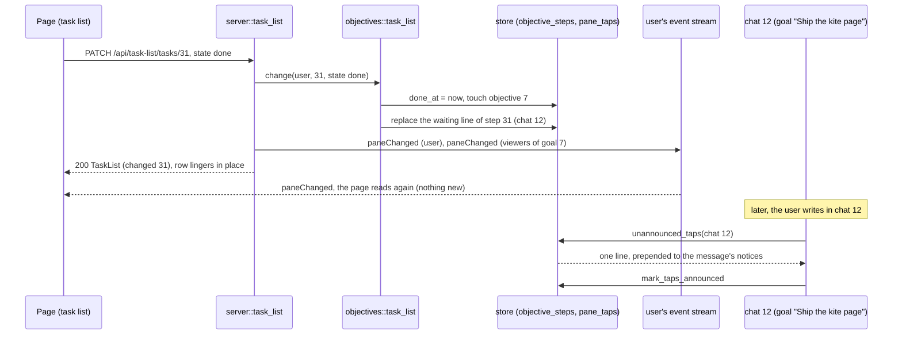

# Task list: design plan

The task list is the user's one page of everything their Jet chats track. It shows the tasks under each goal in the order of today, tomorrow and later, then the goals themselves, then a done pile that keeps the history of what the user finished. It is a new place in the left pane, beside Files, and it reads like a paper list: one line per task and a box you colour in.

This plan is written for two builders. One builds the server, from parts 4 and 5. The other builds the page, from parts 1 to 3 and the page half of part 4. Each part names the repo files it touches. Every path is under `crates/jet/` unless it says otherwise.

This plan was revised once after a design and UX critique. The critic's findings, and what changed because of each one, are in section 10.

## 0. Decisions at a glance

| # | Decision | Why (source or repo rule) |
| --- | --- | --- |
| D1 | A task is a row of `objective_steps`, and a goal is a row of `objectives`. There is no second tasks table. The table is rebuilt so that a task can have no goal, and its ids are never reused. | With one table there is one truth. Jet's tools, the plan pane and the task list read and write the same rows, so a change shows everywhere without any syncing. Syncing bugs are what the charter fears. This serves priority 1, correctness of what Jet says, and priority 3, the least new code (`src/lib.rs:3`). `AUTOINCREMENT` stops a stale window from changing a new task that took a deleted task's id ([SQLite AUTOINCREMENT](https://www.sqlite.org/autoinc.html)). |
| D2 | The summary is two plain SQL views, `task_list` and `task_list_goals`. Nothing is materialized. | SQLite has no materialized views. A view is a named SELECT, run fresh on every read, so it is never stale ([SQLite CREATE VIEW](https://www.sqlite.org/lang_createview.html)). A materialized copy would need triggers to keep it in step, and that brings back the drift D1 removes. |
| D3 | A task's day is its date (`due_date`). Today, Tomorrow and Later are worked out from that date whenever the list is read. Nothing is written when a day passes. | Things moves a dated to-do into Today by itself when its date comes ([Things: start dates](https://culturedcode.com/things/support/articles/2803579/)). With no midnight job there is no idle wake-up to pay for (priority 4). |
| D4 | Each user's tasks have one order, kept in `position`, and every day list shows its tasks in that order. Only a move changes `position`. A change of status never does. | A paper list has one order. Integer positions with no gaps and no float keys keep it simple, and a personal list is short. |
| D5 | Status is two timestamps: `started_at` makes a task yellow and `done_at` makes it green; with neither set it is gray. A tap on the box moves it one step forward, gray to yellow to green. The open row's three words set any status directly. | This is how the person marks paper. The tri-state checkbox has `aria-checked="mixed"` ([APG checkbox](https://www.w3.org/WAI/ARIA/apg/patterns/checkbox/)). The existing code reads `done_at` and does not change. The words are how the person undoes a stray mark. |
| D6 | A done task leaves its day list for a folded done pile, which holds 90 days of history. The server deletes a done task 90 days after it was done, and the open tasks of a goal 90 days after the goal closed. One task is cleaned up by its Delete. | Things' Logbook keeps finished items ([Things: Logbook](https://culturedcode.com/things/support/articles/4001304/)). Linear archives closed issues after a set time, but not while the parent is open ([Linear: archive](https://linear.app/docs/archive-issues)). A goal keeps counting the tasks done under it. |
| D7 | The list opens in the main area, as Files does, at `#tasks`. It does not draw inside the 260 px drawer. Its order is Today, Tomorrow, Goals, Later, then Done. | This follows the repo; see "Where the request and the repo differ" below. The order is the charter's own: "what should be done today, what should be done tomorrow, what are the overarching goals". Later comes after the goals because it is the long tail. |
| D8 | Jet learns of a change made outside a chat through the existing pane taps. Each task has at most one waiting line, which states its latest state. The line is told before the user's next message in the chat of the task's goal, or in the main chat when the task has no goal. | That path already exists, is told exactly once, runs no model turn and never reaches another user (`src/store/pane.rs`, `src/chat/mod.rs:277-309`). Keeping one line per task means a reversed tap never leaves a false fact behind. |
| D9 | The plan pane's step box becomes the same three-state mark and makes the same call. The old tick route is deleted. In the pane's step and goal rows, amber then means "in progress" only. | One box should behave the same everywhere. One write path for each change means fewer of the bugs the charter fears. |

### Where the request and the repo differ (the repo wins, as the brief says)

- **The path.** The request names `crates/jet/web`, which does not exist. The page lives in `crates/jet/ui/`.
- **What "the left pane" is.** The request calls Files a "tab" of the left pane and asks for the layout "at the left pane's real width". In the repo, Files is one row in the drawer, `nav.files-nav`, which `workspace/shell.js:23-25` puts above the chats. A tap on it opens the library in the main area: `mode = 'files'`, the address `#files`, and the plan pane hidden (`workspace/shell.js:129-136`, `chat/library/library.css:62-76`). The task list follows the same pattern. Its row sits beside Files in the 260 px drawer, or the 64 px rail, and its page fills the main column. Inside 260 px, a task title would get about 150 px after the box and the goal name, which is roughly 18 characters, and the chat list would have to leave the drawer.
- **The word "tasks".** The page already uses it for Jet's own agent-tasks: the `agent_tasks` table, `TaskId`, `/api/tasks/{id}/snooze` and the heading "Jet's tasks" (`src/store/migrations/0005_objectives.sql:60`, `ui/plan/view.js:192`). In this plan, a **task** is the user's task, which is a row of `objective_steps`, and code calls it a step. New names avoid the clash: `ListTask`, `Progress`, and the routes under `/api/task-list`.

---

## 1. Layout and visual design

### 1.1 Where it sits, at real widths

All values come from `ui/chat.css:3-60`, `ui/workspace/workspace.css:1-43` and `ui/chat/library/library.css`.

| Window | Drawer | Main column | Task list column |
| --- | --- | --- | --- |
| 1440 px | 260 px (`--drawer-w`) | 1180 px | 640 px, centred |
| 1024 px | 260 px | 764 px | 640 px, centred |
| 800 px (drawer open, at 760 px or more) | 260 px | 540 px | 540 px, of which 508 px is content |
| any width, drawer folded | 64 px rail | the window width minus 64 px | min(100%, 640 px) |
| 390 px phone | hidden until the chats button opens it | 390 px | 390 px, of which 366 px is content (`--gutter` is 12 px below 420 px) |

While the list is open the plan pane is hidden and `--pane-w` is 0, exactly as for Files (`library.css:75-76`).

The column is 640 px wide. That is about 70 characters of 15 px text, roughly one line of a paper page. The library uses 880 px because it shows a file's name and its facts side by side.

### 1.2 The drawer row

The row goes into the same `nav.files-nav` that holds Files, **above** Files, because the list is where the person returns every day. Change the nav's `aria-label` from "Files" to "Task list and files".

| Part | Rule (all existing classes unless marked new) |
| --- | --- |
| Row | `.files-row` > `button.chat-open`, 34 px tall (44 px when `pointer: coarse`), `padding: 0 8px`, `gap: 8px`, `border-radius: var(--r-s)` (4 px) |
| Icon | `.nav-icon` (a 32 px column) holding an 18 px icon `tasks`. Add the new path `'M4 6h4v4H4zM4 14h4v4H4zM12 8h8M12 16h8'` to `ICONS` in `ui/dom.js` |
| Label | `.nav-label`, the text "Task list", 13 px, `--fg` |
| Count (new `.nav-count`) | The number of open tasks for today. 12 px, `--muted`, `font-variant-numeric: tabular-nums`, `margin-left: auto`. Hidden at 0 and at rail width. It is not a badge: the blue badge (`--fill`) means unread, and none of this is unread |
| Hover and current | `rgba(255,255,255,.04)` on hover. `--surface-2` and `aria-current="page"` while the list is open, the same rules as Files (`library.css:64-69`) |
| Rail (64 px) | The icon is centred, and the label and count are hidden. `title="Task list"` |

### 1.3 The page

```
┌────────────────────────── Task list ──────────────────────────┐ ← head band 52 px
│                                                               │
│  Today  Wed 25 Nov                                            │ ← heading, then one rule
│  ─────────────────────────────────────────────────────────    │
│  ▣  Draft the spec                       Ship the kite page   │ ← in progress (yellow, dash)
│  ☐  Review Sam's PR       Ship the kite page · from 24 Nov    │ ← carried over, muted
│  ☐  Call the bank                                             │ ← no goal
│  +  Add a task                                                │ ← a blank line you write on
│                                                               │
│  Tomorrow  Thu 26 Nov                                         │
│  ─────────────────────────────────────────────────────────    │
│  ☐  Book the venue                                Q4 report   │
│  +  Add a task                                                │
│                                                               │
│  Goals                                                        │
│  ─────────────────────────────────────────────────────────    │
│  ●  Ship the kite page                   2/5 · 3 days left    │ ← goal row, 40 px
│  ●  Hire a designer                                 Paused    │
│  ●  Q4 report                                 2 days overdue  │   ("overdue" in --danger)
│                                                               │
│  Later                                                        │
│  ─────────────────────────────────────────────────────────    │
│  ☐  Write the launch post     Ship the kite page · Fri 4 Dec  │
│  …                                                            │
│  +  Add a task                                                │
│                                                               │
│  ───────────────────────────────────────────────────────────  │
│  Done  12                                                ⌄    │ ← fold line, folded
└───────────────────────────────────────────────────────────────┘
```

The order is **Today, Tomorrow, Goals, Later, then Done**, the charter's own order: "what should be done today, what should be done tomorrow, what are the overarching goals" (D7). The first screen answers the daily question, "what do I do today". The goals stay above Later, which is the long tail. Jet can plan up to 30 steps for each goal (`src/facade/objectives.rs:102`), so Later can be long.

Later is **not** folded, because every task stays one look away, as on paper. Folding it after about 7 rows was considered and rejected: a fold hides where a dragged task lands, and that needs its own rules.

### 1.4 Spacing, type and colour

| Element | Rule |
| --- | --- |
| Section `.tasklist` | `display: flex; flex-direction: column; height: 100%; overflow: auto; background: var(--ground); scrollbar-width: thin`, the same as `.library` (`library.css:3`) |
| Head band | Sticky, `top: 0`, `z-index: 3`, 52 px, `--ground`, `border-bottom: 1px solid var(--line)`, with `padding: 0 calc(var(--gutter) + 52px)` to leave room for the phone's chats button. Title `h1` "Task list": 14 px / 52 px, weight 600, centred, `--fg`, `tabindex="-1"`, no ring. This is `.library-head` / `.library-title` (`library.css:4-9`) |
| Column | `width: min(100%, 640px); margin: 0 auto; padding: 0 var(--gutter) max(32px, env(safe-area-inset-bottom)); container-type: inline-size` |
| Sections | The first has `margin-top: 20px`, each later one `28px` |
| Section heading line | `display: flex; align-items: baseline; gap: 8px; min-height: 28px; padding-bottom: 4px; border-bottom: 1px solid var(--line)`. The `h2` is 13 px / 20 px, weight 650, `--fg`. The date ("Wed 25 Nov") is 12 px, weight 400, `--muted`, and Later has none. **No count on any heading**: the only counts on the page are the Done fold line and the drawer row |
| List | `ul` with `margin: 0; padding: 0; list-style: none`. **No rule between rows.** The 40 px rhythm groups them, as on ruled paper with no lines drawn |
| Task row | `display: flex; align-items: center; gap: 8px; min-height: 40px; border-radius: var(--r-s); user-select: none; -webkit-touch-callout: none` (inputs inside keep `user-select: text`). Hover (`@media (hover: hover)`): `background: rgba(255,255,255,.04)`, as `.chat-row:hover` |
| Mark button | `display: grid; align-items: center; justify-items: start; flex: none; width: 30px; height: 40px; padding: 0; background: none; border: 0`. The box sits on the column's left edge and the 10 px after it is part of the target |
| Box | 20 × 20 px, `border: 2px solid`, `border-radius: var(--r-s)`, a 14 px icon at `stroke-width: 3` in `--ground`. These are `.step-box`'s sizes (`plan.css:123-125`), and the colours are in part 2 |
| Title | `flex: 1; min-width: 0`, `font-size: var(--text-size)` (15 px, or 16 px below 760 px), `line-height: 20px`, `--fg`. One line with an ellipsis while closed, the whole title wrapped while open. `title` attribute: the whole title |
| Meta (right side) | `flex: 0 1 auto; max-width: 45%`, 12 px / 16 px, `--muted`, one line with an ellipsis, right-aligned. The parts are joined by " · ": the goal's title, then a day fact (§1.5). The goal title is what gets cut, so the day fact always shows |
| Narrow column | `@container (max-width: 479px)`: a row with meta wraps it to a second line under the title (`flex-wrap: wrap`; meta `flex-basis: 100%; max-width: none; padding-left: 38px; text-align: left; margin-top: -8px`), and the row grows to 52 px. A row with no meta stays one 40 px line |
| Goal row | The same row. The mark slot holds a 10 px circle in the goal's colour (`margin-left: 5px`, so its centre lines up with a box's centre). The title is 15 px / 20 px. The facts on the right are 12 px, `--muted`, tabular, `white-space: nowrap` |
| Add line | Its mark slot holds the `plus` icon at 16 px, `--muted`. The input: `flex: 1; height: 32px; margin: 4px 0 4px -8px; padding: 0 8px; background: none; border: 1px solid transparent; border-radius: var(--r-s); font-size: var(--text-size)`, with the placeholder "Add a task" in `--muted`. On focus: `border-color: var(--edge); background: var(--surface)`, keeping the page's focus ring. The `-8px` lines the typed text up with the titles |
| Open row (§3.3) | `background: var(--surface)`. The title field is styled like `.chat-rename` (`chats.css:39`: `--ground` background, `1px solid var(--edge)` border, 4 px corners, `outline-offset: 0`), but 32 px tall to match the add line (`.chat-rename` itself is 28 px) and 44 px below 760 px. It has the same margin as the add line. The strip under it is `display: flex; flex-wrap: wrap; align-items: center; gap: 2px 4px; padding: 0 6px 8px 30px` |
| Text buttons | The library's `.text-button` size (`library.css:18`): 13 px, weight 600, `min-height: 36px; padding: 0 8px`, `--link-jet`. The strip's Delete is `--muted` until it is armed, then `--danger` on `rgba(255,123,114,.18)`, as `.chat-delete.is-confirming` (`chats.css:36`) |
| Status words (strip) | Three text buttons, "Not started", "In progress" and "Done", each with `aria-pressed`. The current one is `--fg` with `background: var(--surface-2)`, and the other two are `--link-jet` |
| Goal picker | A native `<select>`, 36 px, 13 px, `--surface-2`, `1px solid var(--edge)`, 4 px corners, `max-width: 100%` |
| Done fold line | The look of `.fold-line` (`plan.css:101-103`): 36 px, 13 px / 20 px, weight 600, `--muted`, a count, a 14 px chevron, `border-top: 1px solid var(--line)`, `margin-top: 28px` |
| Done day label | The look of `.day-label` (`plan.css:80`): 12 px / 18 px, weight 600, `--muted`, `margin: 10px 0 2px` |
| Alert | Under the head band, inside the column: `margin-top: 12px; padding: 8px 12px; border-radius: var(--r-s); background: rgba(255,123,114,.12); color: var(--danger); font-size: 12px; line-height: 17px`, `role="alert"`. This is `.pane-alert` (`plan.css:28-29`) |
| Quiet notice | 12 px / 18 px, `--muted`, with a "Try again" text button, as `.library-usage` when a refresh failed (`library.css:26-29`, `view.js:124-127`) |

**Touch and small screens.** With `pointer: coarse`, the mark button is `width: 44px; height: 44px; margin-left: -12px; padding-left: 12px`: the target grows into the gutter while the box stays on the edge. Rows, the add input and the strip's buttons are at least 44 px tall. Below 760 px every input is 16 px, so that iOS does not zoom (`chats.css:40-41`).

**Corners.** Every corner is 4 px (`--r-s`). The one exception is the goal mark, which is a circle because it is not a control.

**Colour.** Only tokens that already exist are used, and each one has a single meaning:

| Token | Value | Meaning here |
| --- | --- | --- |
| `--ground` | `#0b141b` | the page background; icons on filled boxes |
| `--surface` | `#111b23` | an open row; a focused add line |
| `--surface-2` | `#17232d` | a row lifted in a drag; skeleton shapes; the current status word; the current drawer row |
| `--line` | `rgba(255,255,255,.08)` | the rule under each heading; the fold line |
| `--edge` | `rgba(255,255,255,.34)` | the border of a field being typed in |
| `--fg` | `#e8edf1` | titles, headings |
| `--muted` | `#8d9ba7` | **gray: not started**, and all secondary text |
| `--warning` | `#f2b154` | **yellow: in progress**, and nothing else among the rows. This token is amber; it is kept rather than adding a new hue, because it is the page's one warm colour |
| `--ok` | `#3ddc97` | **green: done**, and nothing else |
| `--danger` | `#ff7b72` | "overdue", an armed delete, the alert |
| `--link-jet` | `#8cc4ff` | text buttons |
| `--accent` | `#3d8bff` | the insertion line while dragging, and nothing else. It is the page's one accent |
| `--focus` | `#8cc4ff` | focus rings (`chat.css:74`) |

**Amber means "in progress" in the rows, here and in the plan pane.** The pane today colours "Due today", "3 days left", a step due "Today" and "after the due date" in `--warning` (`ui/plan/model.js:70-78, 105-112`, `plan.css:64`). Once the pane's step box turns yellow (D9), that would give amber two meanings side by side. So in both places a goal's days left and a step's date are `--muted`. Only "overdue" and "late" keep a colour, `--danger`. The words stay the same (`daysLeftWords`, `stepDueWords`), and only the tone mapping changes (§4.8).

`--warning` keeps its other uses, which never sit beside a status box: the pane's notice band, the private-note flip, the library's quota line and the HTML file sheet.

### 1.5 Words of a row

| Case | Meta |
| --- | --- |
| A task with a goal, dated today or tomorrow | `Ship the kite page` |
| A task in Today whose date has passed (carried over) | `Ship the kite page · from 24 Nov`, all `--muted`. A carried task is a Bullet Journal ">" ([rapid logging](https://bulletjournal.com/blogs/faq/what-is-rapid-logging-understand-rapid-logging-bullets-and-signifiers)), a normal part of a paper list rather than an error, so the first view after the migration is not a wall of red. The plan pane keeps its own "24 Nov, late" against the goal's plan, in `--danger`. The two show the same date with different emphasis and never contradict each other |
| A task in Later with a date | `Ship the kite page · Fri 4 Dec` (`dueDayWords`, without the year when it is this year) |
| A task with no goal and no fact | no meta |
| A done task | `Ship the kite page · 14:05` |
| A goal | `2/5 · 3 days left` (`progressWords`, `daysLeftWords`). A paused goal shows `Paused`. An overdue goal shows `2 days overdue` in `--danger` |

### 1.6 Motion

Marking and moving happen tens of times a day, so under the frequency gate of the anti-slop craft rules each one is near-imperceptible.

- A box changes colour instantly, with no transition.
- A dropped row settles with `transform 120ms cubic-bezier(.23,1,.32,1)`.
- A row leaving for the done pile collapses its height in 150 ms on the same curve.
- There is no confetti, no shimmer and no animated page load.
- Under `prefers-reduced-motion: reduce` every movement is cut. The global rule in `chat.css:135-137` already does this, so drag code must not wait for `transitionend`.

---

## 2. Status colour: gray, yellow, green

| State | Stored | Box | `aria-checked` | Tooltip (`title`) |
| --- | --- | --- | --- | --- |
| Not started (gray) | `started_at` and `done_at` both NULL | `border-color: var(--muted)`, empty | `false` | "Not started. Tap to start." |
| In progress (yellow) | `started_at` set, `done_at` NULL | `background` and `border-color` `var(--warning)`, with a dash icon (new path `dash: 'M7 12h10'` in `ui/plan/icons.js`) | `mixed` | "In progress. Tap when done." |
| Done (green) | `done_at` set | `background` and `border-color` `var(--ok)`, the existing `check` icon. The title is `--muted` with `line-through` | `true` | "Done. Tap to put back." |

The dash and the check carry the state without relying on colour, so the box meets WCAG 1.4.1. They are also what a native mixed checkbox and a checked one draw.

The box's accessible name states the state: `aria-label="Draft the spec, in progress"`. A screen reader would otherwise say "half checked", which the APG means for a partly checked group.

**How a status changes.**

- **A tap on the box moves the task one step forward:** gray to yellow, then yellow to green. This is how the person marks paper: colour it yellow when you start, green when you finish. Two taps to reach done is deliberate. A stray first tap never sends a task to the pile, and costs a quick task one extra tap.
- **The three words in the open row set any status directly** (§3.3): "Not started", "In progress", "Done". This is how a stray yellow is undone, the way you rub out a mark on paper. Jet is told only the latest state (§5), so a corrected mark never reaches Jet as a false fact.
- **Putting a task back** (a tap on a green box) returns it to the state it had before it was done: yellow if it had been started, gray if not. One function, `putBackState(task)` in `ui/tasklist/model.js`, decides this, and the plan pane imports it. The task keeps its place in the order (D4).
- **On hover with a fine pointer**, a gray box shows its border in `--warning` and a yellow box shows it in `--ok`. The box shows what a click will do, so nobody has to be taught the cycle.
- **A goal's colour comes from its tasks**, through the view in §4.4. It is gray while no task has been started or done, and yellow once any task has been started or done. It turns green once every task is done, if it has at least one. A green goal stays in the list until it is closed, by "Mark done" in its open row (§3.6) or by Jet's `close`. The goal dot is `aria-hidden`. The goal row's name carries the colour in words (§3.6), and so does the visible "2/5".
- **Jet changes status too.** `step_tick` marks a task done or not done, and its new `started` field marks it in progress (§4.9). The list draws whatever the rows say.

---

## 3. Interactions

There is one grammar for every row. **The box changes status. The row opens in place to be changed. The row can be dragged.** There are no hover toolbars, no menus and no dialogs.

### 3.1 Every interaction

| Interaction | Mouse | Keyboard | Touch | Call |
| --- | --- | --- | --- | --- |
| Add | Click the "Add a task" line at the end of a day, type, press Enter | Tab to the line, type, press Enter. The field stays focused and empty for the next one. Esc clears it and leaves | Tap the line, type, tap Done on the keyboard (`enterkeyhint="done"`) | `POST /api/task-list/tasks` |
| Rename in place | Click the row. It opens with the title field focused and the **caret at the end**. Enter or a click outside saves, Esc restores | Enter on the title opens it. Enter saves, Esc restores | Tap the row: it opens **without** focusing the field, so the keyboard stays down. Tap the title field to edit, then tap Done | `PATCH …/tasks/{id}` `{title}` |
| Change goal | In the open row, the native "Goal" select: "No goal", then the open goals by title | Tab to it, then the arrow keys | Tap it | `PATCH` `{goalId}` |
| Change day | In the open row, the "Move to" buttons name the other two days | The same buttons, or Alt+↑ / Alt+↓ (§3.2) | The same buttons, or a drag | `PATCH` `{day}` |
| Change status | Click the box (one step forward), or a status word in the open row (any status) | Space on the box, or the status words | Tap the box (a 44 × 44 target), or a status word | `PATCH` `{state}` |
| Mark done | Click a yellow box, or "Done" in the open row. The row stays where it is, green, then goes to the pile (§3.4) | Space on a yellow box | Tap a yellow box | `PATCH` `{state:"done"}` |
| Delete | In the open row: "Delete", then "Delete?" within 4 s, as for chats (`chats-view.js:65-78`) | Delete or Backspace on a closed row opens it with Delete armed and focused. A second Delete or Enter deletes | The same two taps in the open row | `DELETE …/tasks/{id}` |
| Drag up and down, and between days | Press on the row anywhere but the box and move 4 px. Drop on the line shown | Alt+↑ / Alt+↓ (§3.2), or the open row's "Up" and "Down" | Touch and hold for 350 ms, then drag | `PATCH` `{day, after}` |
| Open the task's chat | "Open chat" in the open row | The same, by Tab and Enter | The same | none: the page shows the chat |
| View the done history | Click the "Done" fold line. "Show older" at the end of the pile loads more | Enter or Space on it | Tap it | `GET /api/task-list/done` for older pages |
| Clean up the history | A done row's "Delete" (two taps). The server cleans up after 90 days (§4.6) | The same | The same | `DELETE …/tasks/{id}` |
| Put back from done | Click a green box in the pile | Space | Tap | `PATCH` `{state}` (§2) |
| Rename a goal, or mark it done | Click a goal row to open it (§3.6) | Enter on it | Tap it | `PATCH …/goals/{id}` |

### 3.2 Keyboard map

**One Tab stop per list.** The lists are each day list, the goals and the open pile. Each one is a single Tab stop with a roving `tabindex`: one control in the list has `tabindex="0"` (the one focused last, or the first row's title) and every other control has `-1`. So 30 tasks still take only a few Tabs to get past.

| Key | Where | Does |
| --- | --- | --- |
| Tab / Shift+Tab | page | from list to list. The order is Today's list, its add field, Tomorrow's list, its add field, the goals, Later's list, its add field, the fold line, then the pile |
| ↑ / ↓ | a row's box or title | moves to the same control in the row above or below, within the list. Home and End go to the first and last row |
| ← / → | a row | switches between the row's box and its title |
| Alt+↑ / Alt+↓ | a row's box or title | moves the task one place. At the bottom of a day, Alt+↓ moves it to the **top** of the next day (Today, then Tomorrow, then Later), and the focus goes with it. At the top of a day, Alt+↑ moves it to the **end** of the day before. Nothing happens at the top of Today or the bottom of Later. The title carries `aria-keyshortcuts="Alt+ArrowUp Alt+ArrowDown"` |
| Space | box | one step forward (§2) |
| Enter | title | opens the row |
| Enter | title field | saves and closes |
| Esc | title field, open row | restores the title and closes. The focus returns to the title |
| Esc | while dragging | cancels the drag. The row goes back and no call is made |
| Delete, Backspace | a closed row | opens it with Delete armed |

These shortcuts are active only while a row has the focus, so they do not clash with a screen reader's keys. WCAG 2.1.4 allows a character shortcut that is "active only on focus".

The keys follow two sources. GitHub found arrow-key moves natural, and that announcements must be debounced by 100 ms ([GitHub: accessible sortable list](https://github.blog/engineering/user-experience/exploring-the-challenges-in-creating-an-accessible-sortable-list-drag-and-drop/)). Atlassian warns against arrow keys alone and asks for a visible alternative ([Atlassian: drag and drop accessibility](https://atlassian.design/components/pragmatic-drag-and-drop/accessibility-guidelines/)). That alternative is the open row's buttons, which also meet WCAG 2.5.7: a keyboard path "does not automatically meet this success criterion", while "up or down" controls shown on selection do ([WCAG 2.5.7](https://www.w3.org/WAI/WCAG22/Understanding/dragging-movements.html)).

**Announcements** go to the page's existing polite region, `#announce` (`ui/index.html:119`), debounced by 100 ms:

- "Draft the spec moved to Tomorrow, 2 of 4."
- "Draft the spec is in progress." / "Draft the spec is done."
- "Added Call the bank to Today."
- "Deleted Call the bank."

**Focus after an action** follows the plan pane's `data-key` pattern (`pane.js:113-117, 137`):

- After a move: the moved row's title.
- After done or delete: the next row's box in the same day, else the previous row's, else the day's add field.
- After an add: the add field.

### 3.3 The open row

```
│  ▣  [ Draft the spec|                                      ]  │ ← title field, caret at the end
│     Not started  [In progress]  Done      Goal [ Ship the kite page ⌄ ] │
│     Move to  Tomorrow  Later     Up  Down     Open chat     Delete    │
```

- **One open row at a time.** Opening another, a click outside, or Esc closes it. A click outside saves.
- **Focus on open.** A fine pointer or the keyboard focuses the title field with the caret at the end and nothing selected, so the first key typed does not replace the title. A coarse pointer (`pointer: coarse`) opens the row without focusing the field. The keyboard stays down until the person taps the field, as the empty state does on a phone (§3.7).
- **Status words** set the state directly. The current one has `aria-pressed="true"`.
- **"Move to"** is a muted 12 px word, followed by buttons for the two days the task is not in.
- **Up and Down** move the task one place, as Alt+↑ / Alt+↓ do. The row stays open and the focus stays on the button.
- **At 366 px** the strip wraps to three lines. Delete stays at the end of the last line (`margin-left: auto`).
- **Semantics.** The strip is a `role="group"` named "Change Draft the spec". The title button carries `aria-expanded` and `aria-controls` pointing at the strip.
- **An empty title on save is a cancel**: the old title stays, as in `chats-view.js:47-53`.
- **A done row** opens to a strip that holds Delete only. A finished record is not edited, and its box is the way back (§2).

### 3.4 Done, and the done pile

- **The row lingers in place.** A task marked done turns green and is struck through, and **stays where it is** while the person goes on marking. These rows wait until 4 s pass with no box tapped, then all leave for the pile together, collapsing over 150 ms. Rows never move under a pointer aiming at the next box. The Done count goes up at once. A tap on a lingering green box puts the task back where it was (D4). A lingering row cannot be dragged. The 4 s is the page's existing `CONFIRM_MS` (`ui/plan/taps.js:6`).
- **The page keeps a lingering row itself.** The server's answer already holds the task under `done`. The view draws it in its old place from its own record of lingering rows (§4.12), so neither the write's answer nor a re-read removes it early.
- **The pile** is folded under "Done 12". Open, it lists done tasks newest first, grouped by the day they were done in the user's zone: "Today", "Yesterday", then "Mon 23 Nov". The read carries the newest 100. "Show older" at the end loads the next 100 from `GET /api/task-list/done` (§4.11) until the 90 days run out.
- **A done row** shows a green box, a muted struck-through title, and "goal · 14:05". A tap on the box puts the task back. Its strip offers Delete only, which is how one item is cleaned up. It cannot be dragged, because the pile is ordered by time.
- **The server cleans up automatically** (§4.6). The open pile's foot says so in one muted line: "Done tasks are kept for 90 days."

### 3.5 Dragging

The drag follows [NN/g: drag and drop](https://www.nngroup.com/articles/drag-drop/): the row looks lifted, the insertion moves when the dragged row's centre crosses, touch starts with a long press, and there are alternatives.

- **Start.**
  - Mouse: press and move 4 px. A press that moves less is a click.
  - Touch: hold 350 ms while moving less than 8 px. Moving more is a scroll.
  - Rows have `touch-action: pan-y`. Once a touch drag has started, a `touchmove` listener with `{ passive: false }` calls `preventDefault()` so the list stops scrolling (unknown U1).
  - `user-select: none` and `-webkit-touch-callout: none` on rows stop iOS from starting a text selection or its callout during the hold (§1.4).
  - The box, a field, a lingering row and a done row never start a drag.
- **While dragging.**
  - A copy of the row follows the pointer up and down only. It has `background: var(--surface-2)`, `box-shadow: 0 6px 20px rgba(0,0,0,.45)` and `z-index: 2`. The row's own slot stays at `opacity: .35`.
  - The drop place is a 2 px line in `--accent` across the list. It moves when the lifted row's centre crosses a row's middle.
  - A day's heading takes the drop at the top of that day. A day's add line takes it at the end, which makes an empty day a target.
  - The goals section is passed over and is never a target.
  - Within 48 px of the scroller's top or bottom edge, the list scrolls 2 to 12 px per frame, faster deeper into the edge.
  - With a fine pointer the cursor is `grab` over a row and `grabbing` while dragging.
  - A read that arrives during a drag is kept, and drawn only after the drop or the cancel (§4.12).
- **Drop.**
  - The page reorders its own copy at once and sends `PATCH {day, after}`.
  - Success: the page draws the answer.
  - Failure: the page reads the list again and shows the alert (§3.7).
  - The `click` that follows a drop, or a cancelled drag, is swallowed, so it never opens the row.
- **Cancel.** Esc, `pointercancel`, a lost pointer capture or the window losing focus puts the row back. No call is made.
- **Drops onto goals or onto the Done line do nothing.** The goal picker and the box do those jobs.
- **No drag handle icon.** Every row can be dragged, and the open row is the non-drag way. Reminders works this way: "touch and hold … then drag" ([Apple: Reminders](https://support.apple.com/102484)).

### 3.6 Goals

- **The goal row** shows the colour dot, the title and its facts: "2/5 · 3 days left". Goals are ordered by due date, then id.
- **Its accessible name** carries the colour in words: "Ship the kite page, in progress, 2 of 5 done, 3 days left".
- **Opened**, it shows:
  - the title field (1 to 200 characters, the objectives table's limit);
  - the deliverable, 13 px / 19 px, `--muted`, cut to two lines;
  - "Due Fri 4 Dec · 3 days left · 2 of 5 done";
  - the strip, with "Open chat" and "Mark done". "Mark done" arms as **"Done? Its 3 open tasks leave the list."** (or "Done?" when none is open), and a second click within 4 s confirms.
- **Marking a goal done** closes it, and its waiting checks are cancelled (`src/objectives/mod.rs:489-511`). Its open tasks leave the day lists without being done. They stay on the closed objective, which Jet still lists, and the server deletes them 90 days after the goal closed (§4.6). Its done tasks stay in the pile.
- **Deleting a goal's chat** takes the goal's open tasks off the list in the same way, because that drops the goal (`src/store/chats.rs:180-189`). So does Jet's `close`.
- **There is no "Add a goal".** A goal is an objective. The server makes an objective only with a deliverable, a due date and a first check, which Jet agrees with the user in conversation (`src/objectives/mod.rs:297-344`, `facade/objectives.rs:17`).
- **With no goals**, the Goals section shows the plan pane's invitation (`ui/plan/view.js:179-183`): "Tell Jet what you are working on, for example 'I need to ship the kite page by Friday.'" The example puts that sentence in the open chat's message box through the existing `jet:draft` event (`ui/chat/main.js:274-280`).
- **No delete or pause.** Dropping or pausing a goal stays with Jet ("drop it") or with deleting its chat. That keeps the list a list.
- **Only the user's own goals.** Goals shared with the user stay under "Shared with you" in the plan pane. This also keeps Never 3 in `src/lib.rs:6`.

### 3.7 Empty, loading and error states

| State | What shows |
| --- | --- |
| First load | `aria-busy="true"` and an sr-only "Loading the task list". Skeletons in the final layout's shape, with no shimmer: the "Today" heading and three task lines, each a 20 px `--surface-2` box and a 44 % × 12 px bar. These are the library's skeleton sizes (`library.css:54-58`) |
| Nothing at all (no goals, no tasks, empty pile) | Today shows its add line, focused on a desktop. A phone focuses the title instead, so its keyboard does not cover the list, as `library/view.js:179-184` does. Tomorrow and Later show only their add lines. The Goals section holds the invitation (§3.6). No illustration, no "all caught up" |
| An empty day | Its heading, then its add line, and nothing else |
| An empty pile | The fold line "Done" with no count. Opened, it says "Tasks you finish land here." |
| The first read failed | A centred block, like `.library-state` (`library.css:32-35`): "The task list could not be loaded." and a "Try again" text button |
| A later read failed | The last good list stays, with the quiet notice "The task list could not be refreshed. Try again" under the head band |
| "Show older" failed | The pile keeps what it has, and the alert says "Older done tasks could not be loaded. … Try again." |
| A change failed | The page puts the list back by reading it again. The alert shows `tapEnded(failure, error)` from `ui/plan/taps.js:28-31`, for example "The task could not be moved. That task is no longer in your list. Try again." It stays until a later change works, as in the pane. The failures are "The task could not be added / renamed / moved / changed / deleted" and "The goal could not be renamed / closed" |
| An add failed | The typed text goes back into the field, and the alert shows |
| The open row's task vanished in a re-read | The row closes, and the alert says "That task is no longer in your list." (§4.12) |
| Offline | The drawer already says "Server disconnected" (`chat/drawer/view.js:18`). Changes fail with "Jet could not be reached." |

---

## 4. Data contract

### 4.1 Module table

| Box | One job | State it owns | New / changed / same |
| --- | --- | --- | --- |
| `store::task_list` (`src/store/task_list.rs`) | Read the two views and write task rows, keeping each user's one order | the rows of `objective_steps` | new. `src/store/steps.rs` changes (§4.8) |
| `objectives::task_list` (`src/objectives/task_list.rs`) | The rules: today in the user's zone, the day rule, ownership, the version rule, and the one line per task that Jet is told | none | new |
| `server::task_list` (`src/server/task_list.rs`) | The HTTP routes: read and change the list, then tell the user's pages | none | new |
| `pane_taps` (`src/store/pane.rs`, `src/chat/mod.rs:277-309`) | Tell Jet each line once, before the user's next message in its chat | `pane_taps` rows, which gain `step_id` and `step_added` | changed: one column pair and one replace rule |
| `scheduler` (`src/scheduler/mod.rs`) | Delete old done tasks, and the open tasks of long-closed goals, on each pass of its loop | none | changed: one call beside `expire_items` |
| page `ui/tasklist/` | Draw the list and turn gestures into calls | the open row and its draft, the armed delete, the lingering done rows, the drag | new |
| `workspace/shell.js` | Show one place at a time: a chat, an app, tools, files or the task list | `mode` | changed (§4.8) |

### 4.2 Diagram


Work waits or crosses a boundary in four places:

1. Every page-to-server call crosses the network. The server does its store work on a worker (`on_worker`, `src/server/pane.rs:34`).
2. The event stream crosses the network back to the page.
3. A line waits in `pane_taps` until the user's next message in that chat.
4. The scheduler loop runs on its own thread.

### 4.3 Pattern, extension point, fit, unknowns

- **Pattern: one table, many writers, one change signal, and readers that read again.**
  - The page, Jet's tools and the scheduler all write rows.
  - Every writer calls `Chats::pane_changed(user)` (`src/chat/chats.rs:219-224`).
  - Every reader (the task list, the plan pane and the files) reads again on `jet:pane-changed`.
  - The plan pane already works this way (`ui/plan/pane.js:266-267`), so this is no new pattern.
- **Extension point: more kinds of change Jet is told of.** Each kind is one arm of `TaskChange` in `objectives/task_list.rs`, with its `line()` (§5.3). Nothing else grows. There is no trait, because there is one adapter.
- **Fit:** §4.8.
- **Unknowns:** §4.10.

### 4.4 Migration `src/store/migrations/0014_task_list.sql`

Add this file at the end of `MIGRATIONS` in `src/store/mod.rs:75-90`, as `include_str!("migrations/0014_task_list.sql")`.

**Why the rebuild is safe inside the runner's transaction.** The runner applies each migration inside one transaction with `foreign_keys = ON` (`src/store/mod.rs:157, 219-226`), and a migration cannot turn foreign keys off inside a transaction. Nothing references `objective_steps`: `grep -rn "REFERENCES objective_steps" crates/` finds nothing. So the rebuild is safe as it stands.

**The order of the rebuild.** The steps follow SQLite's own order: create the new table under a new name, copy, drop, rename, then make the indexes and views again ([SQLite ALTER TABLE](https://www.sqlite.org/lang_altertable.html)). `ALTER COLUMN … DROP NOT NULL` exists only from SQLite 3.53, so the migration does not rely on it.

```sql
-- The task list: each step is one task of the user's, under a goal (an objective) or under none,
-- in one order for all of the user's tasks, with the day it is for and when it was started and
-- done. A task under no goal is the user's alone and is never shared. Ids are never reused, so a
-- stale page that names a deleted task is refused, never applied to a newer one.

CREATE TABLE new_objective_steps (
    id INTEGER PRIMARY KEY AUTOINCREMENT,
    user_id INTEGER NOT NULL REFERENCES users (id) ON DELETE CASCADE,
    -- NULL for a task under no goal.
    objective_id INTEGER REFERENCES objectives (id) ON DELETE CASCADE,
    -- The user's one order of all their tasks, from 1. A goal's steps are in this order too.
    position INTEGER NOT NULL,
    title TEXT NOT NULL CHECK (length(title) BETWEEN 1 AND 300),
    -- The day the task is for, YYYY-MM-DD in the user's zone; NULL for later, with no day.
    due_date TEXT,
    started_at INTEGER,
    done_at INTEGER
) STRICT;

-- Existing steps keep their ids and each goal's order; goals follow one another by id.
INSERT INTO new_objective_steps (id, user_id, objective_id, position, title, due_date, started_at, done_at)
SELECT s.id, o.user_id, s.objective_id,
       row_number() OVER (PARTITION BY o.user_id ORDER BY s.objective_id, s.position, s.id),
       s.title, s.due_date, NULL, s.done_at
FROM objective_steps s JOIN objectives o ON o.id = s.objective_id;

DROP TABLE objective_steps;
ALTER TABLE new_objective_steps RENAME TO objective_steps;
CREATE INDEX steps_by_objective ON objective_steps (objective_id);
CREATE INDEX steps_by_user ON objective_steps (user_id, position);
CREATE INDEX steps_done ON objective_steps (done_at) WHERE done_at IS NOT NULL;

-- A line about one task, so that a newer change of that task replaces its waiting line, and an
-- add the user undoes before Jet hears of it is never told. `step_added` marks a line about a
-- task that Jet has not heard of yet.
ALTER TABLE pane_taps ADD COLUMN step_id INTEGER;
ALTER TABLE pane_taps ADD COLUMN step_added INTEGER NOT NULL DEFAULT 0;
CREATE INDEX pane_taps_by_step ON pane_taps (step_id) WHERE announced = 0 AND step_id IS NOT NULL;

-- The task list as the page reads it: each task with its goal, its state in one word, and the chat
-- a change of it is told in (its goal's, or the main chat). A task of a goal that is done or
-- dropped shows only once it is done, in the done pile.
CREATE VIEW task_list AS
SELECT
    s.id,
    s.user_id,
    s.objective_id AS goal_id,
    o.title AS goal_title,
    coalesce(o.chat_id, m.id) AS chat_id,
    s.title,
    s.due_date AS date,
    s.position,
    s.started_at,
    s.done_at,
    CASE
        WHEN s.done_at IS NOT NULL THEN 'done'
        WHEN s.started_at IS NOT NULL THEN 'in_progress'
        ELSE 'not_started'
    END AS state
FROM objective_steps s
LEFT JOIN objectives o ON o.id = s.objective_id
JOIN chats m ON m.user_id = s.user_id AND m.kind = 'main'
WHERE s.objective_id IS NULL
   OR o.status IN ('active', 'paused')
   OR s.done_at IS NOT NULL;

-- The goals of the task list: the user's open objectives, with their tasks counted and their
-- colour in one word. Green once every task is done; yellow once any is started or done.
CREATE VIEW task_list_goals AS
SELECT
    o.id,
    o.user_id,
    o.chat_id,
    o.title,
    o.deliverable,
    o.due_date AS due,
    o.status,
    count(s.id) AS tasks,
    count(s.done_at) AS done,
    CASE
        WHEN count(s.id) > 0 AND count(s.done_at) = count(s.id) THEN 'done'
        WHEN count(s.started_at) > 0 OR count(s.done_at) > 0 THEN 'in_progress'
        ELSE 'not_started'
    END AS state
FROM objectives o
LEFT JOIN objective_steps s ON s.objective_id = o.id
WHERE o.status IN ('active', 'paused')
GROUP BY o.id;
```

**Explicit ids and `sqlite_sequence`.** The copy inserts explicit ids. An INSERT that raises the largest rowid updates `sqlite_sequence` ([SQLite AUTOINCREMENT](https://www.sqlite.org/autoinc.html)). U3 confirms it on real data.

**The main-chat invariant.** The `JOIN chats m … kind = 'main'` in `task_list` relies on every user having exactly one main chat. Migration 0004 made one for each existing user (`0004_personal_jet.sql:16-18`, the unique index `one_main_chat_per_user`). `Store::add_user` makes one with every new account (`src/store/directory.rs:123`). Delete refuses the main chat (`src/store/chats.rs:170-173`). A user without one is therefore a bug, and is not a state the view has to handle.

**The owner invariant.** For a task with a goal, `objective_steps.user_id` equals `objectives.user_id`. The store enforces this in one place:

- An insert takes `user_id` from the goal in the same statement: `INSERT … SELECT o.user_id … FROM objectives o WHERE o.id = ?goal AND o.user_id = ?user`.
- A change of goal checks `o.user_id = ?user` before it writes.
- When either check fails, the route answers `goalGone` (404).

### 4.5 How order and the day are stored

**The day** is `due_date`. The list is read with `today` and `tomorrow` worked out in the user's zone: `time::today(zone, now)` and the date after it (`src/objectives/time.rs:99-103`). The zone comes from `users.time_zone`, or UTC when it is unknown, as `Objectives::view` does (`src/objectives/mod.rs:616-624`). In SQL:

```sql
CASE WHEN date IS NULL THEN 'later' WHEN date <= :today THEN 'today' WHEN date = :tomorrow THEN 'tomorrow' ELSE 'later' END AS day,
(done_at IS NULL AND date < :today) AS late
```

**A task's date is the day planned for it. The deadline is the goal's** (`objectives.due_date`).

- Jet already uses step dates as the plan of days it agrees with the user. So a step Jet dated Friday shows in Later as "Fri 4 Dec", moves into Tomorrow on Thursday, and into Today on Friday.
- Todoist draws the same line: dates are "when you plan to begin working on them", and deadlines "represent the hard cutoff" ([Todoist: deadlines](https://www.todoist.com/help/articles/introduction-to-deadlines-in-todoist-uMqbSLM6U)). Here the hard cutoff is the goal's due date.

**The day rule** applies to every move. It is one function in `objectives::task_list`:

| Moved to | New `due_date` |
| --- | --- |
| Today | today's date. A carried task that is moved, even within Today, stops being carried |
| Tomorrow | tomorrow's date |
| Later | unchanged if the task is already in Later, NULL otherwise |

**When a day passes, nothing is written.**

- Tomorrow's tasks read as Today's.
- Today's unfinished tasks stay in Today and are shown as carried ("from 24 Nov").
- A dated task in Later reads as Tomorrow, and then as Today, when its date comes. It keeps its place in the one order, so it may land in the middle of Today.

Todoist also keeps overdue tasks in Today ([Todoist: plan your day](https://todoist.com:443/help/articles/how-to-plan-your-day-UVUXaiSs)). Here, though, carried tasks stay draggable like any other, where Todoist says "overdue tasks can't be manually sorted" ([Todoist: sorting](https://www.todoist.com/help/articles/default-sorting-order-in-todoist-mqmgerY7)).

**The order** is `position`: one sequence for each user over all of their rows, done ones included. Ties are broken by `id`, and every query orders `BY position, id`.

| Write | Position |
| --- | --- |
| A new task (from the page, or Jet's `step_add` and `create`) | `max(position) + 1` over the user's rows. Every new task comes last in its day |
| A move to another day with no `after` (the strip's buttons) | `max(position) + 1`, so the task is last in its new day |
| `after: null` | just before the first open task of the target day, or `max + 1` when that day is empty |
| `after: <id>` | just after that task, if it is an open task in the target day once the day rule has run. Otherwise last in the target day. This is lenient on purpose: a stale `after` never fails |
| `after` with no `day` | the target day is the task's current day |
| A change of title, goal or **status** (put back included) | unchanged. A task put back returns to where it was |

An explicit placement reads the user's rows in order, takes the task out, puts it in at its new index, and writes `position = 1..n` for the rows whose number changed. All of this is one transaction (`Store::try_with` plus `db.transaction()`, as `src/store/steps.rs:77-91` does). SQLite runs one writer at a time, so a concurrent `step_add` from Jet lands before or after the move, never in its middle.

**The version rule.** A check whose objective changes while it runs drops its result and runs again (`src/scheduler/check.rs:534-563`). So which writes raise `objectives.version` matters (priorities 1 and 4):

| Write | Raises the version of |
| --- | --- |
| A change of title, goal, day, status, or an add or delete of a task with a goal | that goal (`touch`, `src/store/objectives.rs:97-108`), as step writes do now. On a change of goal, the old goal too |
| A change of `position` alone, including the renumbering of other rows | nothing |
| Any write to a task with no goal | nothing |

**State effects of `PATCH {state}`.** These are the effects for the page. Jet's `started`/`done` fields map onto the same effects (§4.9).

| Target `state` | `started_at` | `done_at` |
| --- | --- | --- |
| `not_started` | NULL | NULL |
| `in_progress` | `coalesce(started_at, now)` | NULL |
| `done` | unchanged | `coalesce(done_at, now)` |

Setting a task to the state it already has writes nothing and keeps no line.

### 4.6 How done history is kept and cleaned up

- **The pile** holds done tasks with `done_at > now − 90 days`, newest first. The constant `DONE_KEPT_DAYS = 90` lives in `objectives::task_list`. The read carries the newest 100 and the full `doneCount`. `GET /api/task-list/done?before=<doneAt>&beforeId=<id>` answers the next 100 (§4.11).
- **One item** is cleaned up with its Delete.
- **The purge.** The scheduler loop calls `store.purge_task_list(now, DONE_KEPT_DAYS * 86400)` beside `expire_items` (`src/scheduler/mod.rs:211-233`). That loop already runs at least once a minute, so no new timer is needed:

  ```sql
  DELETE FROM objective_steps
  WHERE (objective_id IS NULL AND done_at IS NOT NULL AND done_at < :cutoff)
     OR objective_id IN (SELECT id FROM objectives
                         WHERE status IN ('done', 'dropped') AND closed_at < :cutoff)
  RETURNING user_id;
  ```

  - **What goes:** a done task with no goal, 90 days after it was done; and every task of a goal, done or not, 90 days after the goal closed.
  - **What never goes:** a task of a goal that is still open, because it is part of that goal's record. Linear does not archive while "the parent issue is not closed" ([Linear: archive](https://linear.app/docs/archive-issues)).
  - **Hidden tasks:** the open tasks a closed goal took off the list (§3.6) are not kept for ever. They go with the goal's record.
  - **Who is told:** each distinct `user_id` returned gets `chats.pane_changed(user)`.
- **A purge failure never stops the scheduler.** `run()` would end the scheduler thread on an error (`src/scheduler/mod.rs:192-198, 211-222`). So the loop calls the purge as `if let Err(error) = self.purge_task_list(now) { eprintln!("jet: the task list could not be purged: {error}"); }`, with no `?`. The next pass of the loop tries again, at most a minute later. That makes the class RETRY, driven by the loop.

### 4.7 How objectives and objective_steps map onto goals and tasks

| Task-list word | Table and column | Notes |
| --- | --- | --- |
| goal | an `objectives` row with `status` in `active` or `paused` | `title` (1 to 200), `deliverable`, `due_date` (the deadline), `chat_id`, `status`. A closed goal (`done` or `dropped`) leaves the Goals section |
| goal colour | `task_list_goals.state` | from the goal's tasks (§2) |
| task | an `objective_steps` row | `title` (1 to 300), `due_date` (the day), `position` (the one order), `started_at`, `done_at` |
| task with no goal | `objective_id IS NULL` | its chat is the user's main chat |
| a task's chat | `task_list.chat_id` | the goal's chat, or else the main chat |
| state | `task_list.state` | `not_started`, `in_progress` or `done` |
| done pile | `task_list` rows with `done_at` within 90 days | newest first, 100 at a time |

**Decision: extend `objective_steps`. Do not add a tasks table.** Measured against `src/lib.rs:3`:

- **Correctness of what Jet says.** Jet's `objectives_list` reads the very rows the list draws.
- **Simplicity.** The existing step writers keep working: `step_add`, `step_tick` and `step_edit` (`src/store/steps.rs`), the pane's mark, and the colleague's read. Each one only gains the new columns.
- **What a new `tasks` table would cost.** It would copy every step, or move every step writer, and keep two orders in step. Its name would also clash with `agent_tasks`, `TaskId` and `/api/tasks/...` (§0).
- **What this choice costs.** One table rebuild.

### 4.8 Fit: existing code that changes shape

**Server.**

| File | Change |
| --- | --- |
| `src/store/steps.rs` | `Step` gains `started_at: Option<u64>`, serialised as `startedAt`. `steps()` filters `WHERE s.objective_id = ?1 AND s.user_id = ?2 ORDER BY s.position, s.id`. `insert_all` takes the user and numbers from `max(position) + 1` over that user's rows. `add_step` does the same. `tick_step` keeps `started_at` as it is |
| `src/store/objectives.rs:163` | Orders a goal's steps `BY position`. Add `, id` |
| `src/store/pane.rs` | `record_tap` gains a sibling, `record_task_line(user, chat, step, line, added, at)`. In one transaction it reads and deletes the step's unannounced rows (in any chat), then inserts per §5.3 |
| `src/store/mod.rs` | the migration; `pub(crate) mod task_list;` |
| `src/objectives/mod.rs` | `mod task_list;` beside `mod pane;`. Re-export `TaskList` |
| `src/server/routes.rs` | Merge `task_list::router()`, as the pane's router is merged |
| `src/scheduler/mod.rs` | `purge_task_list(now)` beside `expire_items(now)`, logged and never `?` (§4.6) |
| `src/server/pane.rs`, `src/objectives/pane.rs` | Delete the route `PUT /api/objectives/{id}/steps/{step}` and `Objectives::tap_step`. The pane's box calls `PATCH /api/task-list/tasks/{id}` (D9). Their tests in `tests/integration/pane.rs` move to `tests/integration/task_list.rs` |
| `src/facade/objectives.rs`, `src/facade/handler.rs` | §4.9 |

**Page.**

| File | Change |
| --- | --- |
| `ui/workspace/shell.js` | `showFiles` becomes `showPlace(name)` over a small map, `{ files: library, tasks: taskList }`. The place rows go into `nav.files-nav`. `popstate` handles `#tasks` as it handles `#files`. `paint()` hides every place that is not the mode, so no place is a special case. `showChat()` clears `#tasks` as well as `#files` from the address (`shell.js:125-128`), and so does the initial load check (`shell.js:149`) |
| `ui/chat/library/library.css:70-76` | The "while the library is open" rules move to `ui/workspace/workspace.css`, with the selector `.workspace-shell:is([data-mode="files"], [data-mode="tasks"])`. They belong to the shell, not to the library |
| `ui/plan/view.js` `stepRow` | Uses the task list's mark: `aria-checked` `false` / `mixed` / `true`, `data-state`, and the state in its name. A tap moves the state one step forward on the same cycle. `act.tick` becomes `act.mark(step, el)`, which calls `PATCH /api/task-list/tasks/{step.id}` with `{ state }` |
| `ui/plan/plan.css` | `.step[data-state="in_progress"] .step-box { background: var(--warning); border-color: var(--warning) }`. The `[data-tone="warn"]` colour rules for `.fact` and `.step-due` (`plan.css:64`) go |
| `ui/plan/model.js` | `daysLeftWords` and `stepDueWords` keep their words. Their `'warn'` tones become `'quiet'` (§1.4), and their tests in `model.test.mjs` follow |
| `ui/plan/icons.js` | Add `dash` |
| `ui/dom.js` | Add the `tasks` icon |
| `ui/index.html` | `<link rel="stylesheet" href="./tasklist/tasklist.css">` after `library.css` |
| `ui/chat/main.js` | `createTaskList({ openChat, announce, titleOf })` beside `createLibrary`, passed to `createWorkspace` |

**Tree after the work.** New files are marked +.

```
crates/jet/src/
  objectives/task_list.rs         + rules, the version rule, TaskChange and its lines
  server/task_list.rs             + routes
  store/task_list.rs              + reads of the views, writes, order, purge
  store/migrations/0014_task_list.sql  +
crates/jet/ui/tasklist/
  model.js                        + pure: readTaskList, groups, words, nextState, putBackState, keyboardMove
  model.test.mjs                  +
  store.js                        + the page's copy of the list, the write queue, the day-change check
  view.js                         + draws the place over the local state (§4.12), the open row, focus
  drag.js                         + pointer and touch drag; answers { day, after } on drop, knows no server
  tasklist.css                    +
crates/jet/tests/
  integration/task_list.rs        +
  browser/tasks.mjs               +
```

Each new file opens with a comment of one or two lines, as `AGENTS.md` asks.

### 4.9 Jet's tools: what changes so Jet sees the whole list

The changes are in `src/facade/objectives.rs` and `src/facade/handler.rs`, and they are kept small.

1. **`objectives_list`** answers `{"objectives": [...], "looseSteps": [Step, ...]}`. `looseSteps` holds the user's tasks with no goal: the open ones, and the done ones from the last 90 days. Every step carries `startedAt`. Add this sentence to `OBJECTIVES_LIST`: "`looseSteps` are tasks the user keeps under no objective. A step's `due` is the day it is planned for, `startedAt` means the user has started it, and steps are in the user's own order."
2. **`step_add`**: `id` becomes optional. Without it, the task has no goal. Add to `OBJECTIVES_UPDATE`: "Leave out `id` on `step_add` only for a task under no objective." The answer is the objective's view when there is an `id`, and `{"step": Step}` otherwise.
3. **`step_tick` and `step_edit`**: `id` becomes optional. Without it, the step is found by its id among all of the user's tasks. A step id that is not the user's is `NoSuchStep`, as now.
4. **`step_tick`** gains an optional `started: boolean`. Give one of `done` or `started`. With neither, `done` defaults to `true`, as now (`facade/objectives.rs:262-267`). With both, the command is refused with `nothingToChange`.

   | Given | Effect (the same as §4.5) |
   | --- | --- |
   | `done: true` | the `done` effect |
   | `done: false` | `done_at = NULL` |
   | `started: true` | the `in_progress` effect |
   | `started: false` | the `not_started` effect |

5. **Viewers of the goal.** `handler.rs:392` tells a goal's viewers only when `arguments.command.id` is given. With `id` optional, a colleague viewing the goal would miss the change. Take the goal id from the command's answer instead: the objective view's `id`, or the `step.goalId` of a step answer.

Jet's own writes are not told back to it. They reach the page through the `pane_changed` that `facade/handler.rs:385-397` already sends.

### 4.10 Unknowns (spike before building on them)

| # | Question (yes / no) | Spike |
| --- | --- | --- |
| U1 | After a 350 ms long press on a `touch-action: pan-y; user-select: none; -webkit-touch-callout: none` row, does `preventDefault()` in a `{ passive: false }` `touchmove` listener stop the scroll, show no selection or callout, and does the click that follows the drop get swallowed? Test in iOS Safari and Android Chrome, inside `.workspace-content` (`overflow: hidden`), with the list as its own scroller | Build one test page. Load it in headless Chrome with touch emulation, in a 390 px iframe (see §6), then on one real iPhone. Fallback if not: `touch-action: none` on the row only while a press is held |
| U2 | Does the bundled SQLite (`libsqlite3-sys 0.40.0` in `Cargo.lock`) support `RETURNING` (3.35 and later) and window functions (3.25 and later)? | A store test that runs `SELECT sqlite_version()` and then the migration |
| U3 | Does 0014 run inside the runner's transaction with `foreign_keys = ON`, on a copy of a real data directory? After it, are every step id and every done mark as they were, and is `sqlite_sequence` at the largest id? | Run it on a copy of the data folder. Compare `SELECT id, done_at FROM objective_steps` before and after, then add one task and check that its id is above the old largest |

### 4.11 HTTP API

All routes sit behind the sign-in guard, as `/api/pane` does. All bodies are JSON. **Every answer has a JSON body, errors included.** `requestJson` reads `response.json()` and treats a body that is not JSON as a lost connection (`ui/bridge/browser-agent.js:10-22`), so:

- `DELETE` answers 200 with the list, not 204.
- Each body is read through a JSON extractor whose rejection becomes `{kind, message}` with status 400, never axum's plain-text 422.

#### The read: `TaskList`

`GET /api/task-list` → 200. Every task and goal write answers with the same shape.

```json
{
  "timeZone": "Europe/London",
  "today": "2026-11-25",
  "tomorrow": "2026-11-26",
  "mainChatId": 1,
  "doneKeptDays": 90,
  "doneCount": 134,
  "changed": null,
  "goals": [
    {
      "id": 7, "title": "Ship the kite page", "deliverable": "The kite page live at /kite",
      "chatId": 12, "due": "2026-11-28", "daysLeft": 3, "status": "active",
      "state": "in_progress", "tasks": 5, "done": 2
    }
  ],
  "tasks": [
    {
      "id": 31, "title": "Draft the spec", "goalId": 7, "goalTitle": "Ship the kite page", "chatId": 12,
      "date": "2026-11-25", "day": "today", "late": false, "state": "in_progress",
      "startedAt": 1764061200, "doneAt": null
    },
    {
      "id": 40, "title": "Call the bank", "goalId": null, "goalTitle": null, "chatId": 1,
      "date": "2026-11-25", "day": "today", "late": false, "state": "not_started",
      "startedAt": null, "doneAt": null
    }
  ],
  "done": [
    {
      "id": 29, "title": "Sketch the layout", "goalId": 7, "goalTitle": "Ship the kite page", "chatId": 12,
      "date": "2026-11-24", "day": null, "late": null, "state": "done",
      "startedAt": 1763974800, "doneAt": 1764068700
    }
  ]
}
```

| Field | Type | Meaning |
| --- | --- | --- |
| `timeZone` | string or null | the user's zone. Null means the days are in UTC |
| `today`, `tomorrow` | `YYYY-MM-DD` | the days the buckets were worked out with. The page reads again when its clock passes `today` (§4.12) |
| `mainChatId` | number | the main chat |
| `doneKeptDays` | number | 90 |
| `doneCount` | number | all done tasks within the 90 days. `done[]` holds at most the newest 100 of them |
| `changed` | number or null | in a write's answer, the id of the task the write touched, for focus and announcements. Null in a read, a delete's answer and a goal write's answer |
| `goals[]` | `ListGoal` | open goals, by `due` then `id`. `daysLeft` is worked out as `ObjectiveView::days_left` does (`src/objectives/mod.rs:631`), and is **negative once the goal is overdue**, which is the input `daysLeftWords` expects. `status` is `active` or `paused`. `state` is the colour. `tasks` and `done` are counts |
| `tasks[]` | `ListTask` | open tasks (`doneAt` null) in the user's one order. The page groups them by `day`, keeping that order |
| `done[]` | `ListTask` | the pile's newest 100, newest `doneAt` first, ties by `id` descending |
| `ListTask.date` | `YYYY-MM-DD` or null | the stored day |
| `ListTask.day` | `"today"`, `"tomorrow"`, `"later"`, or null | the bucket; null for a done task |
| `ListTask.late` | boolean or null | true for an open task dated before `today`, shown as carried. Null for a done task |
| `ListTask.state` | `"not_started"`, `"in_progress"` or `"done"` | |
| times | Unix seconds | like every other time the server sends |

#### The writes, and the pile's older pages

| Method and path | Body | Does | Jet is told (§5.3) |
| --- | --- | --- | --- |
| `POST /api/task-list/tasks` | `{"title": string, "day": "today"\|"tomorrow"\|"later", "goalId"?: number\|null}` | adds a task, last in its day. `"later"` stores no date | the task's line, as added |
| `PATCH /api/task-list/tasks/{id}` | any of `{"title"?: string, "goalId"?: number\|null, "state"?: state, "day"?: day, "after"?: number\|null}`, at least one | changes one task: title, goal, state (§4.5), day and place (§4.5) | the task's line, replacing any line still waiting. A write that changes only the place, or rewrites a carried date within Today, keeps no line |
| `DELETE /api/task-list/tasks/{id}` | none | deletes the task | the delete line, or none if Jet never heard of the task |
| `PATCH /api/task-list/goals/{id}` | any of `{"title"?: string, "state"?: "done"}`, at least one | renames the goal (`Objectives::edit`) or closes it as done (`Objectives::close`) | Goal renamed / Goal done |
| `GET /api/task-list/done?before=<doneAt>&beforeId=<id>` | none | → 200 `{"done": [ListTask, …], "more": boolean}`: the next 100 done tasks within the 90 days, older than that pair | nothing |

In the `PATCH` bodies, a field that is absent and a field that is `null` mean different things:

- `"goalId": null` means "no goal".
- `"after": null` means "first in the day".
- An absent field means "leave it as it is".

Read these as `Option<Option<i64>>` with `#[serde(default, deserialize_with = …)]`, or with a small `Field<T>` enum.

After a successful write, the server calls `chats.pane_changed(user)`. When the task has a goal, it also calls `chats.viewers_pane_changed(goal)` for the old goal and the new one (`src/chat/chats.rs:242-253`). Then it answers with the list.

#### Errors

| Status | `kind` | When | `message`, which the page shows |
| --- | --- | --- | --- |
| 400 | `badBody` | the body or the query is not of the right shape | "The page sent a change Jet cannot read" |
| 400 | `badTitle` | the trimmed title is empty, or longer than 300 characters for a task or 200 for a goal | "A title needs 1 to 300 characters" (200 for a goal) |
| 400 | `badDay` | `day` is not `today`, `tomorrow` or `later` | "That is not a day of the list" |
| 400 | `badState` | `state` is not one of the three, or a goal's `state` is not `done` | "That is not a state of a task" |
| 400 | `nothingToChange` | a `PATCH` with no field | "Nothing to change" |
| 404 | `taskGone` | this user has no task with this id. Another user's task gets the same answer | "That task is no longer in your list" |
| 404 | `goalGone` | the goal in the path or in `goalId` is not one of this user's | "That goal is no longer in your list" |
| 409 | `goalClosed` | the goal is done or dropped: a task moved to it, a rename, or closing it again | "That goal is closed" |
| 500 | `store` | the database failed after `Objectives::write`'s three tries (`src/objectives/mod.rs:648-662`) | "The database failed" |

Every refusal is checked before the first write and changes nothing.

### 4.12 How the page learns of changes, and what it keeps through a re-read

| Source of the change | How the page hears of it |
| --- | --- |
| A write from this page | the answer, which is the whole list |
| A write from another window, the plan pane, Jet's tools, a finished check, a deleted chat, or the purge | `{kind:"paneChanged"}` on `/api/events` (`src/chat/chats.rs:219-224`), which `ui/chat/main.js:223` turns into `jet:pane-changed`. The task list's store reads again, as the plan pane (`pane.js:267`) and the files (`library/store.js:122`) already do |
| The event stream starting again | `agent.watch` calls `paneChanged()` (`main.js:490-499`), so the store reads again |
| The day passing | every 60 s, and on `visibilitychange` to visible, the store compares `isoDay(now, timeZone)` (`ui/plan/model.js:96-99`) with the read's `today`, and reads again when they differ |

**The store** (`ui/tasklist/store.js`):

- Writes go out one at a time, in the order they were made, through a small queue.
- Every request, read or write, takes a ticket. An answer is drawn only if it is newer than the one already drawn, as the plan pane's `refreshNumber` does (`pane.js:141-153`).
- A read asked for while writes are queued waits until the queue is empty, then runs once.
- The drawer's count is the number of `tasks` whose `day` is `"today"`.
- The store loads when the page starts, as `files.start()` does, so the count is right before the list is first opened.

**The view lays its own local state over every list it draws.** A write's answer or a re-read never takes away what the person is doing:

1. **Lingering done rows.** The view keeps each lingering row's last record and its index in its day, and draws it there, green, until the linger ends (§3.4). It does this even though the answer has moved the task to `done[]`.
2. **The open row.** While a row is open, a new list is kept but not drawn over it. The chat list does the same while a title is being renamed: "A list that is rebuilt under a field being typed in would take the cursor away" (`chats-view.js:113-115`). The rest of the page is drawn when the row closes. One exception: if the new list no longer holds the open row's task, the row closes and the alert says "That task is no longer in your list."
3. **The add fields.** These are made once and kept across draws, with their text and their focus.
4. **A drag.** A list that arrives during a drag is kept and drawn after the drop or the cancel.
5. **Instant changes.** A drag, a mark, a delete or a rename changes the page's copy at once. An add waits for its answer (§3.7).

---

## 5. How Jet learns of a change made outside a chat

### 5.1 Decision: reuse pane taps, one line per task

**Yes, reuse them.** Each change made in the task list, or with the plan pane's box, keeps its task's line in `pane_taps` (`src/store/migrations/0009_pane_taps.sql`, plus the two columns of 0014) through `record_task_line` (§4.8).

- **Where the line goes:** the chat of the task's goal, or the main chat for a task with no goal (`task_list.chat_id`).
- **When it is told:** before the user's next message in that chat, exactly once, through `unannounced_taps` and `mark_taps_announced` (`src/chat/mod.rs:277-309`, `src/store/shares.rs:355-421`).
- **How many lines:** each task has **at most one** waiting line, which always states the task as it is now. A newer change replaces the older line. An add that is deleted before Jet heard of it leaves nothing. So Jet never hears a reversed tap, and a day of marking costs one line per task touched, not one per tap.

Why reuse it, against `src/lib.rs:3-6`:

- **It is the existing path for "a change the user made outside a chat".** Ticks, snoozes, cancels, note flips, share taps and send taps already use it. It is told once, in the chat the change concerns.
- **It costs no model turn and no idle wake-up** (priority 4).
- **It cannot make Jet nudge.** A line is told only when the user writes (Never 1).
- **It reaches nobody else** (Never 3).
- **The alternatives are worse.**
  - A turn for each change spends a model call on every tick, and could nudge without fresh evidence.
  - The whole list in every prompt grows each turn and is stale between turns.
  - Telling every chat is noise, because a goal's change concerns its own chat.
  - A new table would copy `pane_taps`.

**Jet knows even without the line.** A check that runs before the user writes reads the steps from the database when it starts (`src/scheduler/brief.rs:85-87`). Jet in any chat sees the current list through `objectives_list`. The line exists so that Jet *hears* what changed. Jet's data is already right, because there is one table.

**Two limits are accepted.**

- A line waits for ever in a goal chat the person never writes in again. That chat's Jet still reads the truth through its tools.
- A change Jet makes in one chat to a goal that lives in another chat is not told in that other chat. This is what happens today. It is accepted, because every chat's Jet reads the one table.

### 5.2 Flow



### 5.3 The exact lines

`record_task_line` works in one transaction. First it deletes every unannounced row of the step, in any chat, and remembers whether any of those rows had `step_added = 1`. Then it inserts:

| Change | What is inserted |
| --- | --- |
| The task still exists (an add, or any change but a pure reorder) | One row in the task's chat (`task_list.chat_id`), with the **task line**. `step_added = 1` when this write is an add, or when a deleted row had it. The verb is "added" in that case and "changed" otherwise |
| The task's goal changed, and the old chat had heard of the task (no deleted row had `step_added`) | Also a **left line** in the old goal's chat, `step_added = 0` |
| The task was deleted | If a deleted row had `step_added`, nothing: Jet never heard of the task. Otherwise the **delete line** in the task's chat |

Titles are the user's own words, inside quotes. Dates are written with `time::in_words` (`src/objectives/time.rs:80-82`), for example "Thu 26 Nov 2026". A line may be told days later, so it never says "today" or "tomorrow". `(step 31)` lets Jet act on the task with `step_tick` and `step_edit` without listing first. `{of}` is ` of the goal "{goal}"` when the task has a goal, and nothing when it has none.

| Line | Text |
| --- | --- |
| Task line | `[The user {added / changed} the task "{title}" (step {id}){of} in their task list: {not started / in progress / done}, for {date in words / later, with no day}.]` |
| Left line | `[The user moved the task "{title}" (step {id}) out of the goal "{A}", to {the goal "B" / no goal}.]` |
| Delete line | `[The user deleted the task "{title}" (step {id}){of}.]` |
| Goal renamed | `[The user renamed the goal "{old}" to "{new}".]` |
| Goal done | `[The user marked the goal "{title}" done. Its waiting checks are cancelled.]`, plus ` {n} of its tasks were still open and left the list.` when n is above 0 |

For example: `[The user changed the task "Draft the spec" (step 31) of the goal "Ship the kite page" in their task list: done, for Wed 25 Nov 2026.]`

The goal lines have no `step_id` and are never merged.

The old pane line, "[The user tapped step … in the pane …]" (`src/objectives/pane.rs:207-209`), goes away together with `tap_step`. The task line serves both the pane's box and the list (D9). "In their task list" covers both, because they are one list of the same rows.

**What is not told:**

- a reorder within a day, including a carried date rewritten within Today. This is the user's own priority, and Jet sees it in `position`;
- Jet's own changes;
- the purge;
- loading older pages of the pile.

---

## 6. LLM design slop this design avoids

Each rule is from the anti-UI-slop skill (`SKILL.md`, `reference/anti-slop-craft.md`, `reference/distill.md`, `reference/operate.md`) or from a named source.

1. **Cards and tiles for rows and goals: avoided.** Rows sit on a 40 px rhythm, with no rule between them and one rule under each heading. Operate says: "Use spacing and alignment for grouping before adding borders, cards, or backgrounds."
2. **Counts on every heading, and repeated copy: avoided.** The only counts are the Done fold and the drawer row. A task's goal is one muted name at the end of its line, not a second line on every row. Distill says: "Remove repeated copy, duplicate actions, decorative noise."
3. **Progress rings, percentage bars, streaks, confetti: avoided.** Progress is "2/5" in text and a coloured box. Anti-slop law 1 bans "confetti for minor events". The reward is the done pile, a history the person can look back on.
4. **Pills, tags and coloured chips for status, goal or priority: avoided.** Colour lives in one 20 px box and one 10 px dot, and all text stays neutral. Even a carried task is muted, not red.
5. **A second accent, gradients, and sparkles on "AI" things: avoided.** Only existing tokens are used, and the one accent appears only on the drag line. Law 2 says "One accent, locked". Amber means one thing in the rows, here and in the plan pane.
6. **A hover toolbar of icon buttons on each row, and kebab menus: avoided.** A row opens in place, with plain words. Icons appear only where the page already has them: the drawer, plus, check and dash.
7. **A modal "New task" form with fields for priority, labels and dates: avoided.** You write on the blank line at the end of a day, as on paper. Navigation law 2 keeps dialogs for tasks that stand on their own.
8. **An illustrated empty state with a mascot, or "You're all caught up! 🎉": avoided.** Each empty state is one plain sentence that says how to fill it (law 8). There are no emoji in the chrome (law 5).
9. **Shimmering skeletons and choreographed entrances: avoided.** The skeletons are static, in the final layout's shape. Motion stays under 150 ms and happens only where a finger moved something.
10. **Several labels for one intent: avoided.** The labels are "Done", "Delete", "Open chat", "Add a task", "Move to" and the three status words, the same everywhere (law 6).
11. **Smart sorting, filters, priority flags, sort menus: avoided.** Order is the user's drag and nothing else. This is the opposite of Todoist's smart sort, which blocks manual dragging ([Todoist: sorting](https://www.todoist.com/help/articles/default-sorting-order-in-todoist-mqmgerY7)).

**The design contract** (SKILL.md, quick path, step 1):

- **Audience:** one person who runs their work through Jet's chats.
- **Primary task:** decide and mark today's tasks.
- **The category's default:** Todoist's Today, a dense list with priority colours and smart order.
- **Its predictable opposite:** a minimal checklist that knows nothing.
- **What this page shows that neither does:**
  - each task sits under the goal Jet tracks, and opens the chat where that goal lives;
  - the person's own marks of gray, yellow and green;
  - Jet hears of each change before the next message.

**The finish count, for the page builder** (SKILL.md, quick path, step 4):

| Check | Must be |
| --- | --- |
| Accent hues | 1 |
| Corner radii | every one is `--r-s`, except the goal circle |
| Emoji in the chrome | 0 |
| Gradients | 0 |
| Duplicate labels for one intent | 0 |
| Inert controls | 0 |
| States | loading, empty and error exist for the list, the pile and every write |

**The renders.** Render at 1440, 1024, 800 and 390 px. Headless Chrome "will not lay out below about 500px with `--window-size` and crops instead", so render the 390 px view by loading the page in a 390 px wide iframe (SKILL.md, quick path, step 5).

**The last step of the page is a critique round in a separate context** (SKILL.md, quick path, step 5, and the Finish section). A fresh agent is given this contract, the renders, and Things' Today as the comparison. It names the single difference with the most impact, the builder fixes that one thing, and the round repeats at most three times. The builder keeps the best version, not the last.

---

## 7. Failure table and validation plan

### 7.1 Failure table

| Error | Class | What happens | Guard |
| --- | --- | --- | --- |
| `TaskListError::BadBody`, `BadTitle`, `BadDay`, `BadState`, `NothingToChange` | REJECT | 400. No write, no line. The page shows the alert and reads again | integration: `bad_changes_are_refused_and_change_nothing` |
| `TaskListError::TaskGone` (the task is missing, or belongs to another user) | REJECT | 404. No write, no line. The page reads again, and the row is gone | integration: `another_users_tasks_and_goals_are_gone`, `moving_a_deleted_task_is_refused_as_gone_and_tells_jet_nothing` |
| `TaskListError::GoalGone` | REJECT | 404 | integration (as above) |
| `TaskListError::GoalClosed` | REJECT | 409 | integration: `a_task_cannot_move_to_a_closed_goal` |
| `StoreError`, busy | RETRY | `Objectives::write` tries 3 times, as it already does, and then gives `store` | existing |
| `StoreError`, any other | REJECT at the route (500); RESET on the page | The page keeps nothing it guessed and reads the list again from the server, which is its trusted source | browser: `a_failed_change_puts_the_list_back_and_says_why` |
| A network failure on a write | RESET on the page | The page reads again and shows "Jet could not be reached." It **does not repeat the write**: an add is not safe to repeat, and the person can see the result | browser (as above) |
| A read failure | RETRY, driven by events | The first read shows "Try again". A later failure keeps the last list with the quiet notice. The page reads again on the next `paneChanged`, on visibility, when the stream starts again, or on "Try again". There is no timer loop | browser |
| A purge failure | RETRY, driven by the loop | The failure is logged. The loop goes on, and the next pass, at most a minute later, tries again. Checks keep running | unit: `a_failed_purge_leaves_the_scheduler_running` |

### 7.2 Scenarios

| ID | Scenario | Source | Lane | Test |
| --- | --- | --- | --- | --- |
| V1 | Done in the list is told once, as one line, in the goal's chat | flow: page → routes → `pane_taps` → chat turn | integration | `a_task_marked_done_in_the_list_is_told_once_in_its_goals_chat` |
| V2 | A drag to Tomorrow writes the date and the place; a reorder raises no version | flow: page → routes → store | integration | `moving_a_task_to_tomorrow_writes_tomorrows_date_and_its_place` |
| V3 | Jet ticks a step while the list is open | flow: facade → feed → page | browser (live) | `jet_ticking_a_step_turns_its_box_green_in_the_open_list` |
| V4 | A day passes | time: the user's midnight | integration (test clock) | `tomorrows_task_is_todays_after_midnight_with_no_write` |
| V5 | A task is deleted elsewhere, and its id is not reused, while this window drags it | interleave: two writers | integration | `moving_a_deleted_task_is_refused_as_gone_and_tells_jet_nothing` |
| V6 | Deleting a goal's chat takes its open tasks off the list | flow: chat delete → store → page | integration | `deleting_a_goals_chat_takes_its_open_tasks_off_the_list` |
| V7 | The purge spares open goals and takes the hidden tasks of long-closed ones | time: the scheduler loop | integration (test clock) | `the_purge_spares_open_goals_and_takes_long_closed_ones` |
| V8 | Two quick moves land in order | interleave: the write queue | browser | `two_quick_moves_land_in_the_order_made` |
| V9 | Another user's tasks and goals | Never 3 | integration | `another_users_tasks_and_goals_are_gone` |
| V10 | An open row keeps its typed text and focus while Jet changes another task | interleave: a re-read during an edit | browser (live) | `an_open_row_keeps_its_text_and_focus_while_jet_ticks_another_task` |
| V11 | Start, then a correction to not started, leaves one true line | flow: page → `pane_taps` | integration | `a_corrected_mark_leaves_one_true_line_for_jet` |

### 7.3 Traces

**V1. Done in the list is told once, in the goal's chat.**

Start: user A, zone Europe/London, the test clock at Wed 25 Nov 2026 10:00. Goal 7 "Ship the kite page" lives in chat 12. Task 31 "Draft the spec" is `in_progress`, dated 2026-11-25. A line from the earlier start of step 31 is waiting in chat 12.

Trigger: `PATCH /api/task-list/tasks/31 {"state":"done"}`.

1. routes: 200. `tasks` no longer holds 31. `done[0].id == 31`, `done[0].state == "done"`, `changed == 31`.
2. feed: `{kind:"paneChanged"}`, once on A's stream.
3. store: exactly one unannounced `pane_taps` row for step 31, in chat 12, reading `[The user changed the task "Draft the spec" (step 31) of the goal "Ship the kite page" in their task list: done, for Wed 25 Nov 2026.]`. The earlier "in progress" line is gone.
4. chat 12: A sends "hi". The provider stand-in receives that one line among the message's notices.
5. chat 12: A sends "again". The line is absent.

End: one line, told once. No line in the main chat. No turn before step 4.

**V2. A drag to Tomorrow writes the date and the place.**

Start: as V1, with no lines waiting. Today holds 31 and 40. Tomorrow holds 50, "Book the venue", dated 2026-11-26, of goal 8. Goals 7 and 8 have versions v7 and v8.

Trigger: `PATCH /api/task-list/tasks/40 {"day":"tomorrow","after":null}`.

1. routes: 200. Today is `[31]` and Tomorrow is `[40, 50]`, in `tasks` order. `tasks[id=40].date == "2026-11-26"`.
2. store: the positions read `31 < 40 < 50`.
3. store: one line in main chat 1: `[The user changed the task "Call the bank" (step 40) in their task list: not started, for Thu 26 Nov 2026.]`.
4. `PATCH /api/task-list/tasks/40 {"after":50}`, within the same day: Tomorrow is `[50, 40]`.
5. store: the versions of goals 7 and 8 are still v7 and v8.

End: exactly one `pane_taps` row, the one from step 3. The reorder of step 4 is not told and raises no version.

**V3. Jet ticks a step while the list is open (browser, live).**

Start: the page at `#tasks`, 1440 × 900. Task 31 is yellow in Today.

Trigger: in chat 12, a scripted turn calls `objectives_update {action:"step_tick", step:31, done:true}`.

1. feed: `paneChanged`.
2. page: within 2 s, task 31 is gone from Today. With the fold open, its box in the pile has `aria-checked="true"`.
3. page: no alert, and no reload.

End: the drawer's count is one lower. No line is kept for Jet's own change.

**V4. A day passes (test clock).**

Start: the clock at Wed 25 Nov 2026 23:59 London. Task 50 is dated 2026-11-26, in Tomorrow. Task 31 is dated 2026-11-25, in Today, open.

Trigger: the clock moves to Thu 26 Nov 2026 00:01.

1. `GET /api/task-list`: `today == "2026-11-26"`. Task 50 has `day "today"` and `late false`. Task 31 has `day "today"` and `late true`.
2. store: no row changed. `SELECT position, due_date` gives the same as before the trigger.

End: no `pane_taps` row, and no `paneChanged` from the server for the day change.

**V5. A task deleted elsewhere while this window drags it, with no id reuse.**

Order: the other window's delete first, then an add, then this window's drop.

Start: as V2, with no lines waiting. Two windows of user A are open. Task 40 is the task with the largest id.

Trigger: window 2 sends `DELETE /api/task-list/tasks/40`, then `POST /api/task-list/tasks {"title":"Call the bank","day":"today"}`. After that, window 1 drops the old 40 into Tomorrow: `PATCH /api/task-list/tasks/40 {"day":"tomorrow"}`.

1. Window 2's delete: 200. Store: one line in main chat 1, `[The user deleted the task "Call the bank" (step 40).]`.
2. Window 2's add: 200, with `changed == 41`. The new task's id is above 40, because 40 is never used again. Store: the line `[The user added the task "Call the bank" (step 41) …]` in chat 1.
3. Window 1's patch: 404 `{kind:"taskGone"}`.
4. store: task 41 is unchanged, and so are the positions of 31 and 50.
5. Window 1 reads again. The old row is gone and 41 shows. The alert reads "The task could not be moved. That task is no longer in your list. Try again."

End: no line about the refused move, and no `paneChanged` from it. The same holds when Jet closes the task's goal in a chat, which takes the task out of the day lists.

**V6. Deleting a goal's chat takes its open tasks off the list.**

Start: goal 7 lives in chat 12. Its tasks: 31 open, 29 done, 33 open.

Trigger: `DELETE /api/chats/12`.

1. feed: `paneChanged` (`src/chat/chats.rs:187`).
2. `GET /api/task-list`: `goals` no longer holds 7. `tasks` holds neither 31 nor 33. `done` still holds 29.
3. store: the rows 31 and 33 still exist, under the dropped objective 7, and `objectives_list` still shows them.

End: no line is told for the drop. The chat is gone, and that is the user's own act.

**V7. The purge spares open goals (test clock).**

Start: the clock at 2026-11-25.

| Task | Goal | Done | Goal closed |
| --- | --- | --- | --- |
| 60 | none | 2026-08-20 | — |
| 61 | goal 7, active | 2026-08-20 | — |
| 62 | goal 8 | 2026-08-20 | done, 2026-08-21 |
| 64 | goal 8 | open | done, 2026-08-21 |
| 63 | goal 9 | 2026-08-20 | 2026-11-01 |

Trigger: one pass of the scheduler loop.

1. store: 60, 62 and 64 are deleted. 61 and 63 stay.
2. feed: `paneChanged`, once for A.

End: no row with a later `done_at`, or of a goal closed later, is touched. No line.

**V8. Two quick moves land in order (browser).**

Start: Today holds `[31, 40, 41]`, and task 41 is "Order the banner".

Trigger: on task 41's title, Alt+↑ twice within 100 ms.

1. page: the first `PATCH 41 {after:31}` is sent.
2. page: the second `PATCH 41 {after:null}` is sent only after the first answers.
3. page: Today shows `[41, 31, 40]`. The announcement is said once: "Order the banner moved to Today, 1 of 3."

End: after a reload, Today is still `[41, 31, 40]`. No alert.

**V9. Another user.**

Start: user B owns task 70 and goal 9.

Trigger: as A, three calls:
- `PATCH /api/task-list/tasks/70 {"title":"x"}`
- `PATCH /api/task-list/goals/9 {"title":"x"}`
- `POST /api/task-list/tasks {"title":"x","day":"today","goalId":9}`

1. 404 `taskGone`.
2. 404 `goalGone`.
3. 404 `goalGone`.

End: A's `GET /api/task-list` holds none of B's rows. B's rows are unchanged, and no line is kept in any of B's chats.

**V10. An open row keeps its typed text and focus while Jet changes another task (browser, live).**

Start: the page at `#tasks`. Task 40 is open, and "Call the bank about" is typed in its title field with the caret at the end.

Trigger: in chat 12, a scripted turn ticks task 31 done.

1. feed: `paneChanged`, and the store reads again.
2. page: within 2 s, the title field still holds "Call the bank about" and still has the focus with the caret at the end. Task 31 is still drawn as before.
3. page: Enter. Task 40 is saved as "Call the bank about", the row closes, and the list now shows 31 gone from Today.

End: no alert, and no character is lost.

**V11. Start, then a correction to not started, leaves one true line.**

Start: task 50 is gray, with no line waiting.

Trigger: `PATCH 50 {"state":"in_progress"}`, then `PATCH 50 {"state":"not_started"}`.

1. store: after the first call, one line for step 50 reads "… in their task list: in progress, …".
2. store: after the second call, exactly one line for step 50 reads "… in their task list: not started, for Thu 26 Nov 2026."

End: Jet is never told that the task was in progress.

**Report.**

- Validation plan: 11 scenarios.
- Flows: 6 of 6 on the sketch list have a trace (V1, V2, V3, V4, V6, V7).
- Interleavings: 3 (V5, V8, V10).
- Failure rows: two RETRY rows, the busy database (which already exists and is tested) and the purge (guarded by a unit test). The page's re-read is RESET, traced in V5 and V8. There is no HALT row.
- Lanes: integration 8, browser 3.
- Unknowns: U1 to U3, sent to spikes.

---

## 8. Build order

### Server builder

1. Spikes U2 and U3.
2. Migration 0014, and `store/steps.rs` (§4.8). The existing tests stay green.
3. `store/task_list.rs`: the reads of the views, the pile's pages, add, change, place, delete and purge. `store/pane.rs`: `record_task_line`.
4. `objectives/task_list.rs`: `Progress`, `Day`, the day rule, the version rule, `TaskChange` and its `line()`, and `TaskListError` with `kind()`.
5. `server/task_list.rs`: the routes and errors of §4.11. Join them in `server/routes.rs`.
6. The scheduler's purge, logged and never `?`.
7. The facade changes of §4.9.
8. Delete the pane's tick route and `tap_step`, and move their tests.
9. `tests/integration/task_list.rs`: V1, V2, V4 to V7, V9 and V11, plus the unit test for the purge.
10. `rex smells`: leave nothing new.

### Page builder

The page builder can work against the JSON of §4.11 from a fixture before the server lands.

1. Spike U1.
2. `ui/tasklist/model.js` and `model.test.mjs`:
   - `readTaskList`, which never throws and reads any part of the wrong kind as empty, as `readPane` does (`ui/plan/model.js:30-41`);
   - grouping by day;
   - the words of §1.5;
   - `nextState` and `putBackState`;
   - `keyboardMove(list, id, ±1)`, which gives `{day, after}`.
3. `store.js`: the queue, the tickets, the day-change check and the drawer count.
4. `view.js` and `tasklist.css`: part 1, §3.1 to §3.4, §3.6, §3.7, and the overlay rules of §4.12.
5. `drag.js`: §3.5.
6. The shell changes, the drawer row and the `#tasks` address (§4.8).
7. The plan pane's mark and its quiet date tones (D9, §1.4).
8. `tests/browser/tasks.mjs`, after the pattern of `tests/browser/files.mjs`:
   - V3, V8 and V10;
   - add, rename, and delete by two taps;
   - the status words;
   - drag by mouse and by keyboard;
   - done lingers, then leaves;
   - the pile, with Show older;
   - the empty, loading and error states;
   - at 390 px, in a 390 px iframe, nothing wider than the window.
9. The finish count and the critique round of part 6.

---

## 9. Sources

| Address | What it shaped |
| --- | --- |
| https://uizze.com/.well-known/skills/anti-ui-slop/SKILL.md | the design contract, the finish count, the 390 px iframe and the critique round (part 6) |
| https://uizze.com/.well-known/skills/anti-ui-slop/reference/anti-slop-craft.md | anti-slop laws 1, 2, 5, 6 and 8 (part 6). The motion frequency gate (§1.6). Navigation law 2, so there is no dialog for a task. "Preserve semantic success/warning/error colors", so amber has one meaning (§1.4) |
| https://uizze.com/.well-known/skills/anti-ui-slop/reference/operate.md | "use spacing and alignment for grouping before adding borders, cards": rows on a rhythm, with no per-row rules and no cards |
| https://uizze.com/.well-known/skills/anti-ui-slop/reference/audit.md | the checks of the browser test: target size, focus, contrast in the render, color-independent feedback, and touch-drag cleanup after a cancel or a lost capture (§3.5, §2) |
| https://uizze.com/.well-known/skills/anti-ui-slop/reference/distill.md | "Remove repeated copy": one-line rows and few counts. Keep recovery paths: the status words. No mystery interactions |
| https://culturedcode.com/things/support/articles/2803579/ | a start date moves a to-do into Today by itself, and a deadline is kept apart from it. So the day is a date, the buckets are derived, and the deadline is the goal's (D3, §4.5) |
| https://culturedcode.com/things/support/articles/4001304/ | the Logbook keeps finished items "indefinitely": the done pile as history (D6, §3.4) |
| https://todoist.com:443/help/articles/how-to-plan-your-day-UVUXaiSs | overdue tasks sit in Today, and dragging moves a task to tomorrow: carried tasks stay in Today, and dragging works between days (§4.5) |
| https://www.todoist.com/help/articles/default-sorting-order-in-todoist-mqmgerY7 | smart sort blocks a manual drag, and "overdue tasks can't be manually sorted": the order here is manual only, carried tasks included (§4.5, part 6) |
| https://www.todoist.com/help/articles/introduction-to-deadlines-in-todoist-uMqbSLM6U | dates are "when you plan to begin", deadlines "the hard cutoff": a task's date is its plan day (§4.5) |
| https://support.apple.com/102484 | "tap the empty circle"; touch and hold, then drag: one tap on the box, a long press to drag, and no swipe actions (§3.1, §3.5) |
| https://linear.app/docs/archive-issues | closed issues are archived after a period, but not while "the parent issue is not closed": the purge spares open goals (D6, §4.6) |
| https://bulletjournal.com/blogs/faq/what-is-rapid-logging-understand-rapid-logging-bullets-and-signifiers | a paper task is a short line whose state is a mark, and carried tasks are a neutral ">": one-line rows, status in the box, carried tasks shown in a muted "from 24 Nov" (§1.5) |
| https://www.nngroup.com/articles/drag-drop/ | a lifted look, a centre-crossing trigger, a long press on touch, and an alternative to dragging (§3.5) |
| https://atlassian.design/components/pragmatic-drag-and-drop/accessibility-guidelines/ | "Always provide alternatives to dragging", announce the old and new place, return the focus: the open row's buttons, the announcements and the focus rules (§3.2, §3.3) |
| https://github.blog/engineering/user-experience/exploring-the-challenges-in-creating-an-accessible-sortable-list-drag-and-drop/ | arrow keys feel natural; announcements debounced by 100 ms; avoid `role="application"` (§3.2) |
| https://www.w3.org/WAI/WCAG22/Understanding/dragging-movements.html | a single-pointer way without dragging is required, and a keyboard way is not enough: Up and Down in the open row (§3.3) |
| https://www.w3.org/WAI/ARIA/apg/patterns/checkbox/ | `aria-checked="mixed"` and Space: the box is a tri-state checkbox (part 2) |
| https://www.sqlite.org/lang_altertable.html | the rebuild order, and `DROP NOT NULL` only from 3.53 (§4.4) |
| https://www.sqlite.org/lang_createview.html | a view is a named SELECT and is read-only: the summary is a plain view (D2) |
| https://www.sqlite.org/autoinc.html | without `AUTOINCREMENT`, "ROWIDs from previously deleted rows might be reused": the rebuild uses it (D1, §4.4, V5) |

**Repo files read**, all under `crates/jet/`:

- `src/lib.rs`
- `src/store/migrations/0004`, `0005`, `0007`, `0009` and `0012`
- `src/store/{mod,steps,pane,shares,objectives,chats,directory}.rs`
- `src/objectives/{mod,pane,time}.rs`
- `src/server/{pane,shares}.rs`
- `src/facade/{objectives,handler}.rs`
- `src/chat/{mod,chats}.rs`
- `src/scheduler/{mod,check,brief}.rs`
- `ui/index.html`, `ui/chat.css`, `ui/dom.js`
- `ui/workspace/{shell.js,workspace.css}`
- `ui/chat/drawer/{drawer.css,chats.css,chats-view.js,view.js,chats.js}`
- `ui/chat/library/{view.js,row.js,library.css,store.js}`
- `ui/chat/main.js`, `ui/chat/clock.js`, `ui/chat/thread/thread.css`
- `ui/plan/{pane.js,taps.js,view.js,model.js,plan.css,icons.js}`
- `ui/bridge/browser-agent.js`
- `tests/browser/live.mjs`

---

## 10. Critic's findings and changes

The critique (`.rex/plans/0gx675mh9i/critic.md`) gave 22 findings: 5 must, 10 should and 7 nit. Each was checked against the repo files and the sources it cites, and each checked out. All 22 are applied: 19 in full and 3 in part, with the reason given.

| ID | Severity | Finding | What changed |
| --- | --- | --- | --- |
| F1 | must | The page has no rule that keeps local state through a re-read, so a write's answer removes the lingering row, and a `paneChanged` redraws over an open row or a drag | Applied. §4.12 adds the overlay rules: lingering rows drawn from the view's own record; a held read while a row is open, as `chats-view.js:113-115` does, with the row closing and an alert if its task is gone; add fields kept; reads held during a drag. §3.4 and §3.5 point to them. New trace V10, and a new state row in §3.7 |
| F2 | must | Putting a task back sends it to the end of its day, which breaks the in-place linger | Applied. D4 and §4.5 say that a change of status never changes `position`. The put-back row is gone from the order table, and a task put back returns to its place (§2, §3.4) |
| F3 | must | Nothing in the page leads from yellow back to gray, and a stray tap tells Jet something false | Applied. The open row gains the status words "Not started · In progress · Done" (D5, §2, §3.1, §3.3, §1.4). With F9, Jet hears only the latest state. New trace V11 |
| F4 | must | The open tasks of a closed goal disappear, are never purged, and the copy misstates what happens | Applied. The purge in §4.6 also takes every task of a goal closed more than 90 days ago. The confirm reads "Done? Its 3 open tasks leave the list." §3.6 says deleting a goal's chat, or Jet's `close`, does the same. New trace V6, the old Clear scenario's slot, and V7 extended with task 64. The goal-done line now says the tasks "left the list" |
| F5 | must | A deleted task's id can be reused, so a stale write hits a different task | Applied. The rebuild uses `id INTEGER PRIMARY KEY AUTOINCREMENT` (D1, §4.4), with a note on `sqlite_sequence` and U3 extended to check it. V5 now adds a task between the delete and the stale drop, and still expects 404. The SQLite AUTOINCREMENT page was read and added to §9 |
| F6 | should | Which writes raise the goal's `version` is not stated, and a renumber that raises it would make running checks stale | Applied. §4.5 adds the version rule, citing `src/scheduler/check.rs:534-563`: field changes touch the goal, position alone touches nothing, a task with no goal touches nothing. V2 gains step 5 |
| F7 | should | Goals come before Today, on a misread of the charter | Applied, in part. The quote is corrected. The order is now Today, Tomorrow, Goals, Later, Done (D7, §1.3): the charter's own order, with Later after the goals because it is the long tail. This differs from the critic's first option of putting Goals after Later |
| F8 | should | The page is denser than a paper list: counts on every heading, a hairline per row, a repeated goal line | Applied. Counts are only on the Done fold and the drawer. There are no rules between rows, only one under each heading. A task is one 40 px line with the goal right-aligned (at most 45 %, truncated), and it wraps to two lines only in a column under 480 px (§1.3, §1.4, part 6 items 1 and 2) |
| F9 | should | Lines for Jet pile up, one per tap, never merged | Applied. `pane_taps` gains `step_id` and `step_added` (§4.4). `record_task_line` keeps one line per task stating its latest state. An add deleted before Jet heard of it is never told (§5.1, §5.3, §4.8). The two accepted limits, the unread goal chat and Jet's change across chats, are stated in §5.1 |
| F10 | should | The done pile has two clean-ups; Clear hides history and leaves counts that do not match | Applied. Clear, `users.done_cleared_at`, `POST /done/clear`, its V6 and its error words are removed. Cleanup is the 90-day purge plus each done row's Delete. A done row offers only its box and Delete (D6, §3.1, §3.3, §3.4, §4.6, §4.11). This still covers "view and clean up the done history" from the request |
| F11 | should | A purge failure would stop the scheduler | Applied. The purge is logged and never uses `?`, citing `scheduler/mod.rs:192-198, 211-222`. The failure-table row is RETRY, driven by the loop, with the unit test `a_failed_purge_leaves_the_scheduler_running` (§4.6, §4.8, §7.1) |
| F12 | should | The `PATCH` field semantics are not fully stated | Applied. §4.5 adds the table of state effects, "`after` with no `day` means the current day", and "a same-day move keeps no line even when it rewrites a carried date". §4.9 maps Jet's fields onto the same effects. §4.11 and §5.3 agree |
| F13 | should | Every read sends up to 90 days of done tasks | Applied. The read carries `doneCount` and the newest 100. `GET /api/task-list/done?before=&beforeId=` answers the next 100 with `more`. "Show older" is in the pile, and its failure state is in §3.7 (§3.4, §4.6, §4.11) |
| F14 | should | On touch, a tap focuses and selects the title, and the long press has no guards | Applied. Every pointer opens a row with the caret at the end. A coarse pointer opens the row without focusing the field. Rows get `user-select: none` and `-webkit-touch-callout: none`. The click after a drop or a cancel is swallowed. U1 is extended to cover these (§1.4, §3.1, §3.3, §3.5, §4.10) |
| F15 | should | The plan pane's amber gets a second meaning once D9 lands | Applied, in part. In the pane's step and goal rows, the `warn` tones become `quiet` and only `bad` keeps a colour. `plan.css:64` and `model.js` are added to §4.8, and the amber note is added to the colour table (§1.4, D9). Not done: the other uses of `--warning`, the notice band, the private-note flip, the library quota and the HTML sheet. They never sit beside a status box, and changing them reaches past this feature |
| F16 | nit | Facts the builders copy are wrong: `.chat-rename` height, the library's text-button height, `showChat` clearing `#tasks` | Applied. The title field is stated as 32 px to match the add line, with `.chat-rename` at 28 px named as different. Text buttons use the library's 36 px (`library.css:18`). §4.8 says `showChat()` and the load check clear `#tasks` |
| F17 | nit | Undefined fields in the read: `day` and `late` on done rows, and the sign of `daysLeft` | Applied. Both are null on done rows, with the sample fixed, and `daysLeft` is negative when overdue (§4.11) |
| F18 | nit | Accessible names for the state; the goal dot is colour only | Applied. The box's `aria-label` states the state (§2). The goal dot is `aria-hidden`, and the goal row's name carries the colour in words (§2, §3.6) |
| F19 | nit | The view depends on a main chat existing | Applied as a stated invariant, citing `0004_personal_jet.sql:16-18`, `directory.rs:123` and `chats.rs:170-173`. A user without a main chat is a bug, so the `JOIN` is kept (§4.4) |
| F20 | nit | Jet's tool changes leave two gaps: viewers not told when `id` is left out, and `step_add` without `id` | Applied. The handler takes the goal from the command's answer for `viewers_pane_changed`, and the tool text gains "Leave out `id` on `step_add` only for a task under no objective" (§4.9) |
| F21 | nit | The first run is a red wall of "late", and Later gets long | Applied, in part. Carried tasks show a muted "from 24 Nov" (§1.5, §4.5, part 6 item 4), and the pane keeps its own "late". Not done: folding Later. That choice and the reason (a fold hides where a dragged task lands) are named in §1.3 |
| F22 | nit | The finish gate is missing details: the 390 px iframe, the contract lines, the critique round, two Tab stops per row | Applied. Part 6 gains the design contract, the iframe render and the separate-context critique round, and §8 step 9 points to them. §3.2 now uses one roving Tab stop per list, with ↑/↓ and ←/→ inside it |
