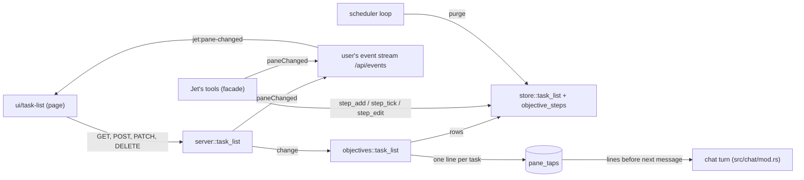
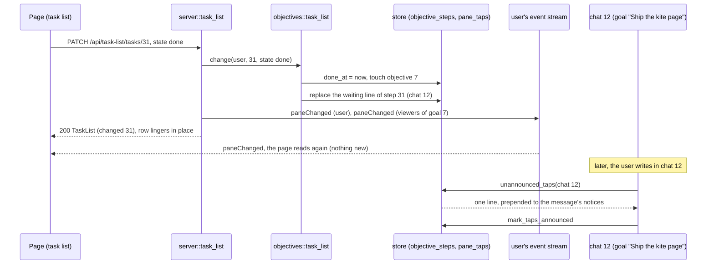

# Task list: design plan

The task list is the user's one page of everything their Jet chats track. It shows what is overdue, then today, tomorrow and later, with four counts that filter the list, each goal's progress beside it, and a done pile that keeps the history of what the user finished. It is a new place in the left pane, beside Files, and it reads like a paper list: one line per task and a box you colour in.

This plan is written for two builders. One builds the server, from parts 4 and 5. The other builds the page, from parts 1 to 3 and the page half of part 4. Each part names the repo files it touches. Every path is under `crates/jet/` unless it says otherwise.

This plan was revised once after a design and UX critique. The critic's findings, and what changed because of each one, are in section 10.

## 0. Decisions at a glance

| # | Decision | Why (source or repo rule) |
| --- | --- | --- |
| D1 | A task is a row of `objective_steps`, and a goal is a row of `objectives`. There is no second tasks table. The table is rebuilt so that a task can have no goal, and its ids are never reused. | With one table there is one truth. Jet's tools, the plan pane and the task list read and write the same rows, so a change shows everywhere without any syncing. Syncing bugs are what the charter fears. This serves priority 1, correctness of what Jet says, and priority 3, the least new code (`src/lib.rs:3`). `AUTOINCREMENT` stops a stale window from changing a new task that took a deleted task's id ([SQLite AUTOINCREMENT](https://www.sqlite.org/autoinc.html)). |
| D2 | The summary is two plain SQL views, `task_list` and `task_list_goals`. Nothing is materialized. | SQLite has no materialized views. A view is a named SELECT, run fresh on every read, so it is never stale ([SQLite CREATE VIEW](https://www.sqlite.org/lang_createview.html)). A materialized copy would need triggers to keep it in step, and that brings back the drift D1 removes. |
| D3 | A task's day is its date (`due_date`). Today, Tomorrow and Later are worked out from that date whenever the list is read. Nothing is written when a day passes. | Things moves a dated to-do into Today by itself when its date comes ([Things: start dates](https://culturedcode.com/things/support/articles/2803579/)). With no midnight job there is no idle wake-up to pay for (priority 4). |
| D4 | Each user's tasks have one order, kept in `position`, and every day list shows its tasks in that order. Only a move changes `position`. A change of status never does. | A paper list has one order. Integer positions with no gaps and no float keys keep it simple, and a personal list is short. |
| D5 | Status is two timestamps: `started_at` makes a task yellow and `done_at` makes it green; with neither set it is gray. A tap on the box moves it one step forward, gray to yellow to green. The open row's three words set any status directly. | This is how the person marks paper. The tri-state checkbox has `aria-checked="mixed"` ([APG checkbox](https://www.w3.org/WAI/ARIA/apg/patterns/checkbox/)). The existing code reads `done_at` and does not change. The words are how the person undoes a stray mark. |
| D6 | A done task leaves its day list for a folded done pile, which holds 90 days of history. The server deletes a done task 90 days after it was done, once it is under no goal or under a goal closed more than 90 days ago. A task that is not done is never purged. One task is cleaned up by its Delete. | Things' Logbook keeps finished items ([Things: Logbook](https://culturedcode.com/things/support/articles/4001304/)). Linear archives closed issues after a set time, but not while the parent is open ([Linear: archive](https://linear.app/docs/archive-issues)). A goal keeps counting the tasks done under it. |
| D7 | The list opens in the main area, as Files does, at `#tasks`. It does not draw inside the 260 px drawer. Its order is Overdue, Today, Tomorrow, Later, then Done, with the goals in a rail beside them, or in a band under the add bar on a narrow screen. | This follows the repo; see "Where the request and the repo differ" below. The order keeps the charter's: today, then tomorrow, then the overarching goals, which now sit in sight beside the days (§1.1). |
| D8 | Jet learns of a change made outside a chat through the existing pane taps. Each task has at most one waiting line, which states its latest state. The line is told before the user's next message in the chat of the task's goal, or in the main chat when the task has no goal. | That path already exists, is told exactly once, runs no model turn and never reaches another user (`src/store/pane.rs`, `src/chat/mod.rs:277-309`). Keeping one line per task means a reversed tap never leaves a false fact behind. |
| D9 | The plan pane's step box becomes the same three-state mark and makes the same call. The old tick route is deleted. In the pane's step and goal rows, amber then means "in progress" only. | One box should behave the same everywhere. One write path for each change means fewer of the bugs the charter fears. |

### Where the request and the repo differ (the repo wins, as the brief says)

- **The path.** The request names `crates/jet/web`, which does not exist. The page lives in `crates/jet/ui/`.
- **What "the left pane" is.** The request calls Files a "tab" of the left pane and asks for the layout "at the left pane's real width". In the repo, Files is one row in the drawer, `nav.files-nav`, which `workspace/shell.js:23-25` puts above the chats. A tap on it opens the library in the main area: `mode = 'files'`, the address `#files`, and the plan pane hidden (`workspace/shell.js:129-136`, `chat/library/library.css:62-76`). The task list follows the same pattern. Its row sits beside Files in the 260 px drawer, or the 64 px rail, and its page fills the main column. Inside 260 px, a task title would get about 150 px after the box and the goal name, which is roughly 18 characters, and the chat list would have to leave the drawer.
- **The word "tasks".** The page already uses it for Jet's own agent-tasks: the `agent_tasks` table, `TaskId`, `/api/tasks/{id}/snooze` and the heading "Jet's tasks" (`src/store/migrations/0005_objectives.sql:60`, `ui/plan/view.js:192`). In this plan, a **task** is the user's task, which is a row of `objective_steps`, and code calls it a step. New names avoid the clash: `ListTask`, `ListState`, and the routes under `/api/task-list`.

---

## 1. Layout and visual design

This part describes the page as it is built now. It was rebuilt from the agenda design in `docs/design/task-list/` (the design note and its twelve mockup screens) so that what is overdue, due, in progress and done is plain at a glance, and each goal shows its progress. The server did not change for it.

### 1.1 Where it sits, at real widths

The page is `section.tasklist#tasks-content` in the main column at `#tasks`, beside Files (D7). `.tasklist` is the scroller and a size container; the page itself never scrolls. Two widths of that container decide the layout:

| Container width | Layout |
| --- | --- |
| 920 px or wider (a 1280 px window with the drawer gives 1020 px) | A column of at most 640 px and a goals rail of 280 px, 32 px apart, centred. The rail is sticky under the 52 px head band and scrolls on its own. |
| 480 to 919 px | One column. The goals are a band of meters under the add bar. |
| under 480 px | The same, with tighter counts, an add bar of one line at rest (its Day and Goal line shows while the bar has the focus or text), and a Later chip that says only "in 4 days". |

The goals are one element. A `ResizeObserver` on `.tasklist` moves it with `insertBefore` when the width crosses 920 px, so the Tab order follows what is seen: after the add bar as the band, or after the Done fold in the rail.

### 1.2 The drawer row

The Task list row beside Files shows two counts apart: the alert icon and the overdue number in `--danger`, then "· 3" for the tasks due today, named "Task list, 5 overdue, 3 due today". With nothing overdue it shows "3", named "Task list, 3 due today". At 0 and 0 it is hidden. The view's `onCount` listener gets `{ overdue, dueToday }`.

### 1.3 The page

In order, in the column:

1. The head band "Task list", the alert, and the quiet refresh notice.
2. The **summary**: four counts, Overdue, Due today, In progress and Done today, that filter the list (§3.1).
3. The **add bar**: the field, the Day and Goal selects, and Add, the page's one filled button.
4. The **goals band**, under 920 px.
5. The **filter line**, only while a filter is on: "Showing 3 in progress. Show all", or "No tasks in progress. Show all".
6. **Overdue**, only when it has tasks: at most three rows, then "Show 2 more overdue", and "Move all to Today" in its heading.
7. **Today** with its date, then **Done today · n**: today's done tasks, newest first, at most five, then "Show n more".
8. **Tomorrow**, then **Later**, then the **Done** fold, which opens the 90-day pile grouped by day, with "Show older".

Each heading counts what it shows: "3 open" with no filter, "2 shown" under one. An empty day says "Nothing due tomorrow.", and Today says "Nothing else due today." while Overdue has tasks. Under a filter, a part with nothing to show is left out.

A **row** has three columns: the box (§2), the main part, and the chip.

- The **title** takes up to two lines, then an ellipsis; the whole title is in `title`.
- The **meta line** under it says "In progress since 09:30" (or "since yesterday", "since Tue", "since 16 Nov · 10 days") in `--warning` at weight 600, worked out from `startedAt`, then the goal's name in `--muted`. The status words are never cut; the goal's name is.
- The **chip** opens the move menu. In Overdue it says "3 days late" in `--danger` on `--danger-soft` with the alert icon; in Today and Tomorrow a quiet dashed "Move"; in Later the date, with "· in 4 days" within six days, or "No date". Its name always gives the date in full, such as "Was due Mon 23 Nov. Move".
- A done row shows its time in place of the chip, and a row that lingers after its box turned green says "Done 10:02" in `--ok`.

A **goal** is a card in the rail or a meter in the band.

- The **card**: the title, a toggle that filters the list to the goal (§3.6); "⋯"; a bar of done (`--ok`) and in progress (`--warning`) with a 2 px gap, `role="img"` named "3 of 7 done, 2 in progress"; "3 of 7 done · 2 in progress · 1 late"; the due line "Due Mon 30 Nov · 4 days left", "Due Tue 24 Nov · 2 days overdue" in `--danger` with the alert icon, or "Paused · due Fri 18 Dec"; and "Next · 3 days late" over the title of the goal's first open task in agenda order.
- The **meter**: one line of the title, cut with an ellipsis, then "3/7 · 4 days left"; "⋯"; and a 4 px bar under it. The band shows three goals, then "Show n more goals".
- With no goals the band is hidden, and the rail says "Jet makes a goal when you agree one in a chat."

### 1.4 Spacing, type and colour

The page's stylesheet, `ui/task-list/task-list.css`, reads colours only through tokens, so it follows Jet's theme with no change on the day Jet gets a light one. Jet ships dark only; `ui/chat.css` holds the dark values of the tokens the page added: `--hover`, `--danger-soft`, `--track`, `--shadow` and `--r-pill`.

The page's own scale sits on `.tasklist`: spacing `--tl-space-1` to `--tl-space-7` (4, 8, 12, 16, 24, 32 and 48 px); three type sizes, 13 px for meta, chips and controls, Jet's `--text-size` (15 px, 16 px on a phone) for titles, headings, fields and selects, and 18 px for the counts; weights 400, 600 and 700; 44 px for the least row and every coarse target; and 120 ms and 150 ms with one easing.

Colour never carries meaning alone: the box has its dash and tick, every danger mark has the alert icon and words, and the bar's split is in the counts line. A pressed count, a pressed goal, a pressed segment and Add share one "on" look, `--fill` with `--on-fill`, and a focus ring inside it takes `--on-fill`.

### 1.5 Words of a row

The words are worked out on the page from the read, by pure functions of `ui/task-list/model.js`: `chipWords`, `sinceWords`, `goalStats`, `summaryCounts`, `agendaGroups` and `matches`. A late task is the server's `late` flag; due today is an open task in Today that is not late; done today is a done task whose `doneAt` falls on today in the user's zone.

### 1.6 Motion

Only the move menu (120 ms of opacity and a 4 px slide), a dropped row settling (120 ms), and a done row folding away after its linger (150 ms of height) move. A filter, "Show more", Move all and the counts redraw in place, and no number animates. With reduced motion, from the system or Jet's `.reduced` class, none of these move.

---

## 2. Status colour: gray, yellow, green

| State | Stored | Box | `aria-checked` | Tooltip (`title`) |
| --- | --- | --- | --- | --- |
| Not started (gray) | `started_at` and `done_at` both NULL | `border-color: var(--muted)`, empty | `false` | "Not started. Tap to start." |
| In progress (yellow) | `started_at` set, `done_at` NULL | `background` and `border-color` `var(--warning)`, with a dash icon (new path `dash: 'M7 12h10'` in `ui/plan/icons.js`) | `mixed` | "In progress. Tap when done." |
| Done (green) | `done_at` set | `background` and `border-color` `var(--ok)`, the existing `check` icon. The title is `--muted` with `line-through` | `true` | "Done. Tap to put back." |

The dash and the check carry the state without relying on colour, so the box meets WCAG 1.4.1. They are also what a native mixed checkbox and a checked one draw.

The box's accessible name states the state: `aria-label="Draft the spec, in progress"`. A screen reader would otherwise say "half checked", which the APG means for a partly checked group.

**How a status changes.**

- **A tap on the box moves the task one step forward:** gray to yellow, then yellow to green. This is how the person marks paper: colour it yellow when you start, green when you finish. Two taps to reach done is deliberate. A stray first tap never sends a task to the pile, and costs a quick task one extra tap.
- **The three words in the open row set any status directly** (§3.3): "Not started", "In progress", "Done". This is how a stray yellow is undone, the way you rub out a mark on paper. Jet is told only the latest state (§5), so a corrected mark never reaches Jet as a false fact.
- **Putting a task back** (a tap on a green box) returns it to the state it had before it was done: yellow if it had been started, gray if not. One function, `putBackState(task)` in `ui/task-list/model.js`, decides this, and the plan pane imports it. The task keeps its place in the order (D4).
- **On hover with a fine pointer**, a gray box shows its border in `--warning` and a yellow box shows it in `--ok`. The box shows what a click will do, so nobody has to be taught the cycle.
- **A goal's progress comes from its tasks**: the read's `tasks` and `done`, and the in-progress and late counts the page works out (§1.3). A goal stays in the list until it is closed, by Mark done in its details (§3.6) or by Jet's `close`.
- **Jet changes status too.** `step_tick` marks a task done or not done, and its new `started` field marks it in progress (§4.9). The list draws whatever the rows say.

---

## 3. Interactions

### 3.1 Every interaction

| What | Mouse or touch | Keyboard |
| --- | --- | --- |
| Filter the list | A tap on a count; again, or "Show all", to clear | The summary is one Tab stop (`role="toolbar"`); ← / → between counts, Enter or Space to toggle, Esc to clear |
| Add a task | Type, choose Day and Goal, Add | N in the list puts the focus in the field; Enter adds and keeps the focus |
| Change status | A tap on the box steps it forward | Space on the box; 1, 2, 3 on a row set Not started, In progress, Done |
| Move a task | The chip, then a day; the open row's Day; a drag | Enter, Space or ↓ on the chip opens the menu; Alt+↑ / Alt+↓ move one place |
| Move all late tasks | "Move all to Today", twice within 4 s | The same |
| Open a row | A tap on the title or the row | Enter on the title |
| Delete | Delete in the open row, twice | Delete on a row opens it with Delete armed |
| A goal | A tap on its title filters; "⋯" opens its details | ↑ / ↓ between goals, ← / → to "⋯", Enter |

The filter is the page's own state and is never sent. One filter is on at a time, a goal filter included. A goal filter sets the add bar's Goal, and "Show all" puts it back to "No goal". An add that the filter would hide clears it, and the page says "Showing all tasks".

Every change shows at once and goes to the server in the order made (§4.12). An add waits for its answer. A failed add keeps its words, day and goal, and says why under the bar ("… Press Add to try again."), tied to the field by `aria-describedby`; any other failed change is taken back and named in the alert until a later change works.

### 3.2 Keyboard map

Tab moves through the summary (one stop), the add field, Day, Goal and Add, the goals band when narrow, then each list as one stop with a roving `tabindex` (Overdue, Today, Done today, Tomorrow, Later), the Done fold and the pile, then the goals rail when wide. Inside a list, ↑ / ↓, Home and End move to the same control of another row, and ← / → move between the box, the title and the chip. N and 1 / 2 / 3 work only while the focus is in the list and outside a field.

On a desktop the focus starts on the first task, or on the add field when the list is empty. A phone keeps it on the head band's title, so its keyboard does not cover the list.

### 3.3 The open row

A tap on the title opens the row; one row or goal is open at a time. The title becomes a growing textarea of one line: Enter saves, and a line break typed or pasted becomes a space. Under it:

1. **Status**: Not started, In progress, Done, which sets any status in one tap.
2. **Day**: Today, Tomorrow, Later, which moves the task in one tap.
3. **Goal**: the native select.
4. **Up**, **Down**, **Open chat**, then **Delete**, which takes two taps.

Esc restores the title and closes the row; a click or a focus outside it saves and closes it. A done row offers Delete only. For a late task, Day has nothing pressed and says "Was due Mon 23 Nov. Today gives it today's date.", and Up and Down are off with "An overdue task keeps its place. Use Day or its chip to move it."

### 3.4 Done, and the done pile

A done task stays green in its place for 4 s after the last tap on any box, then folds away into Done today. A tap in that time puts it back where it was. The pile under the Done fold keeps 90 days (D6), grouped Today, Yesterday, then by date.

### 3.5 Moving

**The move menu** is a popover under the chip, not a dialog: Today, Tomorrow and Later as `menuitemradio`, with the current day ticked, or for a late task none ticked and "Was due Wed 25 Nov" at its foot. ↑ / ↓ move, Enter chooses, Esc closes it onto the chip, and Tab closes it and moves on from the chip. After a choice the focus stays on the moved task's chip.

**One-place moves** (Alt+↑ / Alt+↓ and the open row's Up and Down) follow the server's rule that any move re-dates a task (§4.5):

- A late task is never moved one place, so it keeps its date. Alt and an arrow on it say "Move it with its chip."
- In Today a move counts only the rows shown, which leave the late tasks out, so the `after` it sends is always a task in view.
- While a filter is on, one-place moves and dragging are off ("Show all to reorder."), because hidden tasks sit between the shown ones.

**Move all to Today** arms as "Move 5 to Today?" and a second tap within 4 s sends one `PATCH {day: 'today'}` for each late task shown, in order, with no `after`. The server gives each one today's date and keeps its place, because its day does not change, so they land in Today in the order they had. If some fail, the alert says "Some tasks could not be moved. … Try again." and the list is read again.

**Dragging** is by mouse, or on touch by a hold of 350 ms. A copy of the row follows the pointer, its place stays faint, and a line shows where it lands. A drop lands in a day; an empty day's "Nothing due …" line takes a drop at that day's end. Overdue is never a place to drop: a drag that starts there lands only in a day, which re-dates the task. A drop over Overdue, the goals or the Done fold puts the row back, and Esc cancels.

### 3.6 Goals

A tap on a goal's title toggles the goal filter and fills the goal. "⋯" (`aria-expanded`) opens its details in place: under "Next" in the rail card, which the rail scrolls into view, or as a panel under the meter's bar in the band. They hold the deliverable (cut at three lines, whole in `title`), the title field (Enter saves, Esc restores and closes), Open chat and Mark done. Mark done arms for 4 s as "Done? Its 4 open tasks leave the list." and closes the goal on the second tap; its open tasks leave the list. A keyboard or a fine pointer puts the focus in the title field; a coarse pointer leaves it on "⋯". Closing puts the focus back on "⋯"; after Mark done it goes to the next goal, or to the add field. Goals are made only by Jet in a chat.

### 3.7 Empty, loading and error states

| State | What shows |
| --- | --- |
| Loading | `aria-busy`, four count skeletons, the add bar disabled with "Loading the list…", two goal skeletons, a heading bar with no text and four skeleton rows |
| First read failed | One block: "The task list could not be loaded." and Try again |
| Refresh failed | The last list stays, with "The task list could not be refreshed. Try again" |
| Empty list | The add bar, "Nothing on your list yet.", Jet's example sentence, and the goals invitation in the rail; no counts and no band |
| Filter with no match | "No tasks in progress. Show all" |
| Empty pile | The fold says "Done" with no count; opened, "Tasks you finish land here." |

---

## 4. Data contract

### 4.1 Module table

| Box | One job | State it owns | New / changed / same |
| --- | --- | --- | --- |
| `store::task_list` (`src/store/task_list.rs`) | Read the two views and write task rows, keeping each user's one order | the rows of `objective_steps` | new. `src/store/steps.rs` changes (§4.8) |
| `objectives::task_list` (`src/objectives/task_list.rs`) | The rules: today in the user's zone, the day rule, ownership, the version rule, and the one line per task that Jet is told | none | new |
| `server::task_list` (`src/server/task_list.rs`) | The HTTP routes: read and change the list, then tell the user's pages | none | new |
| `pane_taps` (`src/store/pane.rs`, `src/chat/mod.rs:277-309`) | Tell Jet each line once, before the user's next message in its chat | `pane_taps` rows, which gain `step_id` and `step_added` | changed: one column pair and one replace rule |
| `scheduler` (`src/scheduler/mod.rs`) | Delete old done tasks on each pass of its loop | none | changed: one call beside `expire_items` |
| page `ui/task-list/` | Draw the list and turn gestures into calls | the open row and its draft, the armed delete, the lingering done rows, the drag | new |
| `workspace/shell.js` | Show one place at a time: a chat, an app, tools, files or the task list | `mode` | changed (§4.8) |

### 4.2 Diagram



Work waits or crosses a boundary in four places:

1. Every page-to-server call crosses the network. The server does its store work on a worker (`on_worker`, `src/server/pane.rs:34`).
2. The event stream crosses the network back to the page.
3. A line waits in `pane_taps` until the user's next message in that chat.
4. The scheduler loop runs on its own thread.

### 4.3 Pattern, extension point, fit, unknowns

- **Pattern: one table, many writers, one change signal, and readers that read again.**
  - The page, Jet's tools and the scheduler all write rows.
  - Every writer calls `Chats::pane_changed(user)` (`src/chat/chats.rs:219-224`).
  - Every reader (the task list, the plan pane and the files) reads again on `jet:pane-changed`.
  - The plan pane already works this way (`ui/plan/pane.js:266-267`), so this is no new pattern.
- **Extension point: more kinds of change Jet is told of.** Each kind is one arm of `TaskChange` in `objectives/task_list.rs`, with its `line()` (§5.3). Nothing else grows. There is no trait, because there is one adapter.
- **Fit:** §4.8.
- **Unknowns:** §4.10.

### 4.4 Migration `src/store/migrations/0014_task_list.sql`

Add this file at the end of `MIGRATIONS` in `src/store/mod.rs:75-90`, as `include_str!("migrations/0014_task_list.sql")`.

**Why the rebuild is safe inside the runner's transaction.** The runner applies each migration inside one transaction with `foreign_keys = ON` (`src/store/mod.rs:157, 219-226`), and a migration cannot turn foreign keys off inside a transaction. Nothing references `objective_steps`: `grep -rn "REFERENCES objective_steps" crates/` finds nothing. So the rebuild is safe as it stands.

**The order of the rebuild.** The steps follow SQLite's own order: create the new table under a new name, copy, drop, rename, then make the indexes and views again ([SQLite ALTER TABLE](https://www.sqlite.org/lang_altertable.html)). `ALTER COLUMN … DROP NOT NULL` exists only from SQLite 3.53, so the migration does not rely on it.

```sql
-- The task list: each step is one task of the user's, under a goal (an objective) or under none,
-- in one order for all of the user's tasks, with the day it is for and when it was started and
-- done. A task under no goal is the user's alone and is never shared. Ids are never reused, so a
-- stale page that names a deleted task is refused, never applied to a newer one.

CREATE TABLE new_objective_steps (
    id INTEGER PRIMARY KEY AUTOINCREMENT,
    user_id INTEGER NOT NULL REFERENCES users (id) ON DELETE CASCADE,
    -- NULL for a task under no goal.
    objective_id INTEGER REFERENCES objectives (id) ON DELETE CASCADE,
    -- The user's one order of all their tasks, from 1. A goal's steps are in this order too.
    position INTEGER NOT NULL,
    title TEXT NOT NULL CHECK (length(title) BETWEEN 1 AND 300),
    -- The day the task is for, YYYY-MM-DD in the user's zone; NULL for later, with no day.
    due_date TEXT,
    started_at INTEGER,
    done_at INTEGER
) STRICT;

-- Existing steps keep their ids and each goal's order; goals follow one another by id.
INSERT INTO new_objective_steps (id, user_id, objective_id, position, title, due_date, started_at, done_at)
SELECT s.id, o.user_id, s.objective_id,
       row_number() OVER (PARTITION BY o.user_id ORDER BY s.objective_id, s.position, s.id),
       s.title, s.due_date, NULL, s.done_at
FROM objective_steps s JOIN objectives o ON o.id = s.objective_id;

DROP TABLE objective_steps;
ALTER TABLE new_objective_steps RENAME TO objective_steps;
CREATE INDEX steps_by_objective ON objective_steps (objective_id);
CREATE INDEX steps_by_user ON objective_steps (user_id, position);
CREATE INDEX steps_done ON objective_steps (done_at) WHERE done_at IS NOT NULL;

-- A line about one task, so that a newer change of that task replaces its waiting line, and an
-- add the user undoes before Jet hears of it is never told. `step_added` marks a line about a
-- task that Jet has not heard of yet.
ALTER TABLE pane_taps ADD COLUMN step_id INTEGER;
ALTER TABLE pane_taps ADD COLUMN step_added INTEGER NOT NULL DEFAULT 0;
CREATE INDEX pane_taps_by_step ON pane_taps (step_id) WHERE announced = 0 AND step_id IS NOT NULL;

-- The task list as the page reads it: each task with its goal, its state in one word, and the chat
-- a change of it is told in (its goal's, or the main chat). A task of a goal that is done or
-- dropped shows only once it is done, in the done pile.
CREATE VIEW task_list AS
SELECT
    s.id,
    s.user_id,
    s.objective_id AS goal_id,
    o.title AS goal_title,
    coalesce(o.chat_id, m.id) AS chat_id,
    s.title,
    s.due_date AS date,
    s.position,
    s.started_at,
    s.done_at,
    CASE
        WHEN s.done_at IS NOT NULL THEN 'done'
        WHEN s.started_at IS NOT NULL THEN 'in_progress'
        ELSE 'not_started'
    END AS state
FROM objective_steps s
LEFT JOIN objectives o ON o.id = s.objective_id
JOIN chats m ON m.user_id = s.user_id AND m.kind = 'main'
WHERE s.objective_id IS NULL
   OR o.status IN ('active', 'paused')
   OR s.done_at IS NOT NULL;

-- The goals of the task list: the user's open objectives, with their tasks counted and their
-- colour in one word. Green once every task is done; yellow once any is started or done.
CREATE VIEW task_list_goals AS
SELECT
    o.id,
    o.user_id,
    o.chat_id,
    o.title,
    o.deliverable,
    o.due_date AS due,
    o.status,
    count(s.id) AS tasks,
    count(s.done_at) AS done,
    CASE
        WHEN count(s.id) > 0 AND count(s.done_at) = count(s.id) THEN 'done'
        WHEN count(s.started_at) > 0 OR count(s.done_at) > 0 THEN 'in_progress'
        ELSE 'not_started'
    END AS state
FROM objectives o
LEFT JOIN objective_steps s ON s.objective_id = o.id
WHERE o.status IN ('active', 'paused')
GROUP BY o.id;
```

**Explicit ids and `sqlite_sequence`.** The copy inserts explicit ids. An INSERT that raises the largest rowid updates `sqlite_sequence` ([SQLite AUTOINCREMENT](https://www.sqlite.org/autoinc.html)). U3 confirms it on real data.

**The main-chat invariant.** The `JOIN chats m … kind = 'main'` in `task_list` relies on every user having exactly one main chat. Migration 0004 made one for each existing user (`0004_personal_jet.sql:16-18`, the unique index `one_main_chat_per_user`). `Store::add_user` makes one with every new account (`src/store/directory.rs:123`). Delete refuses the main chat (`src/store/chats.rs:170-173`). A user without one is therefore a bug, and is not a state the view has to handle.

**The owner invariant.** For a task with a goal, `objective_steps.user_id` equals `objectives.user_id`. The store enforces this in one place:

- An insert takes `user_id` from the goal in the same statement: `INSERT … SELECT o.user_id … FROM objectives o WHERE o.id = ?goal AND o.user_id = ?user`.
- A change of goal checks `o.user_id = ?user` before it writes.
- When either check fails, the route answers `goalGone` (404).

### 4.5 How order and the day are stored

**The day** is `due_date`. The list is read with `today` and `tomorrow` worked out in the user's zone: `time::today(zone, now)` and the date after it (`src/objectives/time.rs:99-103`). The zone comes from `users.time_zone`, or UTC when it is unknown, as `Objectives::view` does (`src/objectives/mod.rs:616-624`). In SQL:

```sql
CASE WHEN date IS NULL THEN 'later' WHEN date <= :today THEN 'today' WHEN date = :tomorrow THEN 'tomorrow' ELSE 'later' END AS day,
(done_at IS NULL AND date < :today) AS late
```

**A task's date is the day planned for it. The deadline is the goal's** (`objectives.due_date`).

- Jet already uses step dates as the plan of days it agrees with the user. So a step Jet dated Friday shows in Later as "Fri 4 Dec", moves into Tomorrow on Thursday, and into Today on Friday.
- Todoist draws the same line: dates are "when you plan to begin working on them", and deadlines "represent the hard cutoff" ([Todoist: deadlines](https://www.todoist.com/help/articles/introduction-to-deadlines-in-todoist-uMqbSLM6U)). Here the hard cutoff is the goal's due date.

**The day rule** applies to every move. It is one function in `objectives::task_list`:

| Moved to | New `due_date` |
| --- | --- |
| Today | today's date. A carried task that is moved, even within Today, stops being carried |
| Tomorrow | tomorrow's date |
| Later | unchanged if the task is already in Later, NULL otherwise |

**When a day passes, nothing is written.**

- Tomorrow's tasks read as Today's.
- Today's unfinished tasks stay in Today and are shown as carried ("from 24 Nov").
- A dated task in Later reads as Tomorrow, and then as Today, when its date comes. It keeps its place in the one order, so it may land in the middle of Today.

Todoist also keeps overdue tasks in Today ([Todoist: plan your day](https://todoist.com:443/help/articles/how-to-plan-your-day-UVUXaiSs)). Here, though, carried tasks stay draggable like any other, where Todoist says "overdue tasks can't be manually sorted" ([Todoist: sorting](https://www.todoist.com/help/articles/default-sorting-order-in-todoist-mqmgerY7)).

**The order** is `position`: one sequence for each user over all of their rows, done ones included. Ties are broken by `id`, and every query orders `BY position, id`.

| Write | Position |
| --- | --- |
| A new task (from the page, or Jet's `step_add` and `create`) | `max(position) + 1` over the user's rows. Every new task comes last in its day |
| A move to another day with no `after` (the strip's buttons) | last in the user's order, so the task is last in its new day |
| `after: null` | just before the first open task of the target day, or `max + 1` when that day is empty |
| `after: <id>` | just after that task, if it is an open task in the target day once the day rule has run. Otherwise last in the target day. This is lenient on purpose: a stale `after` never fails |
| `after` with no `day` | the target day is the task's current day |
| A change of title, goal or **status** (put back included) | unchanged. A task put back returns to where it was |

Every placement, a move to the end included, reads the user's rows in order, takes the task out, puts it in at its new index, and writes `position = 1..n` for the rows whose number changed. A new task alone takes `max(position) + 1`. All of this is one transaction (`Store::try_with` plus `db.transaction()`). SQLite runs one writer at a time, so a concurrent `step_add` from Jet lands before or after the move, never in its middle.

**The version rule.** A check whose objective changes while it runs drops its result and runs again (`src/scheduler/check.rs:534-563`). So which writes raise `objectives.version` matters (priorities 1 and 4):

| Write | Raises the version of |
| --- | --- |
| A change of title, goal, date, status, or an add or delete of a task with a goal | that goal (`touch`, `src/store/objectives.rs`), as step writes do now. On a change of goal, the old goal too. A carried date rewritten within Today is a change of date, so it raises the version though it keeps no line |
| A change of `position` alone, including the renumbering of other rows | nothing |
| Any write to a task with no goal | nothing |

**State effects of `PATCH {state}`.** These are the effects for the page. Jet's `started`/`done` fields map onto the same effects (§4.9).

| Target `state` | `started_at` | `done_at` |
| --- | --- | --- |
| `not_started` | NULL | NULL |
| `in_progress` | `coalesce(started_at, now)` | NULL |
| `done` | unchanged | `coalesce(done_at, now)` |

Setting a task to the state it already has writes nothing and keeps no line.

### 4.6 How done history is kept and cleaned up

- **The pile** holds done tasks with `done_at > now − 90 days`, newest first. The constant `DONE_KEPT_DAYS = 90` lives in `objectives::task_list`. The read carries the newest 100 and the full `doneCount`. `GET /api/task-list/done?before=<doneAt>&beforeId=<id>` answers the next 100 (§4.11).
- **One item** is cleaned up with its Delete.
- **The purge.** The scheduler loop calls `purge_task_list(&store, &chats, now)` beside `expire_items` on each pass (`src/scheduler/mod.rs`), which calls `store.purge_task_list(now - DONE_KEPT_DAYS * 86400)`. That loop already runs at least once a minute, so no new timer is needed:

  ```sql
  DELETE FROM objective_steps
  WHERE done_at IS NOT NULL AND done_at < :cutoff
    AND (objective_id IS NULL OR objective_id IN (
         SELECT id FROM objectives WHERE status IN ('done', 'dropped') AND closed_at < :cutoff))
  RETURNING user_id, objective_id;
  ```

  - **What goes:** a done task under no goal, 90 days after it was done; and a done task of a goal closed more than 90 days ago, 90 days after it was done.
  - **What never goes:** a task that is not done, and a task of a goal that is still open, because it is part of that goal's record. Linear does not archive while "the parent issue is not closed" ([Linear: archive](https://linear.app/docs/archive-issues)).
  - **Hidden tasks:** the open tasks a closed goal took off the list (§3.6) stay as rows of the closed objective, which Jet still lists. They leave only with the objective.
  - **Who is told:** each distinct `user_id` returned gets `chats.pane_changed(user)`, and the viewers of each distinct `objective_id` get `viewers_pane_changed`. A purge that deletes rows is logged.
- **A purge failure never stops the scheduler.** `run()` would end the scheduler thread on an error. So `purge_task_list` returns nothing: it logs `jet: the task list could not be purged: …` and returns, and the loop goes on to its checks. The next pass of the loop tries again, at most a minute later. That makes the class RETRY, driven by the loop.

### 4.7 How objectives and objective_steps map onto goals and tasks

| Task-list word | Table and column | Notes |
| --- | --- | --- |
| goal | an `objectives` row with `status` in `active` or `paused` | `title` (1 to 200), `deliverable`, `due_date` (the deadline), `chat_id`, `status`. A closed goal (`done` or `dropped`) leaves the Goals section |
| goal colour | `task_list_goals.state` | from the goal's tasks (§2) |
| task | an `objective_steps` row | `title` (1 to 300), `due_date` (the day), `position` (the one order), `started_at`, `done_at` |
| task with no goal | `objective_id IS NULL` | its chat is the user's main chat |
| a task's chat | `task_list.chat_id` | the goal's chat, or else the main chat |
| state | `task_list.state` | `not_started`, `in_progress` or `done` |
| done pile | `task_list` rows with `done_at` within 90 days | newest first, 100 at a time |

**Decision: extend `objective_steps`. Do not add a tasks table.** Measured against `src/lib.rs:3`:

- **Correctness of what Jet says.** Jet's `objectives_list` reads the very rows the list draws.
- **Simplicity.** The existing step writers keep working: `step_add`, `step_tick` and `step_edit` (`src/store/steps.rs`), the pane's mark, and the colleague's read. Each one only gains the new columns.
- **What a new `tasks` table would cost.** It would copy every step, or move every step writer, and keep two orders in step. Its name would also clash with `agent_tasks`, `TaskId` and `/api/tasks/...` (§0).
- **What this choice costs.** One table rebuild.

### 4.8 Fit: existing code that changes shape

**Server.**

| File | Change |
| --- | --- |
| `src/store/steps.rs` | `Step` gains `started_at: Option<u64>`, serialised as `startedAt`. `steps()` filters `WHERE s.objective_id = ?1 AND s.user_id = ?2 ORDER BY s.position, s.id`. `insert_all` takes the user and numbers from `max(position) + 1` over that user's rows. `add_step`, `edit_step` and `tick_step` are deleted: Jet's step commands and the page write through the same `store::task_list` calls. New reads for Jet: `loose_steps`, `step`, `step_objective` |
| `src/store/objectives.rs:163` | Orders a goal's steps `BY position`. Add `, id` |
| `src/store/pane.rs` | `insert_tap` gains a sibling, `record_task_line(db, user, step, &Told, at)`, run inside the transaction of the task's write. `Told` is `Kept { chat, line, is_add, left }` or `Deleted { chat, line }`; `line` is given the task's id, which an add knows only once it is inserted. It reads and deletes the step's unannounced rows (in any chat), then inserts per §5.3 |
| `src/store/mod.rs` | the migration; `pub(crate) mod task_list;` |
| `src/objectives/mod.rs` | `mod task_list;` beside `mod pane;`. Re-export `TaskList` |
| `src/server/routes.rs` | Merge `task_list::router()`, as the pane's router is merged |
| `src/scheduler/mod.rs` | `purge_task_list(&store, &chats, now)` beside `expire_items(now)`, logged and returning nothing (§4.6) |
| `src/store/objectives.rs` | `rename_and_close` renames a goal, closes it as done, or both, in one transaction, with the goal lines of §5.3 |
| `src/server/pane.rs`, `src/objectives/pane.rs` | Delete the route `PUT /api/objectives/{id}/steps/{step}` and `Objectives::tap_step`. The pane's box calls `PATCH /api/task-list/tasks/{id}` (D9). Their tests in `tests/integration/pane.rs` move to `tests/integration/task_list.rs` |
| `src/tool_facade/objectives.rs`, `src/tool_facade/handler.rs` | §4.9 |

**Page.**

| File | Change |
| --- | --- |
| `ui/workspace/shell.js` | `showFiles` becomes `showPlace(name)` over a small map, `{ files: library, tasks: taskList }`. The place rows go into `nav.files-nav`. `popstate` handles `#tasks` as it handles `#files`. `paint()` hides every place that is not the mode, so no place is a special case. `showChat()` clears `#tasks` as well as `#files` from the address (`shell.js:125-128`), and so does the initial load check (`shell.js:149`) |
| `ui/chat/library/library.css:70-76` | The "while the library is open" rules move to `ui/workspace/workspace.css`, with the selector `.workspace-shell:is([data-mode="files"], [data-mode="tasks"])`. They belong to the shell, not to the library |
| `ui/plan/view.js` `stepRow` | Uses the task list's mark: `aria-checked` `false` / `mixed` / `true`, `data-state`, and the state in its name. A tap moves the state one step forward on the same cycle. `act.tick` becomes `act.mark(step, el)`, which calls `PATCH /api/task-list/tasks/{step.id}` with `{ state }` |
| `ui/plan/plan.css` | `.step[data-state="in_progress"] .step-box { background: var(--warning); border-color: var(--warning) }`. The `[data-tone="warn"]` colour rules for `.fact` and `.step-due` (`plan.css:64`) go |
| `ui/plan/model.js` | `daysLeftWords` and `stepDueWords` keep their words. Their `'warn'` tones become `'quiet'` (§1.4), and their tests in `model.test.mjs` follow |
| `ui/plan/icons.js` | Add `dash` |
| `ui/dom.js` | Add the `tasks` icon |
| `ui/index.html` | `<link rel="stylesheet" href="./task-list/task-list.css">` after `library.css` |
| `ui/chat/main.js` | `createTaskList({ openChat, announce, titleOf })` beside `createLibrary`, passed to `createWorkspace` |

**Tree after the work.** New files are marked +.

```
crates/jet/src/
  objectives/task_list.rs         + rules, the version rule, TaskChange and its lines
  server/task_list.rs             + routes
  store/task_list.rs              + reads of the views, writes, order, purge
  store/migrations/0014_task_list.sql  +
crates/jet/ui/task-list/
  model.js                        + pure: readTaskList, groups, words, nextState, putBackState, keyboardMove
  model.test.mjs                  +
  store.js                        + the page's copy of the list, the write queue, the day-change check
  view.js                         + draws the place over the local state (§4.12), the open row, focus
  drag.js                         + pointer and touch drag; answers { day, after } on drop, knows no server
  task-list.css                   +
crates/jet/tests/
  integration/task_list.rs        +
  browser/tasks.mjs               +
```

Each new file opens with a comment of one or two lines, as `AGENTS.md` asks.

### 4.9 Jet's tools: what changes so Jet sees the whole list

The changes are in `src/tool_facade/objectives.rs` and `src/tool_facade/handler.rs`, and they are kept small.

1. **`objectives_list`** answers `{"objectives": [...], "looseSteps": [Step, ...]}`. `looseSteps` holds the user's tasks with no goal: the open ones, and the done ones from the last 90 days. Every step carries `startedAt`. Add this sentence to `OBJECTIVES_LIST`: "`looseSteps` are tasks the user keeps under no objective. A step's `due` is the day it is planned for, `startedAt` means the user has started it, and steps are in the user's own order."
2. **`step_add`**: `id` becomes optional. Without it, the task has no goal. Add to `OBJECTIVES_UPDATE`: "Leave out `id` on `step_add` only for a task under no objective." The answer is the objective's view when there is an `id`, and `{"step": Step}` otherwise.
3. **`step_tick` and `step_edit`**: `id` becomes optional. Without it, the step is found by its id among all of the user's tasks. A step id that is not the user's is `NoSuchStep`, as now.
4. **`step_tick`** gains an optional `started: boolean`. Give one of `done` or `started`. With neither, `done` defaults to `true`, as now (`tool_facade/objectives.rs:262-267`). With both, the command is refused with `nothingToChange`.

   | Given | Effect (the same as §4.5) |
   | --- | --- |
   | `done: true` | the `done` effect |
   | `done: false` | `done_at = NULL` |
   | `started: true` | the `in_progress` effect |
   | `started: false` | the `not_started` effect |

5. **Viewers of the goal.** `handler.rs` told a goal's viewers only when `arguments.command.id` was given. With `id` optional, a colleague viewing the goal would miss the change. The handler takes the goal id from the command's answer, the objective view's `id`, and falls back to the command's `id`. A step of a goal is always answered with its objective view, so the `{"step": Step}` answer is only for a task under no goal, which has no viewers, and `Step` carries no `goalId`.

Jet's own writes are not told back to it. They reach the page through the `pane_changed` that `tool_facade/handler.rs:385-397` already sends.

### 4.10 Unknowns (spike before building on them)

| # | Question (yes / no) | Spike |
| --- | --- | --- |
| U1 | After a 350 ms long press on a `touch-action: pan-y; user-select: none; -webkit-touch-callout: none` row, does `preventDefault()` in a `{ passive: false }` `touchmove` listener stop the scroll, show no selection or callout, and does the click that follows the drop get swallowed? Test in iOS Safari and Android Chrome, inside `.workspace-content` (`overflow: hidden`), with the list as its own scroller | Build one test page. Load it in headless Chrome with touch emulation, in a 390 px iframe (see §6), then on one real iPhone. Fallback if not: `touch-action: none` on the row only while a press is held |
| U2 | Does the bundled SQLite (`libsqlite3-sys 0.40.0` in `Cargo.lock`) support `RETURNING` (3.35 and later) and window functions (3.25 and later)? | A store test that runs `SELECT sqlite_version()` and then the migration |
| U3 | Does 0014 run inside the runner's transaction with `foreign_keys = ON`, on a copy of a real data directory? After it, are every step id and every done mark as they were, and is `sqlite_sequence` at the largest id? | Run it on a copy of the data folder. Compare `SELECT id, done_at FROM objective_steps` before and after, then add one task and check that its id is above the old largest |

### 4.11 HTTP API

All routes sit behind the sign-in guard, as `/api/pane` does. All bodies are JSON. **Every answer has a JSON body, errors included.** `requestJson` reads `response.json()` and treats a body that is not JSON as a lost connection (`ui/bridge/browser-agent.js:10-22`), so:

- `DELETE` answers 200 with the list, not 204.
- Each body is read through a JSON extractor whose rejection becomes `{kind, message}` with status 400, never axum's plain-text 422.

#### The read: `TaskList`

`GET /api/task-list` → 200. Every task and goal write answers with the same shape.

```json
{
  "timeZone": "Europe/London",
  "today": "2026-11-25",
  "tomorrow": "2026-11-26",
  "mainChatId": 1,
  "doneKeptDays": 90,
  "doneCount": 134,
  "changed": null,
  "goals": [
    {
      "id": 7, "title": "Ship the kite page", "deliverable": "The kite page live at /kite",
      "chatId": 12, "due": "2026-11-28", "daysLeft": 3, "status": "active",
      "state": "in_progress", "tasks": 5, "done": 2
    }
  ],
  "tasks": [
    {
      "id": 31, "title": "Draft the spec", "goalId": 7, "goalTitle": "Ship the kite page", "chatId": 12,
      "date": "2026-11-25", "day": "today", "late": false, "state": "in_progress",
      "startedAt": 1764061200, "doneAt": null
    },
    {
      "id": 40, "title": "Call the bank", "goalId": null, "goalTitle": null, "chatId": 1,
      "date": "2026-11-25", "day": "today", "late": false, "state": "not_started",
      "startedAt": null, "doneAt": null
    }
  ],
  "done": [
    {
      "id": 29, "title": "Sketch the layout", "goalId": 7, "goalTitle": "Ship the kite page", "chatId": 12,
      "date": "2026-11-24", "day": null, "late": null, "state": "done",
      "startedAt": 1763974800, "doneAt": 1764068700
    }
  ]
}
```

| Field | Type | Meaning |
| --- | --- | --- |
| `timeZone` | string or null | the user's zone. Null means the days are in UTC |
| `today`, `tomorrow` | `YYYY-MM-DD` | the days the buckets were worked out with. The page reads again when its clock passes `today` (§4.12) |
| `mainChatId` | number | the main chat |
| `doneKeptDays` | number | 90 |
| `doneCount` | number | all done tasks within the 90 days. `done[]` holds at most the newest 100 of them |
| `changed` | number or null | in a write's answer, the id of the task the write touched, for focus and announcements. Null in a read, a delete's answer and a goal write's answer |
| `goals[]` | `ListGoal` | open goals, by `due` then `id`. `daysLeft` is worked out as `ObjectiveView::days_left` does (`src/objectives/mod.rs:631`), and is **negative once the goal is overdue**, which is the input `daysLeftWords` expects. `status` is `active` or `paused`. `state` is the colour. `tasks` and `done` are counts |
| `tasks[]` | `ListTask` | open tasks (`doneAt` null) in the user's one order. The page groups them by `day`, keeping that order |
| `done[]` | `ListTask` | the pile's newest 100, newest `doneAt` first, ties by `id` descending |
| `ListTask.date` | `YYYY-MM-DD` or null | the stored day |
| `ListTask.day` | `"today"`, `"tomorrow"`, `"later"`, or null | the bucket; null for a done task |
| `ListTask.late` | boolean or null | true for an open task dated before `today`, shown as carried. Null for a done task |
| `ListTask.state` | `"not_started"`, `"in_progress"` or `"done"` | |
| times | Unix seconds | like every other time the server sends |

#### The writes, and the pile's older pages

| Method and path | Body | Does | Jet is told (§5.3) |
| --- | --- | --- | --- |
| `POST /api/task-list/tasks` | `{"title": string, "day": "today"\|"tomorrow"\|"later", "goalId"?: number\|null}` | adds a task, last in its day. `"later"` stores no date | the task's line, as added |
| `PATCH /api/task-list/tasks/{id}` | any of `{"title"?: string, "goalId"?: number\|null, "state"?: state, "day"?: day, "after"?: number\|null}`, at least one | changes one task: title, goal, state (§4.5), day and place (§4.5) | the task's line, replacing any line still waiting. A write that changes only the place, or rewrites a carried date within Today, keeps no line |
| `DELETE /api/task-list/tasks/{id}` | none | deletes the task | the delete line, or none if Jet never heard of the task |
| `PATCH /api/task-list/goals/{id}` | any of `{"title"?: string, "state"?: "done"}`, at least one | renames the goal (`Objectives::edit`) or closes it as done (`Objectives::close`) | Goal renamed / Goal done |
| `GET /api/task-list/done?before=<doneAt>&beforeId=<id>` | none | → 200 `{"done": [ListTask, …], "more": boolean}`: the next 100 done tasks within the 90 days, older than that pair | nothing |

In the `PATCH` bodies, a field that is absent and a field that is `null` mean different things:

- `"goalId": null` means "no goal".
- `"after": null` means "first in the day".
- An absent field means "leave it as it is".

Read these as `Option<Option<i64>>` with `#[serde(default, deserialize_with = …)]`, or with a small `Field<T>` enum.

After a successful write, the server calls `chats.pane_changed(user)`. When the task has a goal, it also calls `chats.viewers_pane_changed(goal)` for the old goal and the new one (`src/chat/chats.rs:242-253`). Then it answers with the list.

#### Errors

| Status | `kind` | When | `message`, which the page shows |
| --- | --- | --- | --- |
| 400 | `badBody` | the body, the query or the id in the path is not of the right shape | "The page sent a change Jet cannot read" |
| 400 | `badTitle` | the trimmed title is empty, or longer than 300 characters for a task or 200 for a goal | "A title needs 1 to 300 characters" (200 for a goal) |
| 400 | `badDay` | `day` is not `today`, `tomorrow` or `later` | "That is not a day of the list" |
| 400 | `badState` | `state` is not one of the three, or a goal's `state` is not `done` | "That is not a state of a task" |
| 400 | `nothingToChange` | a `PATCH` with no field | "Nothing to change" |
| 404 | `taskGone` | this user has no task with this id. Another user's task gets the same answer | "That task is no longer in your list" |
| 404 | `goalGone` | the goal in the path or in `goalId` is not one of this user's | "That goal is no longer in your list" |
| 409 | `goalClosed` | the goal is done or dropped: a task moved to it or added to it, a change of a task under it (only a delete is allowed), a rename, or closing it again | "That goal is closed" |
| 500 | `store` | the database failed after `Objectives::write`'s three tries (`src/objectives/mod.rs:648-662`) | "The database failed" |

Every refusal is checked before the first write and changes nothing.

### 4.12 How the page learns of changes, and what it keeps through a re-read

| Source of the change | How the page hears of it |
| --- | --- |
| A write from this page | the answer, which is the whole list |
| A write from another window, the plan pane, Jet's tools, a finished check, a deleted chat, or the purge | `{kind:"paneChanged"}` on `/api/events` (`src/chat/chats.rs:219-224`), which `ui/chat/main.js:223` turns into `jet:pane-changed`. The task list's store reads again, as the plan pane (`pane.js:267`) and the files (`library/store.js:122`) already do |
| The event stream starting again | `agent.watch` calls `paneChanged()` (`main.js:490-499`), so the store reads again |
| The day passing | every 60 s, and on `visibilitychange` to visible, the store compares `isoDay(now, timeZone)` (`ui/plan/model.js:96-99`) with the read's `today`, and reads again when they differ |

**The store** (`ui/task-list/store.js`):

- Writes go out one at a time, in the order they were made, through a small queue.
- Every request, read or write, takes a ticket. An answer is drawn only if it is newer than the one already drawn, as the plan pane's `refreshNumber` does (`pane.js:141-153`).
- A read asked for while writes are queued waits until the queue is empty, then runs once.
- The drawer's count is the number of `tasks` whose `day` is `"today"`.
- The store loads when the page starts, as `files.start()` does, so the count is right before the list is first opened.

**The view lays its own local state over every list it draws.** A write's answer or a re-read never takes away what the person is doing:

1. **Lingering done rows.** The view keeps each lingering row's last record and its index in its day, and draws it there, green, until the linger ends (§3.4). It does this even though the answer has moved the task to `done[]`.
2. **The open row.** While a row is open, a new list is kept but not drawn over it. The chat list does the same while a title is being renamed: "A list that is rebuilt under a field being typed in would take the cursor away" (`chats-view.js:113-115`). The rest of the page is drawn when the row closes. One exception: if the new list no longer holds the open row's task, the row closes and the alert says "That task is no longer in your list."
3. **The add fields.** These are made once and kept across draws, with their text and their focus.
4. **A drag.** A list that arrives during a drag is kept and drawn after the drop or the cancel.
5. **Instant changes.** A drag, a mark, a delete or a rename changes the page's copy at once. An add waits for its answer (§3.7).

---

## 5. How Jet learns of a change made outside a chat

### 5.1 Decision: reuse pane taps, one line per task

**Yes, reuse them.** Each change made in the task list, or with the plan pane's box, keeps its task's line in `pane_taps` (`src/store/migrations/0009_pane_taps.sql`, plus the two columns of 0014) through `record_task_line` (§4.8).

- **Where the line goes:** the chat of the task's goal, or the main chat for a task with no goal (`task_list.chat_id`).
- **When it is told:** before the user's next message in that chat, exactly once, through `unannounced_taps` and `mark_taps_announced` (`src/chat/mod.rs:277-309`, `src/store/shares.rs:355-421`).
- **How many lines:** each task has **at most one** waiting line, which always states the task as it is now. A newer change replaces the older line. An add that is deleted before Jet heard of it leaves nothing. So Jet never hears a reversed tap, and a day of marking costs one line per task touched, not one per tap.

Why reuse it, against `src/lib.rs:3-6`:

- **It is the existing path for "a change the user made outside a chat".** Ticks, snoozes, cancels, note flips, share taps and send taps already use it. It is told once, in the chat the change concerns.
- **It costs no model turn and no idle wake-up** (priority 4).
- **It cannot make Jet nudge.** A line is told only when the user writes (Never 1).
- **It reaches nobody else** (Never 3).
- **The alternatives are worse.**
  - A turn for each change spends a model call on every tick, and could nudge without fresh evidence.
  - The whole list in every prompt grows each turn and is stale between turns.
  - Telling every chat is noise, because a goal's change concerns its own chat.
  - A new table would copy `pane_taps`.

**Jet knows even without the line.** A check that runs before the user writes reads the steps from the database when it starts (`src/scheduler/brief.rs:85-87`). Jet in any chat sees the current list through `objectives_list`. The line exists so that Jet *hears* what changed. Jet's data is already right, because there is one table.

**Two limits are accepted.**

- A line waits for ever in a goal chat the person never writes in again. That chat's Jet still reads the truth through its tools.
- A change Jet makes in one chat to a goal that lives in another chat is not told in that other chat. This is what happens today. It is accepted, because every chat's Jet reads the one table.
- Jet's own change does not touch a line of the user's that still waits. If the user marks a task done and Jet then marks it not done before the user writes, Jet is still told the user's line. Its `objectives_list` shows the task as it is.

### 5.2 Flow



### 5.3 The exact lines

`record_task_line` works in one transaction. First it deletes every unannounced row of the step, in any chat, and remembers whether any of those rows had `step_added = 1`. Then it inserts:

| Change | What is inserted |
| --- | --- |
| The task still exists (an add, or any change but a pure reorder) | One row in the task's chat (`task_list.chat_id`), with the **task line**. `step_added = 1` when this write is an add, or when a deleted row had it. The verb is "added" in that case and "changed" otherwise |
| The task's goal changed, and the old chat had heard of the task (no deleted row had `step_added`) | Also a **left line** in the old goal's chat, `step_added = 0` |
| The task was deleted | If a deleted row had `step_added`, nothing: Jet never heard of the task. Otherwise the **delete line** in the task's chat |

Titles are the user's own words, inside quotes. Dates are written with `time::in_words` (`src/objectives/time.rs:80-82`), for example "Thu 26 Nov 2026". A line may be told days later, so it never says "today" or "tomorrow". `(step 31)` lets Jet act on the task with `step_tick` and `step_edit` without listing first. `{of}` is ` of the goal "{goal}"` when the task has a goal, and nothing when it has none.

| Line | Text |
| --- | --- |
| Task line | `[The user {added / changed} the task "{title}" (step {id}){of} in their task list: {not started / in progress / done}, for {date in words / later, with no day}.]` |
| Left line | `[The user moved the task "{title}" (step {id}) from {the goal "A" / no goal} to {the goal "B" / no goal}.]` It has no `step_id`, so a later change of the task never takes it out of the old chat |
| Delete line | `[The user deleted the task "{title}" (step {id}){of}.]` |
| Goal renamed | `[The user renamed the goal "{old}" to "{new}".]` |
| Goal done | `[The user marked the goal "{title}" done. Its waiting checks are cancelled.]`, with ` {n} of its tasks were still open and left the list.` before the closing bracket when n is above 0 |

For example: `[The user changed the task "Draft the spec" (step 31) of the goal "Ship the kite page" in their task list: done, for Wed 25 Nov 2026.]`

The goal lines have no `step_id` and are never merged.

The old pane line, "[The user tapped step … in the pane …]" (`src/objectives/pane.rs:207-209`), goes away together with `tap_step`. The task line serves both the pane's box and the list (D9). "In their task list" covers both, because they are one list of the same rows.

**What is not told:**

- a reorder within a day, including a carried date rewritten within Today. This is the user's own priority, and Jet sees it in `position`;
- Jet's own changes;
- the purge;
- loading older pages of the pile.

---

## 6. LLM design slop this design avoids

Each rule is from the anti-UI-slop skill (`SKILL.md`, `reference/anti-slop-craft.md`, `reference/distill.md`, `reference/operate.md`) or from a named source.

1. **Cards and tiles for rows and goals: avoided.** Rows sit on a 40 px rhythm, with no rule between them and one rule under each heading. Operate says: "Use spacing and alignment for grouping before adding borders, cards, or backgrounds."
2. **Counts on every heading, and repeated copy: avoided.** The only counts are the Done fold and the drawer row. A task's goal is one muted name at the end of its line, not a second line on every row. Distill says: "Remove repeated copy, duplicate actions, decorative noise."
3. **Progress rings, percentage bars, streaks, confetti: avoided.** Progress is "2/5" in text and a coloured box. Anti-slop law 1 bans "confetti for minor events". The reward is the done pile, a history the person can look back on.
4. **Pills, tags and coloured chips for status, goal or priority: avoided.** Colour lives in one 20 px box and one 10 px dot, and all text stays neutral. Even a carried task is muted, not red.
5. **A second accent, gradients, and sparkles on "AI" things: avoided.** Only existing tokens are used, and the one accent appears only on the drag line. Law 2 says "One accent, locked". Amber means one thing in the rows, here and in the plan pane.
6. **A hover toolbar of icon buttons on each row, and kebab menus: avoided.** A row opens in place, with plain words. Icons appear only where the page already has them: the drawer, plus, check and dash.
7. **A modal "New task" form with fields for priority, labels and dates: avoided.** You write on the blank line at the end of a day, as on paper. Navigation law 2 keeps dialogs for tasks that stand on their own.
8. **An illustrated empty state with a mascot, or "You're all caught up! 🎉": avoided.** Each empty state is one plain sentence that says how to fill it (law 8). There are no emoji in the chrome (law 5).
9. **Shimmering skeletons and choreographed entrances: avoided.** The skeletons are static, in the final layout's shape. Motion stays under 150 ms and happens only where a finger moved something.
10. **Several labels for one intent: avoided.** The labels are "Done", "Delete", "Open chat", "Add a task", "Move to" and the three status words, the same everywhere (law 6).
11. **Smart sorting, filters, priority flags, sort menus: avoided.** Order is the user's drag and nothing else. This is the opposite of Todoist's smart sort, which blocks manual dragging ([Todoist: sorting](https://www.todoist.com/help/articles/default-sorting-order-in-todoist-mqmgerY7)).

**The design contract** (SKILL.md, quick path, step 1):

- **Audience:** one person who runs their work through Jet's chats.
- **Primary task:** decide and mark today's tasks.
- **The category's default:** Todoist's Today, a dense list with priority colours and smart order.
- **Its predictable opposite:** a minimal checklist that knows nothing.
- **What this page shows that neither does:**
  - each task sits under the goal Jet tracks, and opens the chat where that goal lives;
  - the person's own marks of gray, yellow and green;
  - Jet hears of each change before the next message.

**The finish count, for the page builder** (SKILL.md, quick path, step 4):

| Check | Must be |
| --- | --- |
| Accent hues | 1 |
| Corner radii | every one is `--r-s`, except the goal circle |
| Emoji in the chrome | 0 |
| Gradients | 0 |
| Duplicate labels for one intent | 0 |
| Inert controls | 0 |
| States | loading, empty and error exist for the list, the pile and every write |

**The renders.** Render at 1440, 1024, 800 and 390 px. Headless Chrome "will not lay out below about 500px with `--window-size` and crops instead", so render the 390 px view by loading the page in a 390 px wide iframe (SKILL.md, quick path, step 5).

**The last step of the page is a critique round in a separate context** (SKILL.md, quick path, step 5, and the Finish section). A fresh agent is given this contract, the renders, and Things' Today as the comparison. It names the single difference with the most impact, the builder fixes that one thing, and the round repeats at most three times. The builder keeps the best version, not the last.

---

## 7. Failure table and validation plan

### 7.1 Failure table

| Error | Class | What happens | Guard |
| --- | --- | --- | --- |
| `TaskListError::BadBody`, `BadTitle`, `BadDay`, `BadState`, `NothingToChange` | REJECT | 400. No write, no line. The page shows the alert and reads again | integration: `bad_changes_are_refused_and_change_nothing` |
| `TaskListError::TaskGone` (the task is missing, or belongs to another user) | REJECT | 404. No write, no line. The page reads again, and the row is gone | integration: `another_users_tasks_and_goals_are_gone`, `moving_a_deleted_task_is_refused_as_gone_and_tells_jet_nothing` |
| `TaskListError::GoalGone` | REJECT | 404 | integration (as above) |
| `TaskListError::GoalClosed` | REJECT | 409 | integration: `a_task_cannot_move_to_a_closed_goal` |
| `StoreError`, busy | RETRY | `Objectives::write` tries 3 times, as it already does, and then gives `store` | existing |
| `StoreError`, any other | REJECT at the route (500); RESET on the page | The page keeps nothing it guessed and reads the list again from the server, which is its trusted source | browser: `a_failed_change_puts_the_list_back_and_says_why` |
| A network failure on a write | RESET on the page | The page reads again and shows "Jet could not be reached." It **does not repeat the write**: an add is not safe to repeat, and the person can see the result | browser (as above) |
| A read failure | RETRY, driven by events | The first read shows "Try again". A later failure keeps the last list with the quiet notice. The page reads again on the next `paneChanged`, on visibility, when the stream starts again, or on "Try again". There is no timer loop | browser |
| A purge failure | RETRY, driven by the loop | The failure is logged. The loop goes on, and the next pass, at most a minute later, tries again. Checks keep running | unit: `a_failed_purge_leaves_the_scheduler_running` |

### 7.2 Scenarios

| ID | Scenario | Source | Lane | Test |
| --- | --- | --- | --- | --- |
| V1 | Done in the list is told once, as one line, in the goal's chat | flow: page → routes → `pane_taps` → chat turn | integration | `a_task_marked_done_in_the_list_is_told_once_in_its_goals_chat` |
| V2 | A drag to Tomorrow writes the date and the place; a reorder raises no version | flow: page → routes → store | integration | `moving_a_task_to_tomorrow_writes_tomorrows_date_and_its_place` |
| V3 | Jet ticks a step while the list is open | flow: facade → feed → page | browser (live) | `jet_ticking_a_step_turns_its_box_green_in_the_open_list` |
| V4 | A day passes | time: the user's midnight | integration (test clock) | `tomorrows_task_is_todays_after_midnight_with_no_write` |
| V5 | A task is deleted elsewhere, and its id is not reused, while this window drags it | interleave: two writers | integration | `moving_a_deleted_task_is_refused_as_gone_and_tells_jet_nothing` |
| V6 | Deleting a goal's chat takes its open tasks off the list | flow: chat delete → store → page | integration | `deleting_a_goals_chat_takes_its_open_tasks_off_the_list` |
| V7 | The purge spares open goals and open tasks, and takes the old done tasks of no goal and of long-closed goals | time: the scheduler loop | integration (test clock) | `the_purge_spares_open_goals_and_takes_long_closed_ones` |
| V8 | Two quick moves land in order | interleave: the write queue | browser | `two_quick_moves_land_in_the_order_made` |
| V9 | Another user's tasks and goals | Never 3 | integration | `another_users_tasks_and_goals_are_gone` |
| V10 | An open row keeps its typed text and focus while Jet changes another task | interleave: a re-read during an edit | browser (live) | `an_open_row_keeps_its_text_and_focus_while_jet_ticks_another_task` |
| V11 | Start, then a correction to not started, leaves one true line | flow: page → `pane_taps` | integration | `a_corrected_mark_leaves_one_true_line_for_jet` |

### 7.3 Traces

**V1. Done in the list is told once, in the goal's chat.**

Start: user A, zone Europe/London, the test clock at Wed 25 Nov 2026 10:00. Goal 7 "Ship the kite page" lives in chat 12. Task 31 "Draft the spec" is `in_progress`, dated 2026-11-25. A line from the earlier start of step 31 is waiting in chat 12.

Trigger: `PATCH /api/task-list/tasks/31 {"state":"done"}`.

1. routes: 200. `tasks` no longer holds 31. `done[0].id == 31`, `done[0].state == "done"`, `changed == 31`.
2. feed: `{kind:"paneChanged"}`, once on A's stream.
3. store: exactly one unannounced `pane_taps` row for step 31, in chat 12, reading `[The user changed the task "Draft the spec" (step 31) of the goal "Ship the kite page" in their task list: done, for Wed 25 Nov 2026.]`. The earlier "in progress" line is gone.
4. chat 12: A sends "hi". The provider stand-in receives that one line among the message's notices.
5. chat 12: A sends "again". The line is absent.

End: one line, told once. No line in the main chat. No turn before step 4.

**V2. A drag to Tomorrow writes the date and the place.**

Start: as V1, with no lines waiting. Today holds 31 and 40. Tomorrow holds 50, "Book the venue", dated 2026-11-26, of goal 8. Goals 7 and 8 have versions v7 and v8.

Trigger: `PATCH /api/task-list/tasks/40 {"day":"tomorrow","after":null}`.

1. routes: 200. Today is `[31]` and Tomorrow is `[40, 50]`, in `tasks` order. `tasks[id=40].date == "2026-11-26"`.
2. store: the positions read `31 < 40 < 50`.
3. store: one line in main chat 1: `[The user changed the task "Call the bank" (step 40) in their task list: not started, for Thu 26 Nov 2026.]`.
4. `PATCH /api/task-list/tasks/40 {"after":50}`, within the same day: Tomorrow is `[50, 40]`.
5. store: the versions of goals 7 and 8 are still v7 and v8.

End: exactly one `pane_taps` row, the one from step 3. The reorder of step 4 is not told and raises no version.

**V3. Jet ticks a step while the list is open (browser, live).**

Start: the page at `#tasks`, 1440 × 900. Task 31 is yellow in Today.

Trigger: in chat 12, a scripted turn calls `objectives_update {action:"step_tick", step:31, done:true}`.

1. feed: `paneChanged`.
2. page: within 2 s, task 31 is gone from Today. With the fold open, its box in the pile has `aria-checked="true"`.
3. page: no alert, and no reload.

End: the drawer's count is one lower. No line is kept for Jet's own change.

**V4. A day passes (test clock).**

Start: the clock at Wed 25 Nov 2026 23:59 London. Task 50 is dated 2026-11-26, in Tomorrow. Task 31 is dated 2026-11-25, in Today, open.

Trigger: the clock moves to Thu 26 Nov 2026 00:01.

1. `GET /api/task-list`: `today == "2026-11-26"`. Task 50 has `day "today"` and `late false`. Task 31 has `day "today"` and `late true`.
2. store: no row changed. `SELECT position, due_date` gives the same as before the trigger.

End: no `pane_taps` row, and no `paneChanged` from the server for the day change.

**V5. A task deleted elsewhere while this window drags it, with no id reuse.**

Order: the other window's delete first, then an add, then this window's drop.

Start: as V2, with no lines waiting. Two windows of user A are open. Task 40 is the task with the largest id.

Trigger: window 2 sends `DELETE /api/task-list/tasks/40`, then `POST /api/task-list/tasks {"title":"Call the bank","day":"today"}`. After that, window 1 drops the old 40 into Tomorrow: `PATCH /api/task-list/tasks/40 {"day":"tomorrow"}`.

1. Window 2's delete: 200. Store: one line in main chat 1, `[The user deleted the task "Call the bank" (step 40).]`.
2. Window 2's add: 200, with `changed == 41`. The new task's id is above 40, because 40 is never used again. Store: the line `[The user added the task "Call the bank" (step 41) …]` in chat 1.
3. Window 1's patch: 404 `{kind:"taskGone"}`.
4. store: task 41 is unchanged, and so are the positions of 31 and 50.
5. Window 1 reads again. The old row is gone and 41 shows. The alert reads "The task could not be moved. That task is no longer in your list. Try again."

End: no line about the refused move, and no `paneChanged` from it. The same holds when Jet closes the task's goal in a chat, which takes the task out of the day lists.

**V6. Deleting a goal's chat takes its open tasks off the list.**

Start: goal 7 lives in chat 12. Its tasks: 31 open, 29 done, 33 open.

Trigger: `DELETE /api/chats/12`.

1. feed: `paneChanged` (`src/chat/chats.rs:187`).
2. `GET /api/task-list`: `goals` no longer holds 7. `tasks` holds neither 31 nor 33. `done` still holds 29.
3. store: the rows 31 and 33 still exist, under the dropped objective 7, and `objectives_list` still shows them.

End: no line is told for the drop. The chat is gone, and that is the user's own act.

**V7. The purge spares open goals (test clock).**

Start: the clock at 2026-11-25.

| Task | Goal | Done | Goal closed |
| --- | --- | --- | --- |
| 60 | none | 2026-08-20 | — |
| 61 | goal 7, active | 2026-08-20 | — |
| 62 | goal 8 | 2026-08-20 | done, 2026-08-21 |
| 64 | goal 8 | open | done, 2026-08-21 |
| 63 | goal 9 | 2026-08-20 | 2026-11-01 |

Trigger: one pass of the scheduler loop.

1. store: 60 and 62 are deleted. 61, 63 and 64 stay: 64 is not done, so it stays with goal 8's record.
2. feed: `paneChanged`, once for A.

End: no row with a later `done_at`, or of a goal closed later, is touched. No line.

**V8. Two quick moves land in order (browser).**

Start: Today holds `[31, 40, 41]`, and task 41 is "Order the banner".

Trigger: on task 41's title, Alt+↑ twice within 100 ms.

1. page: the first `PATCH 41 {after:31}` is sent.
2. page: the second `PATCH 41 {after:null}` is sent only after the first answers.
3. page: Today shows `[41, 31, 40]`. The announcement is said once: "Order the banner moved to Today, 1 of 3."

End: after a reload, Today is still `[41, 31, 40]`. No alert.

**V9. Another user.**

Start: user B owns task 70 and goal 9.

Trigger: as A, three calls:
- `PATCH /api/task-list/tasks/70 {"title":"x"}`
- `PATCH /api/task-list/goals/9 {"title":"x"}`
- `POST /api/task-list/tasks {"title":"x","day":"today","goalId":9}`

1. 404 `taskGone`.
2. 404 `goalGone`.
3. 404 `goalGone`.

End: A's `GET /api/task-list` holds none of B's rows. B's rows are unchanged, and no line is kept in any of B's chats.

**V10. An open row keeps its typed text and focus while Jet changes another task (browser, live).**

Start: the page at `#tasks`. Task 40 is open, and "Call the bank about" is typed in its title field with the caret at the end.

Trigger: in chat 12, a scripted turn ticks task 31 done.

1. feed: `paneChanged`, and the store reads again.
2. page: within 2 s, the title field still holds "Call the bank about" and still has the focus with the caret at the end. Task 31 is still drawn as before.
3. page: Enter. Task 40 is saved as "Call the bank about", the row closes, and the list now shows 31 gone from Today.

End: no alert, and no character is lost.

**V11. Start, then a correction to not started, leaves one true line.**

Start: task 50 is gray, with no line waiting.

Trigger: `PATCH 50 {"state":"in_progress"}`, then `PATCH 50 {"state":"not_started"}`.

1. store: after the first call, one line for step 50 reads "… in their task list: in progress, …".
2. store: after the second call, exactly one line for step 50 reads "… in their task list: not started, for Thu 26 Nov 2026."

End: Jet is never told that the task was in progress.

**Report.**

- Validation plan: 11 scenarios.
- Flows: 6 of 6 on the sketch list have a trace (V1, V2, V3, V4, V6, V7).
- Interleavings: 3 (V5, V8, V10).
- Failure rows: two RETRY rows, the busy database (which already exists and is tested) and the purge (guarded by a unit test). The page's re-read is RESET, traced in V5 and V8. There is no HALT row.
- Lanes: integration 8, browser 3.
- Unknowns: U1 to U3, sent to spikes.

---

## 8. Build order

### Server builder

1. Spikes U2 and U3.
2. Migration 0014, and `store/steps.rs` (§4.8). The existing tests stay green.
3. `store/task_list.rs`: the reads of the views, the pile's pages, add, change, place, delete and purge. `store/pane.rs`: `record_task_line`.
4. `objectives/task_list.rs`: `ListState`, `Day`, the day rule, the version rule, `TaskChange` and its `line()`, and `TaskListError` with `kind()`.
5. `server/task_list.rs`: the routes and errors of §4.11. Join them in `server/routes.rs`.
6. The scheduler's purge, logged and never `?`.
7. The facade changes of §4.9.
8. Delete the pane's tick route and `tap_step`, and move their tests.
9. `tests/integration/task_list.rs`: V1, V2, V4 to V7, V9 and V11, plus the unit test for the purge.
10. `rex smells`: leave nothing new.

### Page builder

The page builder can work against the JSON of §4.11 from a fixture before the server lands.

1. Spike U1.
2. `ui/task-list/model.js` and `model.test.mjs`:
   - `readTaskList`, which never throws and reads any part of the wrong kind as empty, as `readPane` does (`ui/plan/model.js:30-41`);
   - grouping by day;
   - the words of §1.5;
   - `nextState` and `putBackState`;
   - `keyboardMove(list, id, ±1)`, which gives `{day, after}`.
3. `store.js`: the queue, the tickets, the day-change check and the drawer count.
4. `view.js` and `task-list.css`: part 1, §3.1 to §3.4, §3.6, §3.7, and the overlay rules of §4.12.
5. `drag.js`: §3.5.
6. The shell changes, the drawer row and the `#tasks` address (§4.8).
7. The plan pane's mark and its quiet date tones (D9, §1.4).
8. `tests/browser/tasks.mjs`, after the pattern of `tests/browser/files.mjs`:
   - V3, V8 and V10;
   - add, rename, and delete by two taps;
   - the status words;
   - drag by mouse and by keyboard;
   - done lingers, then leaves;
   - the pile, with Show older;
   - the empty, loading and error states;
   - at 390 px, in a 390 px iframe, nothing wider than the window.
9. The finish count and the critique round of part 6.

---

## 9. Sources

| Address | What it shaped |
| --- | --- |
| https://uizze.com/.well-known/skills/anti-ui-slop/SKILL.md | the design contract, the finish count, the 390 px iframe and the critique round (part 6) |
| https://uizze.com/.well-known/skills/anti-ui-slop/reference/anti-slop-craft.md | anti-slop laws 1, 2, 5, 6 and 8 (part 6). The motion frequency gate (§1.6). Navigation law 2, so there is no dialog for a task. "Preserve semantic success/warning/error colors", so amber has one meaning (§1.4) |
| https://uizze.com/.well-known/skills/anti-ui-slop/reference/operate.md | "use spacing and alignment for grouping before adding borders, cards": rows on a rhythm, with no per-row rules and no cards |
| https://uizze.com/.well-known/skills/anti-ui-slop/reference/audit.md | the checks of the browser test: target size, focus, contrast in the render, color-independent feedback, and touch-drag cleanup after a cancel or a lost capture (§3.5, §2) |
| https://uizze.com/.well-known/skills/anti-ui-slop/reference/distill.md | "Remove repeated copy": one-line rows and few counts. Keep recovery paths: the status words. No mystery interactions |
| https://culturedcode.com/things/support/articles/2803579/ | a start date moves a to-do into Today by itself, and a deadline is kept apart from it. So the day is a date, the buckets are derived, and the deadline is the goal's (D3, §4.5) |
| https://culturedcode.com/things/support/articles/4001304/ | the Logbook keeps finished items "indefinitely": the done pile as history (D6, §3.4) |
| https://todoist.com:443/help/articles/how-to-plan-your-day-UVUXaiSs | overdue tasks sit in Today, and dragging moves a task to tomorrow: carried tasks stay in Today, and dragging works between days (§4.5) |
| https://www.todoist.com/help/articles/default-sorting-order-in-todoist-mqmgerY7 | smart sort blocks a manual drag, and "overdue tasks can't be manually sorted": the order here is manual only, carried tasks included (§4.5, part 6) |
| https://www.todoist.com/help/articles/introduction-to-deadlines-in-todoist-uMqbSLM6U | dates are "when you plan to begin", deadlines "the hard cutoff": a task's date is its plan day (§4.5) |
| https://support.apple.com/102484 | "tap the empty circle"; touch and hold, then drag: one tap on the box, a long press to drag, and no swipe actions (§3.1, §3.5) |
| https://linear.app/docs/archive-issues | closed issues are archived after a period, but not while "the parent issue is not closed": the purge spares open goals (D6, §4.6) |
| https://bulletjournal.com/blogs/faq/what-is-rapid-logging-understand-rapid-logging-bullets-and-signifiers | a paper task is a short line whose state is a mark, and carried tasks are a neutral ">": one-line rows, status in the box, carried tasks shown in a muted "from 24 Nov" (§1.5) |
| https://www.nngroup.com/articles/drag-drop/ | a lifted look, a centre-crossing trigger, a long press on touch, and an alternative to dragging (§3.5) |
| https://atlassian.design/components/pragmatic-drag-and-drop/accessibility-guidelines/ | "Always provide alternatives to dragging", announce the old and new place, return the focus: the open row's buttons, the announcements and the focus rules (§3.2, §3.3) |
| https://github.blog/engineering/user-experience/exploring-the-challenges-in-creating-an-accessible-sortable-list-drag-and-drop/ | arrow keys feel natural; announcements debounced by 100 ms; avoid `role="application"` (§3.2) |
| https://www.w3.org/WAI/WCAG22/Understanding/dragging-movements.html | a single-pointer way without dragging is required, and a keyboard way is not enough: Up and Down in the open row (§3.3) |
| https://www.w3.org/WAI/ARIA/apg/patterns/checkbox/ | `aria-checked="mixed"` and Space: the box is a tri-state checkbox (part 2) |
| https://www.sqlite.org/lang_altertable.html | the rebuild order, and `DROP NOT NULL` only from 3.53 (§4.4) |
| https://www.sqlite.org/lang_createview.html | a view is a named SELECT and is read-only: the summary is a plain view (D2) |
| https://www.sqlite.org/autoinc.html | without `AUTOINCREMENT`, "ROWIDs from previously deleted rows might be reused": the rebuild uses it (D1, §4.4, V5) |

**Repo files read**, all under `crates/jet/`:

- `src/lib.rs`
- `src/store/migrations/0004`, `0005`, `0007`, `0009` and `0012`
- `src/store/{mod,steps,pane,shares,objectives,chats,directory}.rs`
- `src/objectives/{mod,pane,time}.rs`
- `src/server/{pane,shares}.rs`
- `src/tool_facade/{objectives,handler}.rs`
- `src/chat/{mod,chats}.rs`
- `src/scheduler/{mod,check,brief}.rs`
- `ui/index.html`, `ui/chat.css`, `ui/dom.js`
- `ui/workspace/{shell.js,workspace.css}`
- `ui/chat/drawer/{drawer.css,chats.css,chats-view.js,view.js,chats.js}`
- `ui/chat/library/{view.js,row.js,library.css,store.js}`
- `ui/chat/main.js`, `ui/chat/clock.js`, `ui/chat/thread/thread.css`
- `ui/plan/{pane.js,taps.js,view.js,model.js,plan.css,icons.js}`
- `ui/bridge/browser-agent.js`
- `tests/browser/live.mjs`

---

## 10. Critic's findings and changes

The critique (`.rex/plans/0gx675mh9i/critic.md`) gave 22 findings: 5 must, 10 should and 7 nit. Each was checked against the repo files and the sources it cites, and each checked out. All 22 are applied: 19 in full and 3 in part, with the reason given.

| ID | Severity | Finding | What changed |
| --- | --- | --- | --- |
| F1 | must | The page has no rule that keeps local state through a re-read, so a write's answer removes the lingering row, and a `paneChanged` redraws over an open row or a drag | Applied. §4.12 adds the overlay rules: lingering rows drawn from the view's own record; a held read while a row is open, as `chats-view.js:113-115` does, with the row closing and an alert if its task is gone; add fields kept; reads held during a drag. §3.4 and §3.5 point to them. New trace V10, and a new state row in §3.7 |
| F2 | must | Putting a task back sends it to the end of its day, which breaks the in-place linger | Applied. D4 and §4.5 say that a change of status never changes `position`. The put-back row is gone from the order table, and a task put back returns to its place (§2, §3.4) |
| F3 | must | Nothing in the page leads from yellow back to gray, and a stray tap tells Jet something false | Applied. The open row gains the status words "Not started · In progress · Done" (D5, §2, §3.1, §3.3, §1.4). With F9, Jet hears only the latest state. New trace V11 |
| F4 | must | The open tasks of a closed goal disappear, are never purged, and the copy misstates what happens | Applied, then changed in the build: the request's acceptance says the purge removes only done tasks older than 90 days, so the open tasks of a closed goal stay with its record (§3.6, §4.6, V7). Before that change, the purge in §4.6 also took every task of a goal closed more than 90 days ago. The confirm reads "Done? Its 3 open tasks leave the list." §3.6 says deleting a goal's chat, or Jet's `close`, does the same. New trace V6, the old Clear scenario's slot, and V7 extended with task 64. The goal-done line now says the tasks "left the list" |
| F5 | must | A deleted task's id can be reused, so a stale write hits a different task | Applied. The rebuild uses `id INTEGER PRIMARY KEY AUTOINCREMENT` (D1, §4.4), with a note on `sqlite_sequence` and U3 extended to check it. V5 now adds a task between the delete and the stale drop, and still expects 404. The SQLite AUTOINCREMENT page was read and added to §9 |
| F6 | should | Which writes raise the goal's `version` is not stated, and a renumber that raises it would make running checks stale | Applied. §4.5 adds the version rule, citing `src/scheduler/check.rs:534-563`: field changes touch the goal, position alone touches nothing, a task with no goal touches nothing. V2 gains step 5 |
| F7 | should | Goals come before Today, on a misread of the charter | Applied, in part. The quote is corrected. The order is now Today, Tomorrow, Goals, Later, Done (D7, §1.3): the charter's own order, with Later after the goals because it is the long tail. This differs from the critic's first option of putting Goals after Later |
| F8 | should | The page is denser than a paper list: counts on every heading, a hairline per row, a repeated goal line | Applied. Counts are only on the Done fold and the drawer. There are no rules between rows, only one under each heading. A task is one 40 px line with the goal right-aligned (at most 45 %, truncated), and it wraps to two lines only in a column under 480 px (§1.3, §1.4, part 6 items 1 and 2) |
| F9 | should | Lines for Jet pile up, one per tap, never merged | Applied. `pane_taps` gains `step_id` and `step_added` (§4.4). `record_task_line` keeps one line per task stating its latest state. An add deleted before Jet heard of it is never told (§5.1, §5.3, §4.8). The two accepted limits, the unread goal chat and Jet's change across chats, are stated in §5.1 |
| F10 | should | The done pile has two clean-ups; Clear hides history and leaves counts that do not match | Applied. Clear, `users.done_cleared_at`, `POST /done/clear`, its V6 and its error words are removed. Cleanup is the 90-day purge plus each done row's Delete. A done row offers only its box and Delete (D6, §3.1, §3.3, §3.4, §4.6, §4.11). This still covers "view and clean up the done history" from the request |
| F11 | should | A purge failure would stop the scheduler | Applied. The purge is logged and never uses `?`, citing `scheduler/mod.rs:192-198, 211-222`. The failure-table row is RETRY, driven by the loop, with the unit test `a_failed_purge_leaves_the_scheduler_running` (§4.6, §4.8, §7.1) |
| F12 | should | The `PATCH` field semantics are not fully stated | Applied. §4.5 adds the table of state effects, "`after` with no `day` means the current day", and "a same-day move keeps no line even when it rewrites a carried date". §4.9 maps Jet's fields onto the same effects. §4.11 and §5.3 agree |
| F13 | should | Every read sends up to 90 days of done tasks | Applied. The read carries `doneCount` and the newest 100. `GET /api/task-list/done?before=&beforeId=` answers the next 100 with `more`. "Show older" is in the pile, and its failure state is in §3.7 (§3.4, §4.6, §4.11) |
| F14 | should | On touch, a tap focuses and selects the title, and the long press has no guards | Applied. Every pointer opens a row with the caret at the end. A coarse pointer opens the row without focusing the field. Rows get `user-select: none` and `-webkit-touch-callout: none`. The click after a drop or a cancel is swallowed. U1 is extended to cover these (§1.4, §3.1, §3.3, §3.5, §4.10) |
| F15 | should | The plan pane's amber gets a second meaning once D9 lands | Applied, in part. In the pane's step and goal rows, the `warn` tones become `quiet` and only `bad` keeps a colour. `plan.css:64` and `model.js` are added to §4.8, and the amber note is added to the colour table (§1.4, D9). Not done: the other uses of `--warning`, the notice band, the private-note flip, the library quota and the HTML sheet. They never sit beside a status box, and changing them reaches past this feature |
| F16 | nit | Facts the builders copy are wrong: `.chat-rename` height, the library's text-button height, `showChat` clearing `#tasks` | Applied. The title field is stated as 32 px to match the add line, with `.chat-rename` at 28 px named as different. Text buttons use the library's 36 px (`library.css:18`). §4.8 says `showChat()` and the load check clear `#tasks` |
| F17 | nit | Undefined fields in the read: `day` and `late` on done rows, and the sign of `daysLeft` | Applied. Both are null on done rows, with the sample fixed, and `daysLeft` is negative when overdue (§4.11) |
| F18 | nit | Accessible names for the state; the goal dot is colour only | Applied. The box's `aria-label` states the state (§2). The goal dot is `aria-hidden`, and the goal row's name carries the colour in words (§2, §3.6) |
| F19 | nit | The view depends on a main chat existing | Applied as a stated invariant, citing `0004_personal_jet.sql:16-18`, `directory.rs:123` and `chats.rs:170-173`. A user without a main chat is a bug, so the `JOIN` is kept (§4.4) |
| F20 | nit | Jet's tool changes leave two gaps: viewers not told when `id` is left out, and `step_add` without `id` | Applied. The handler takes the goal from the command's answer for `viewers_pane_changed`, and the tool text gains "Leave out `id` on `step_add` only for a task under no objective" (§4.9) |
| F21 | nit | The first run is a red wall of "late", and Later gets long | Applied, in part. Carried tasks show a muted "from 24 Nov" (§1.5, §4.5, part 6 item 4), and the pane keeps its own "late". Not done: folding Later. That choice and the reason (a fold hides where a dragged task lands) are named in §1.3 |
| F22 | nit | The finish gate is missing details: the 390 px iframe, the contract lines, the critique round, two Tab stops per row | Applied. Part 6 gains the design contract, the iframe render and the separate-context critique round, and §8 step 9 points to them. §3.2 now uses one roving Tab stop per list, with ↑/↓ and ←/→ inside it |

## 11. What the build changed

The server was built from this plan. Where the build differs, the sections above now say what was built; this list names each difference.

| # | Where | Planned | Built, and why |
| --- | --- | --- | --- |
| B1 | §3.6, §4.6, D6, V7 | The purge also deleted the open tasks of a goal closed more than 90 days ago | It deletes only done tasks done more than 90 days ago, under no goal or under a goal closed more than 90 days ago. The request's acceptance says "the purge removes only done tasks older than 90 days". Open tasks of a closed goal stay as rows of its record. In V7, 60 and 62 go; 61, 63 and 64 stay |
| B2 | §0, §4.1, §8 | `Progress` | `ListState`, because Clippy refuses a variant `InProgress` of an enum `Progress` |
| B3 | §4.8, §5.3 | `record_task_line(user, chat, step, line, added, at)` | `record_task_line(db, user, step, &Told, at)`, inside the write's own transaction. The line is made from the task's id, which an add knows only after its insert |
| B4 | §5.3 | Left line `out of the goal "A", to …` | `from {the goal "A" / no goal} to {the goal "B" / no goal}`, because a task can also leave no goal. It has no `step_id`, so a later change of the task never deletes it from the old chat |
| B5 | §5.3 | Goal done line with ` {n} of its tasks …` after it | The sentence goes inside the brackets |
| B6 | §4.11 | `goalClosed` only for a move to, a rename or a close | Also for a change of a task under a closed goal, as `refuse_closed` does for Jet. Delete stays allowed, so the pile can be cleaned up |
| B7 | §4.5 | A version is raised by a change of title, goal, day or status | By a change of any stored field but `position`: title, goal, date, started, done. A carried date rewritten within Today raises it, and keeps no line |
| B8 | §4.5 | A move to the end of a day takes `max(position) + 1` | Every placement numbers the user's tasks 1..n again in one transaction; only an add takes `max + 1` |
| B9 | §4.8 | `tick_step` keeps `started_at` | `add_step`, `edit_step` and `tick_step` of the store are gone. Jet's step commands go through the same write as the page, with no line. A write reads the task, works out the change, and writes in one transaction only if the task is still as read; else it reads again, at most three times, then answers `store` |
| B10 | §4.9 | `step.goalId` in a step answer | See item 5 of §4.9. `NoSuchStep` now names only the step |
| B11 | §4.11 | Goal writes tell the pages `paneChanged` | They also send `chatsChanged`, because a rename can rename the goal's chat |
| B12 | §4.11 | `timeZone` null means UTC | A stored zone the server cannot read is also shown in UTC, with `timeZone` null |
| B13 | §4.8, D9 | `ui/plan/view.js` `act.tick` | The call is in `ui/plan/pane.js`. It sends `PATCH /api/task-list/tasks/{id}` with `{state}`: `done`, or back to `in_progress` when the step was started and `not_started` when not. The three-state mark is the page job's |
| B14 | §4.6 | The purge tells each user | It also tells the viewers of each goal whose tasks it deleted |
| B15 | §5.1 | — | A line of the user's that still waits is not changed by Jet's own later change of the task (an accepted limit, §5.1) |
